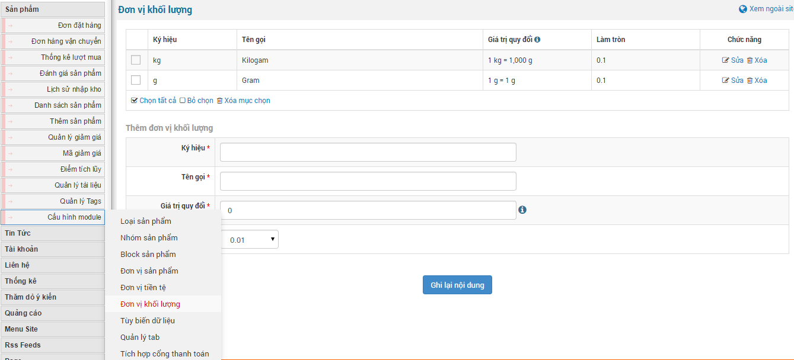
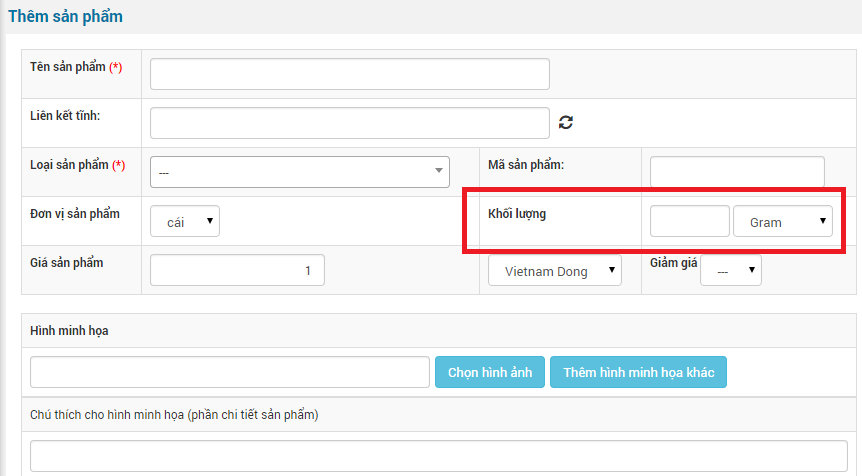

Đơn vị khối lượng là đơn vị cân nặng của từng sản phẩm và cho phép quy đổi đơn vị khối lượng hoặc của cả đơn hàng và được sử dụng khi dùng chức năng vận chuyển.

- Thêm đơn vị khối lượng mới bạn di chuyển con trỏ chuột vào "**Cấu hình module**" và chọn "**Đơn vị khối lượng**" và điền thông tin vào phần "**Thêm đơn vị khối lượng**" gồm có: ký hiệu, tên gọi, giá trị quy đổi, làm tròn. Tiếp theo nhấp chuột vào "**Ghi lại nội dung**" để lưu thông tin kết quả.
- Để xóa hoặc sửa đơn vị khối lượng bạn làm tương tự như thêm mới nhưng bỏ qua nhập thông tin mà bạn cần nhấp chuột vào "**Sửa**" hoặc "**Xóa**" hoặc tích vào những đơn vị khối lượng cần xóa rồi chọn "**Xóa mục chọn**".

Chọn đơn vị khối lượng theo từng sản phẩm tùy chọn để đăng sản phẩm mới.
