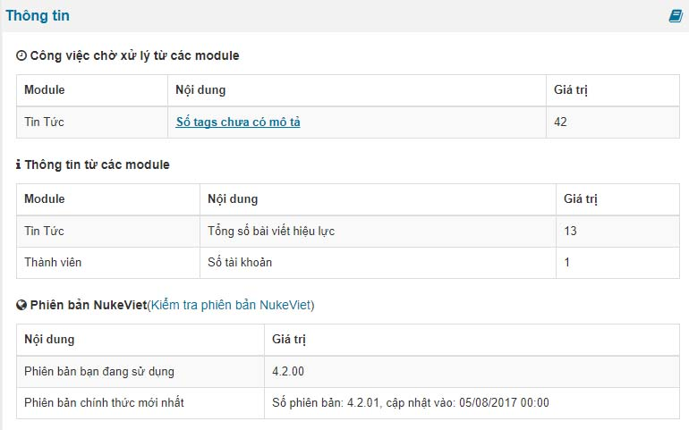
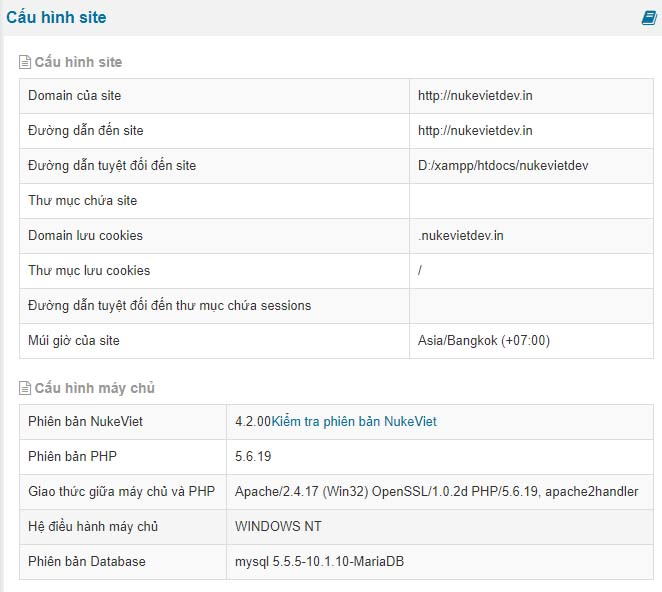
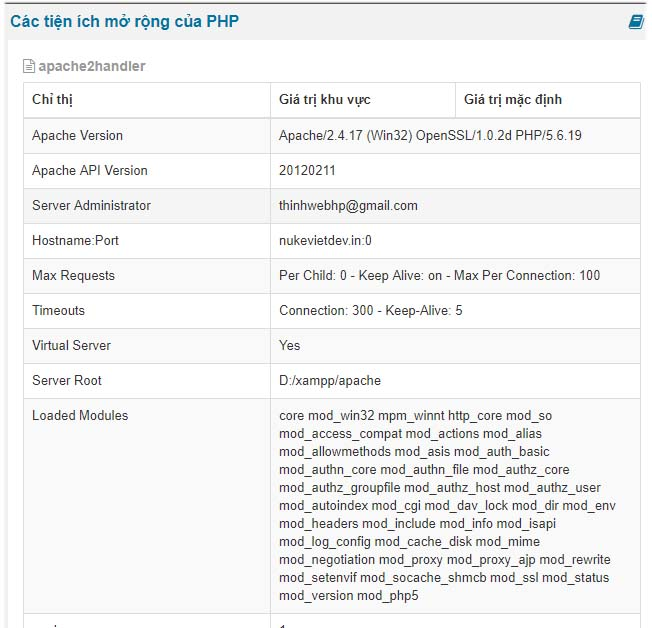
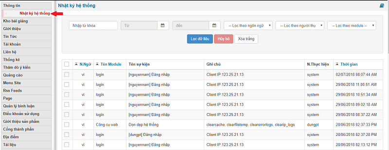
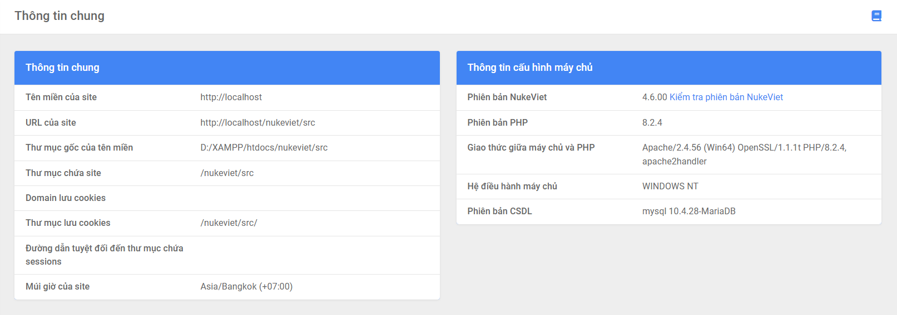
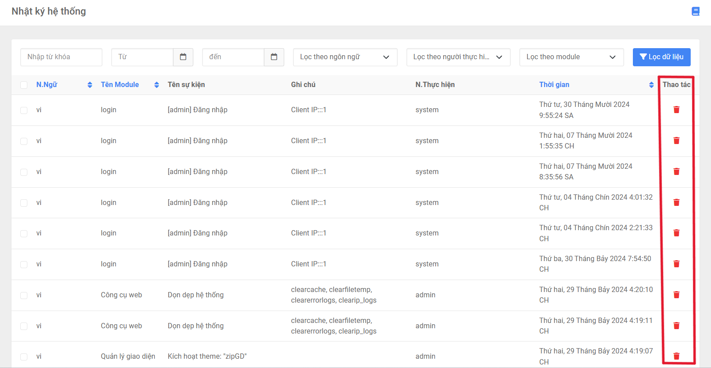

1.  Các công việc chờ xử lý từ các module
2.  Thông tin từ các module
3.  Phiên bản nukeviet

- Phiên bản đang sử dụng
- Phiên bản phát hành chính thức

# Cấu hình site

Cấu hình site hiển thị thông số của site và của máy chủ

======= Hiển thị thông số của site ======

1.  Tên miền
2.  Đường dẫn tuyệt đối
3.  Múi giờ thiết lập của site
4.  Cookies và sessions

======= Thông số máy chủ ======

1.  Phiên bản nukeviet đang sử dụng
2.  Hệ điều hành máy chủ
3.  Phiên bản php
4.  Giao thức máy chủ và php
5.  Phiên bản database

# Cấu hình PHP

Cấu hình php là phần hiển thị các thông số mà máy chủ cho phép bạn sử dụng cũng như bạn dựa vào đó để tùy chỉnh lại thông số sao cho phù hợp với nukeviet trong quá trình sử dụng.

# Tiện ích mở rộng

Tiện ích mở rộng liệt kê dan sách các thông số của mã php hiện có trong máy chủ

# Các biến môi trường

Các biến môi trường là thông số của máy chủ cung cấp cho dịch vụ web

# Các biến tiền định

Các biến tiền định

# Nhật ký hệ thống

Nhật ký hệ thống ghi lại các thông số của ban quản trị, member tiến hành các thao tác trên website

### Phiên bản NukeViet 4.6.0

**Cấu hình site**

Giao diện thay đổi

Bảng *‘cấu hình site*’ đổi tên thành *‘thông tin chung’*

- *‘Domain của site’* đổi tên thành *‘Tên miền của site’*
- *‘Đường dẫn đến site’* đổi thành *‘URL của site’*
- *‘Đường dẫn tuyệt đối của site’* đổi thành *‘Thư mục gốc của site’*
- Thông tin của cấu hình máy chủ thay đổi tùy theo phiên bản người dùng cài đặt

**Nhật ký hệ thống**

- Mục danh sách không đánh sốGiao diện thay đổi, có thêm cột thao tác

