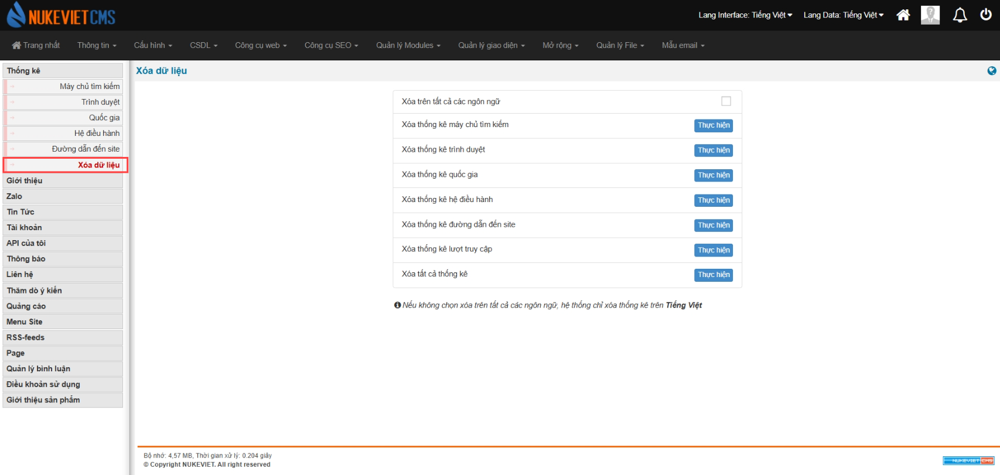

Thống kê dùng để

1.  Thống kê lại lượng visit theo ngày, tháng, năm và tuần
2.  Thống kê theo quốc gia
3.  Thống kê theo trình duyệt
4.  Thống kê theo hệ điều hành

### Phiên bản NukeViet 4.6.0

Giao diện quản lý module statistics thay đổi:

- Thêm mục *‘Xóa dữ liệu’*

