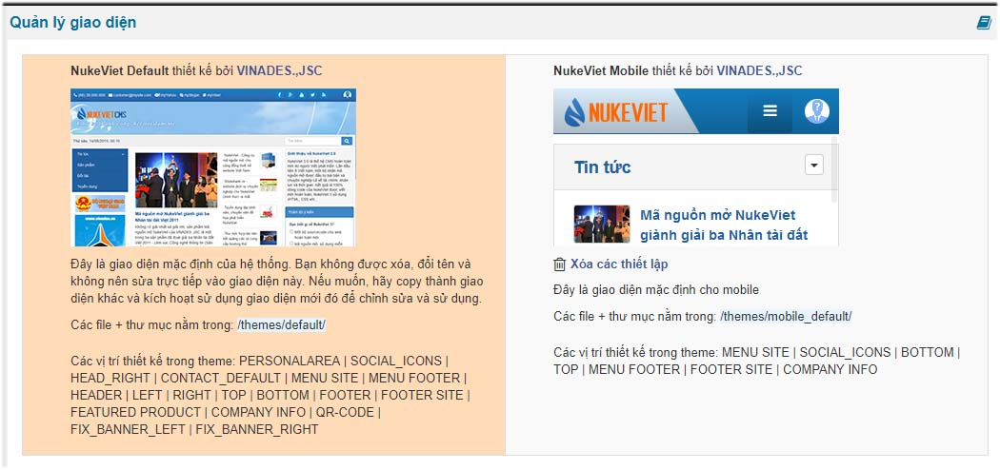
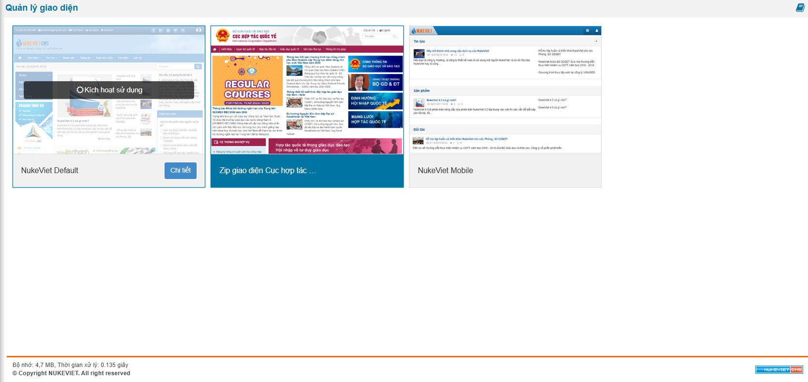
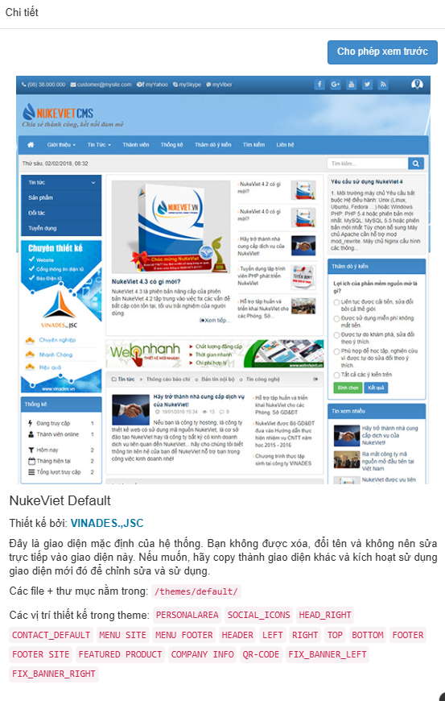

Giao diện mặc định của NukeViet 4 gồm có

- Giao diện Responsive kết hợp PC
- Giao diện mobile

- Giao diện Responsive tương thích với tất cả các thiết bị hiển thị từ PC cho tới mobile đều dùng chung một themes.
- Giao diện PC không cho phép thích ứng với màn hình của các thiết bị.
- Giao diện Mobile hiển thị dành riêng cho thiết bị Mobile

- Thay vì hiển thị tất cả thông tin ra ngoài thì ở NukeViet 4.6, người dùng di chuyển con trỏ vào giao diện cần xem sẽ hiện nút *‘Chi tiết’*.

- Bấm vào nút *'Chi tiết'* để hiển thị thông tin

