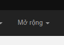
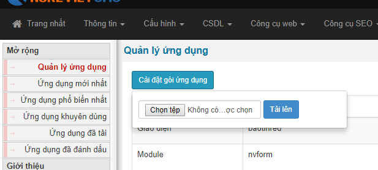
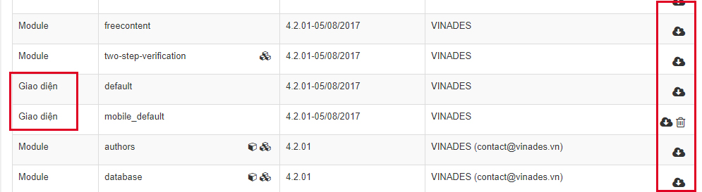
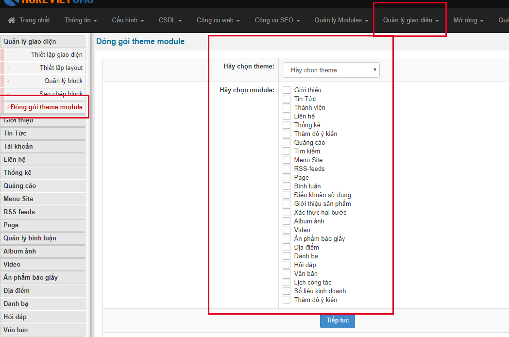
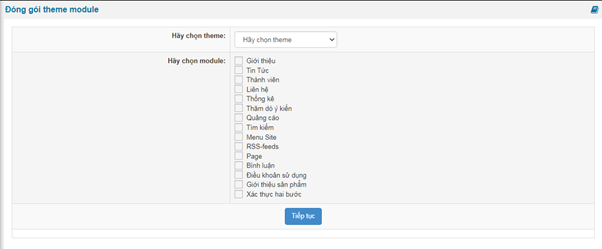

### Cài giao diện mới

Để cài đặt giao diện mới bạn có 2 cách

\- Sử dụng công cụ quản lý trong admin

1.  Đăng nhập trang quản trị bằng tài khoản tối cao
2.  Vào phần mở rộng 
3.  Tiếp đến các bạn cài đặt theme thông qua tính năng cài đặt gói ứng dụng
4.  Chọ tệp tin như hình trên và chọn đúng theme mà bạn cài lên site sau đó nhấn nút "Tải lên"
5.  Tiếp đến hệ thống sẽ đưa ra thông báo và tiến hành bước tiếp theo bỏ qua cảnh báo là nó sẽ đưa lên site là xong

\- Cài đặt thủ công bằng cách copy paste

1.  Nếu bạn tải về nukeviet store thì bạn giải nén copy thư mục tên theme sang thư mục themes trong nukeviet
2.  Nếu bạn sao chép từ website a sang website b thì bạn chỉ việc copy tên thư mục là tên theme từ site a sang site b là xong
3.  Tiếp theo bạn chỉ việc vào quản trị chọn "Quản lý giao diện". Tại đây sẽ hiển thị giao diện mới và bạn thiết lập cấu trúc rồi kích hoạt sử dụng

### Đóng gói giao diện

Để đóng gói giao diện các bạn cần làm theo các bước sau

1.  Đăng nhập trang quản trị bằng tài khoản tối cao
2.  Tiếp đến truy cập phần "Mở rộng"
3.  Tại đây sẽ hiển thị danh sách module và giao diện có trên site
4.  Tiếp đến bạn tải về bằng cách bấm nút vào biểu tượng download phía bên phải tưng ứng với themes ở khu vực bên trái và đúng tên theme như hình sau là nó sẽ đóng gói lại cho bạn hoàn chỉnh thành một tập tin zip

### Đóng gói theme module

Để đóng gói theme module thì các bạn thực hiện theo hướng dẫn sau

1.  Đăng nhập trang quản trị
2.  Tiếp đến truy cập "Quản lý giao diện"
3.  Tại đây bạn chọn "Đóng gói theme module"
4.  Hiển thị ra danh sách thì bạn lựa chọ theme và module của theme đó mà bạn muốn đóng gói rồi nhấn "Tiếp tục"

\* Note: so với bản 4 thì bản 4.5 không còn tuỳ chọn module “Album ảnh”, “Video”, “Ấn phẩm báo giấy”, “Địa điểm”, “Danh bạ”, “Hỏi đáp”, “Văn bản”, “Lịch công tác”, “Số liệu kinh doanh” và “Thăm dò ý kiến”. 
