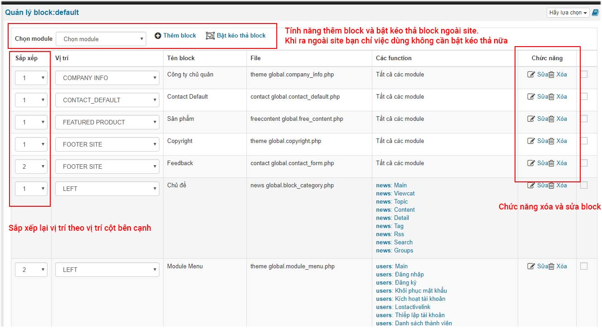
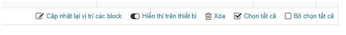
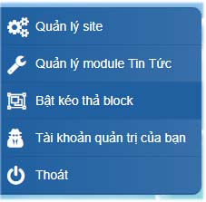
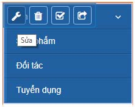
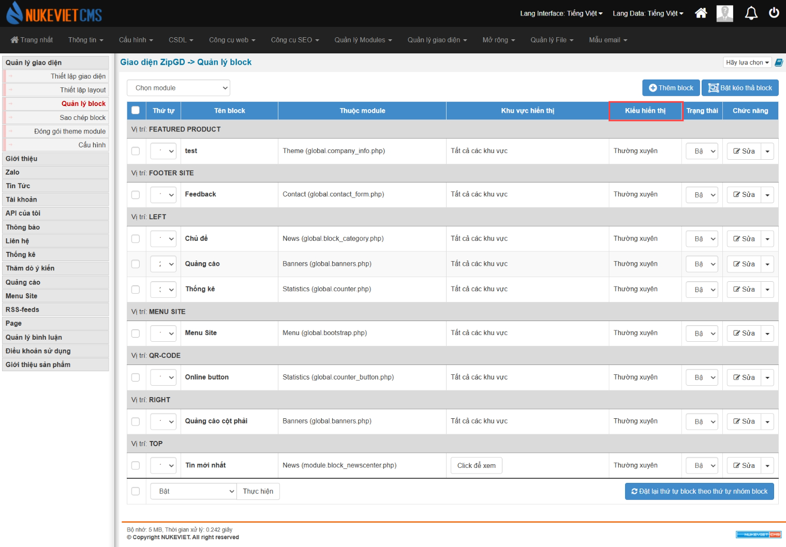

Quản lý blocks là phần quản lý quan trọng nếu bạn không sử dụng bật kéo thả block ngòa site. Trong trường hợp bạn đang lập trình block mà không may block ngoài site làm trắng trang thì bạn có thể vào phần "Quản lý blocks" để tiến hành edit lại block đó theo thông số để kiểm tra lỗi của lập trình viên.

## Thêm block

Để thêm block trong phần quản lý blocks bạn bấm vào text: "Thêm block" -\> Chọn block cho module -\> điền thông số block -\> chấp nhận. Sau khi thêm xong block mới sẽ hiện trong danh sách "Quản lý block" như hình sau.

## Xóa hoặc sửa block

Để sửa hoặc xóa block bạn chọn vào phần "Chức năng".

Để tiến hành xóa hàng loạt thì bạn tích chọn toàn bộ và bấm xóa ở cuối phần quản lý block

Sau khi tiến hành tùy chọn sắp xếp hay vị trí thì bạn tiến hành cập nhật lại vị trí của block

## Quản lý block trên trang chủ

Để quản lý block trên trang chủ bạn cần làm các bước sau:

- Điểm trong danh sách không đánh số Đăng nhập trang quản trị
- Ra ngoài site
- Bật kéo thả block

- Di chuyển chuột tới vị trí block cần sửa và nó sẽ hiện tính năng của block và bạn tiến hành sửa, xóa, tạm dừng sử dụng block

### Phiên bản NukeViet 4.6.0

- Giao diện thay đổi: Các block đã được sắp xếp lại theo vị trí
- Cột *‘file’* đổi tên *‘thuộc module’*, cột *‘các function’* đổi tên *‘khu vực hiển thị’*, thêm cột *‘kiểu hiển thị’*

