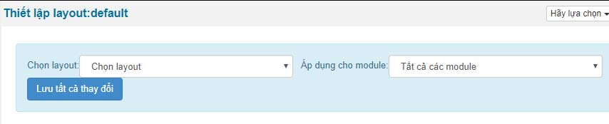
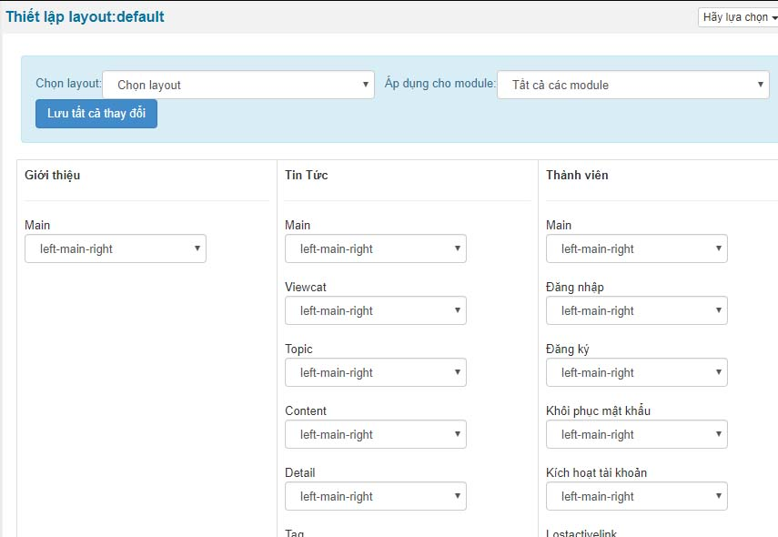

Thiết lập layout giúp hiển thị cách trình bày tùy từng vị trí của module được thanh thoát hơn.

1.  Để chọn chung một layout cho 1 module bạn bấm chọn layout và chọn module sau đó bấm Lưu tất cả thay đổi

1.  Để thiết lập cho từng vị trí trên từng module riêng từ layout thì bạn tùy chọn select từng vị trí của module và kéo xuống cuối site bấm lưu tất cả thay đổi

