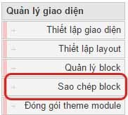
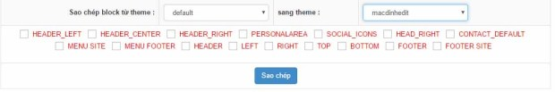
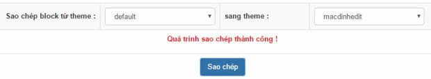
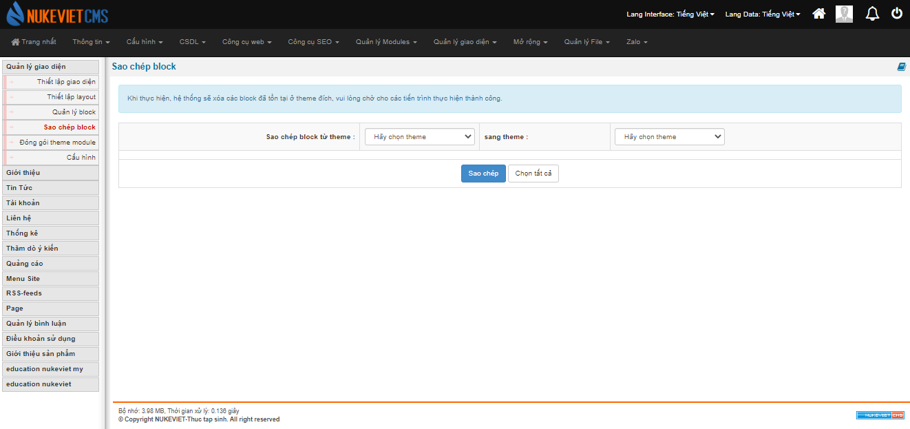

Sao chép block là một trong những tính năng khá hay khi bạn sao chép cấu hình block từ giao diện cũ sang giao diện mới mà không phải tốn thời gian đi cấu hình lại từng blocks. Để sao chép được thì bạn làm theo các bước hướng dẫn dưới đây

- Điều đầu tiên vẫn là việc cần phải làm đó là đăng nhập trang quản trị bằng tải khoản tối cao hoặc điều hành chung nếu bạn phân quyền quản lý themes.
- Tiếp theo là bạn vào phần “Quản lý giao diện”

- Tiếp theo bên tay trái sẽ hiển thị danh sách các tính năng trong phần quản lý giao diện thì bạn chọn phần “Sao chép block”.

- Lưu ý là themes mới và themes cũ của bạn cần phải thiết lập layout để tiến hành sao chép.
- Tiếp đến là bạn chọn themes muốn sao chép block và themes đã có thiết lập block. Lưu ý là bạn cần tích chọn những vị trí cần sao chép đồng nghĩa với copy toàn bộ cấu hình của các blocks ở vị trí đó từ themes A sang themes B. Nếu không tích chọn thì khi bạn sao chép sẽ không có block nào từ themes A sang themes B.

- Tiếp theo nhấn nút “Sao chép”. Sau khi nhấn nút “Sao chép” bạn nhận được thông báo “Quá trình sao chép thành công !”.

 \*Note: ở nukeviet 4, nếu bạn muốn sao chép tất cả bạn phải tích chọn từng theme, còn ở bản 4.5, bạn có thể nhấn “Chọn tất cả” mà không cần tích chọn từng cái. 
