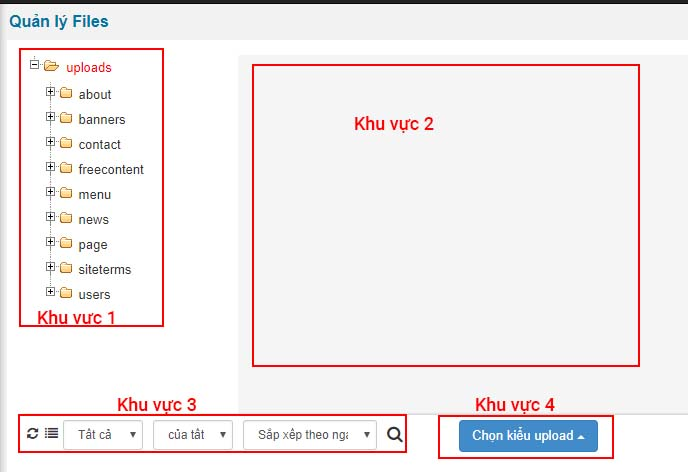

Quản lý file hay còn gọi là quản lý upload. Nó được dùng để quản lý tất cả các file tải lên cũng như tạo thumbnail cho hình ảnh theo kích thước thiết lập của module này

Khu vực 1: danh sách tên các module. Khi bạn click vào nó sẽ hiển thị ra danh sách ảnh có trong module đó được upload lên website

Khu vực 2: Khu vực hiển thị danh sách các ảnh đã được up lên theo tất cả hoặc theo từng module của khu vực 1.

Khu vực 3: Tìm kiếm, load lại ảnh khi bạn thiết lập kích thước thumbnail

Khu vực 4: Nút upload từ internet và từ pc lên hosting theo vị trí khu vực 1
