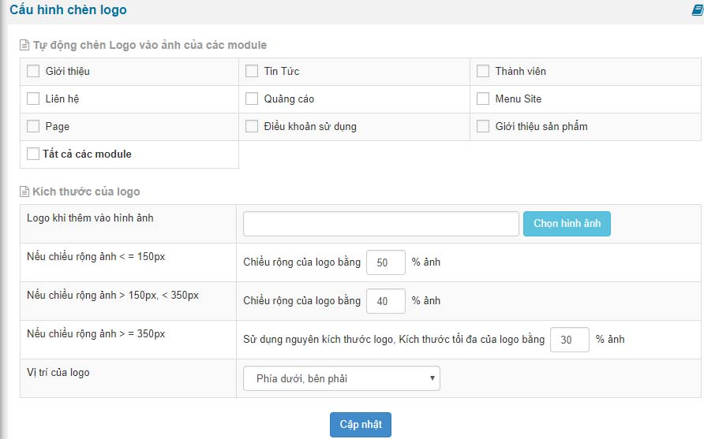
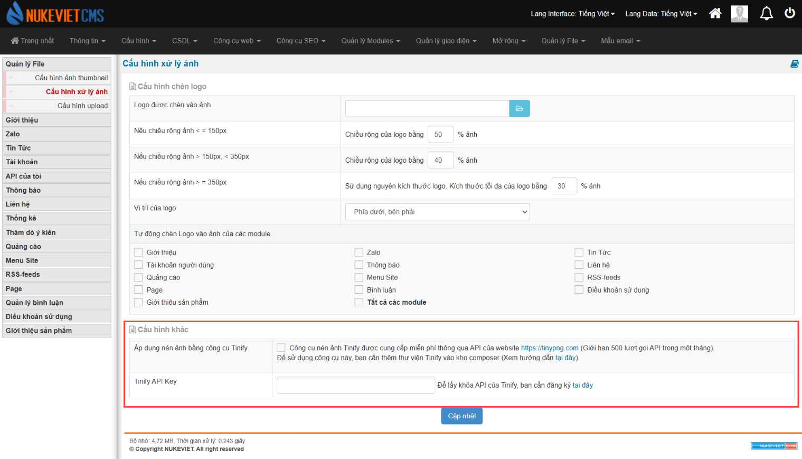

Cấu hình chèn logo cho phép bạn chèn logo website vào bức ảnh sau mỗi lần upload lên website. Như vậy nó sẽ đánh dấu bản quyền vài người khác copy lại nó sẽ có logo của website của bạn trên bức ảnh.

Để chèn logo vào bức ảnh upload bạn làm theo bước sau

1.  Đăng nhập quản trị
2.  Bấm "Quản lý file" trên menu ngang.
3.  Bấm vào "Cấu hình chèn logo".
4.  Tại đây thì bạn điền thông số và lưu lại.

Các thông số bạn cần điền đầy đủ và tùy chỉnh theo ý muốn của bạn cũng như tùy từng ảnh của từng module sử dụng tính năng này.

### Phiên bản NukeViet 4.6.0

- Được đưa vào mục *‘cấu hình xử lý ảnh’*
- Bảng *‘tự động chèn logo vào ảnh của các module’* và *‘kích thước của logo’* được hợp thành 1 bảng
- Có thêm bảng cấu hình khác

