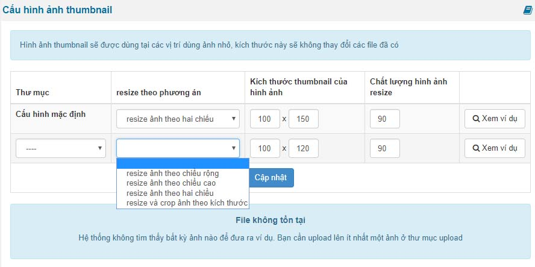

Cấu hình ảnh thumbnail dùng trong việc bạn hiển thị ảnh ở danh sách tin tức, ở trang chủ, ở block tránh tình trạng hiển thị ảnh gốc làm vỡ site vì lý do ảnh gốc khi up lên sẽ có nhiều kích thước khác nhau và to hơn khu vực hiển thị

Để thiết lập ảnh thumbnail thì bạn cần điền các thống số

- Thư mục: thư mục quan trọng bởi bạn không thiết lập theo đúng module ý của bạn thì nó ảnh hưởng tới toàn bộ các thư mục khác khi resize nhàm
- Resize theo phương án
- Kích thước thumbnail của hình ảnh
- Chất lượng hình ảnh resize: số cao nhất là 99

Sau khi điền thông số xong thì bạn bấm nút Cập nhật

### Trong NukeViet 4.6:

\- Thumbnail mặc định có kích thước tối đa là 350 x 350 pixels

\- Thumbnail cho thư mục cụ thể có kích thước tối đa là 1000 x 1000 pixels

Trong trường hợp nếu buộc phải thay đổi tham số tối Thumbnail đa là 350 x 350 pixels, Lập trình viên vào CSDL và xóa Cache để thay đổi: thumb_max_width, thumb_max_height
