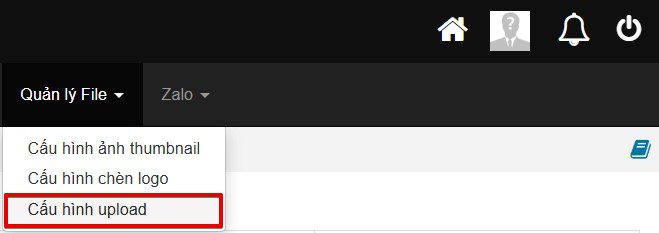
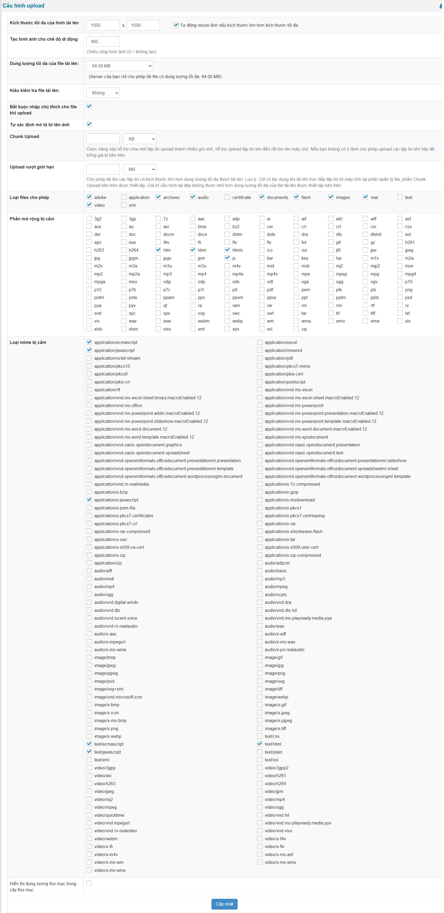

Cấu hình upload là thành phần cũng khá quan trọng khi bạn thiết lập file tải lên. Hosting hay vps cho phép up ảnh dung lượng cao thì bạn có thể up lên theo ý định của bạn hoặc có thẻ giới hạn các thông số cũng như các file được phép tải lên. Phiên bản Nukeviet của cấu hình này là 4.5

Để truy cập chức năng này, đăng nhập vào trang quản trị rồi tìm đến theo menu **Quản lý File \> Cấu hình upload**

Bên dưới là giao diện trang cấu hình upload

Giải thích chi tiết cho một số tuỳ chọn:

- **Kích thước tối đa của hình tải lên**: là tuỳ chọn giới hạn kích thước bao gồm chiều dài vào rộng cho mỗi hình ảnh được tải lên. Ngoài ra có thêm tuỳ chọn Tự động resize ảnh nếu kích thước lớn hơn kích thước tối đa
- **Tạo hình ảnh cho chế độ di động**: là tuỳ chọn tạo độ rộng cho kích thước hình ảnh trên các màn hình thiết bị di động
- **Dung lượng tối đa của file tải lên**: là tuỳ chọn cho phép tải file có dung lượng tối đa lên máy chủ (server)
- **Kiểu kiểm tra file tải lên**: là tuỳ chọn nhằm mục đích kiểm tra file tải lên có được phép tải lên hay không. Mức kiểm tra cao nhất là tuỳ chọn Mạnh.
- **Bắt buộc nhập chú thích cho file khi upload**: là tuỳ chọn yêu cầu bắt buộc nhập chú thích cho file khi upload nếu được bật.
- **Tự xác định mô tả từ tên ảnh**: là tuỳ chọn lấy tên của file hình ảnh làm mô tả nếu được bật.
- **Chunk Upload**: là tuỳ chọn hỗ trợ chia nhỏ tập tin upload thành nhiều gói nhỏ, hỗ trợ upload tập tin lớn đến rất lớn lên máy chủ. Nếu bạn không có ý định cho phép upload các tập tin lớn hãy để trống giá trị tuỳ chọn này.
- **Upload vượt giới hạn**: là tuỳ chọn cho phép tải lên các tập tin có kích thước lớn hơn dung lượng tối đa được tải lên. Lưu ý: Chỉ có tác dụng khi tải lên trực tiếp tập tin từ máy tính tại phần quản lý file, phần Chunk Upload bên trên được thiết lập. Giá trị cấu hình tại đây không được nhỏ hơn dung lượng tối đa của file tải lên được thiết lập bên trên
- **Loại files cho phép**: là tuỳ chọn cho phép các loại file có định dạng nào được phép tải lên. Bỏ chọn sẽ không cho phép loại file tải lên.
- **Phần mở rộng bị cấm**: là tuỳ chọn các file có đuôi mở rộng bị cấm tải lên. Bỏ chọn sẽ cho phép các file có đuôi mở rộng được tải lên.
- **Loại mime bị cấm**: là tuỳ chọn cấm các tiêu chuẩn định danh hai phần (type/subtype) dùng để mô tả bản chất và định dạng của tệp tin/dữ liệu khi truyền qua Internet, giúp trình duyệt web và các ứng dụng khác biết cách xử lý nội dung đó. Bỏ chọn sẽ cho phép các tiêu chuẩn định danh được tải lên.
- **Hiển thị dung lượng thư mục trong cây thư mục**: là tuỳ chọn hiển thị dung lượng của một thư mục. Dung lượng được hiển thị bằng số KB/MB ở bên phải thư mục trong cây thư mục

## Nguyên tắc của các kiểu kiểm tra file tải lên

### Cấp độ mạnh

Thứ tự ưu tiên từ trên xuống dưới tùy theo máy chủ có hỗ trợ hay không.

- Sử dụng tiện ích [Fileinfo](https://www.php.net/manual/en/book.fileinfo.php) của php.
- Sử dụng command file của hệ điều hành linux nếu php cho phép lệnh system hoặc exec. Đa số các share hosting sẽ cấm
- Sử dụng hàm [mime_content_type](https://www.php.net/manual/en/function.mime-content-type.php) của php
- Sử dụng getimagesize để phân tích và xử lý nếu file tải lên là ảnh

Sau khi có được mime file, kiểm tra để đảm bảo nó chỉ nằm trong danh sách được phép, do hệ thống quy định tại tệp mime.ini

### Cấp độ vừa phải

Thứ tự ưu tiên từ trên xuống dưới tùy theo máy chủ có hỗ trợ hay không.

- 4 cách xác định mine đầu tiên của cấp độ mạnh
- Nếu không thành công sử dụng `$_FILES['upfile']['type']` của fileupload

Sau khi có được mime file, kiểm tra để đảm bảo nó chỉ nằm trong danh sách được phép, do hệ thống quy định tại tệp mime.ini

### Cấp độ yếu

5 bước kiểm tra của cấp độ vừa phải, tuy nhiên sau khi xử lý qua 5 bước đó không kiểm tra thuộc danh sách trong tệp mime.ini (tệp cố định trong mã nguồn)

### Không kiểm tra

Thử trước cấp độ yếu sau đó từ phần mở rộng ext của tên tệp suy ra mine.
