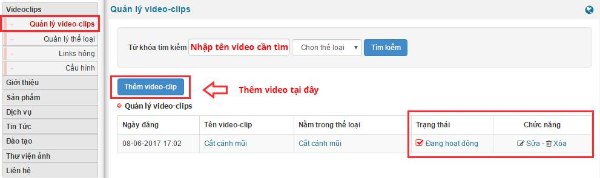
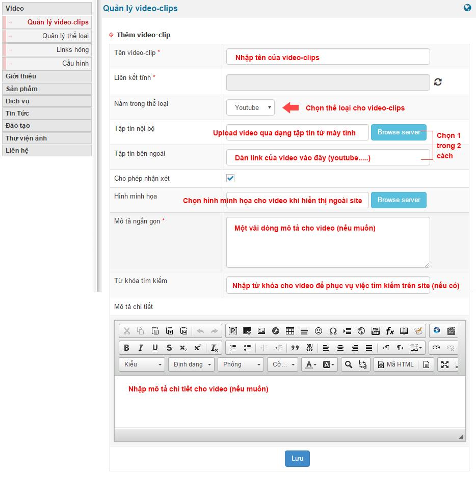
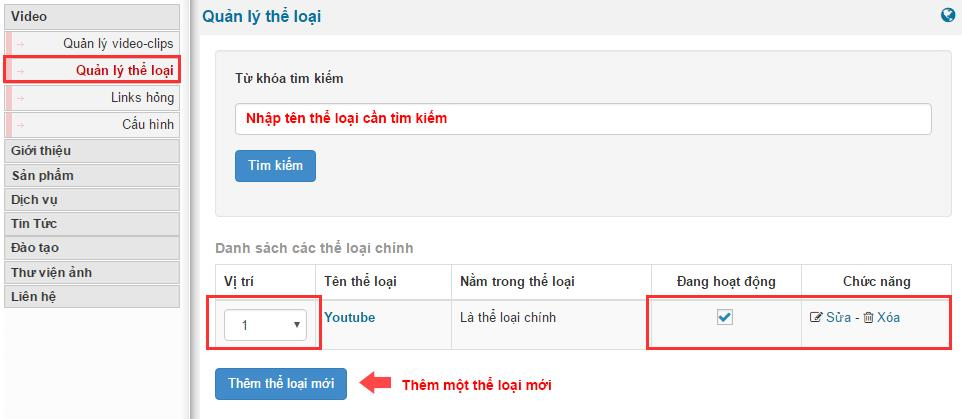
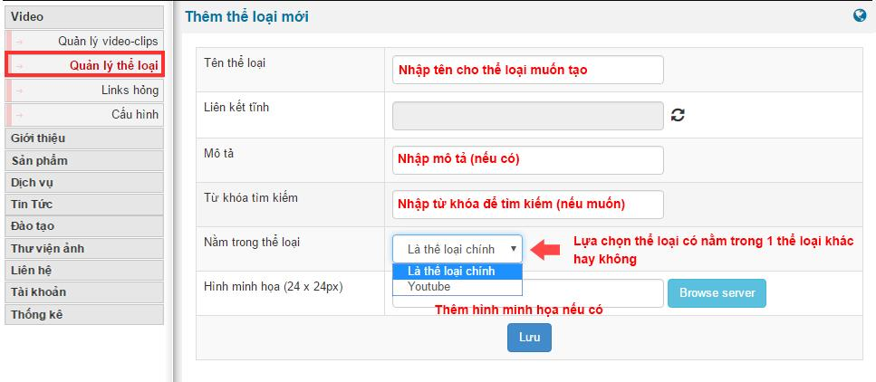
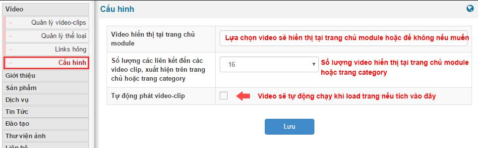

Module video clips là module được dùng để quản lý tập trung các video trên website

Ở đây, khu vực 2 sẽ hiển thị toàn bộ các video clip đang tồn tại trên site cùng với các thông tin của video đó như ngày đăng video, tên video , video đang nằm trong thể loại nào, Video có hoạt động hay không cùng với chức năng sửa, xóa video. Ngoài ra admin có thể tìm kiếm video bằng cách nhập tên vào ô từ khóa hoặc thêm video clip trực tiếp bằng cách ấn vào nút **thêm video clips**

## Thêm video clips

Admin cần điền thông tin vào các ô tương ứng sau đó ấn vào button “Lưu” để kết thúc quá trình thêm một video mới

## Quản lí thể loại

Ở đây khu vực 2 sẽ hiển thị tất cả các thể loại đang có của video cùng với các thông tin của thể loại đó như vị trí, tên thể loại, có nằm trong một thể loại nào khác hay không, có hoạt động hay không và admin có thể tìm kiếm, chỉnh sửa vị trí, chỉnh sửa hoạt động, sửa hoặc xóa một thể loại bất kì Ngoài ra admin cũng có thể thêm một thể loại mới bằng cách click vào button thêm thể loại mới

Admin điền thông và ấn Lưu để kết thúc quá trình thêm thể loại mới

## Cấu hình module

Admin ấn Lưu để giữ lại các thiết lập với mới thay đổi
