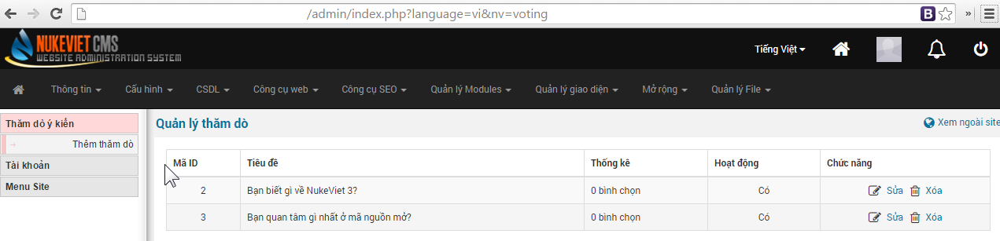
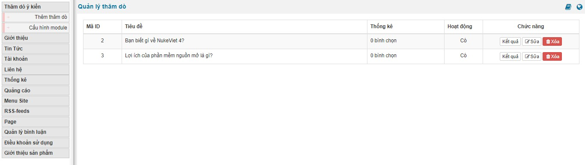
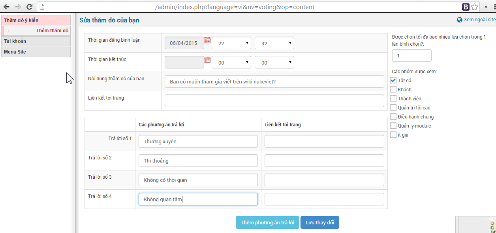
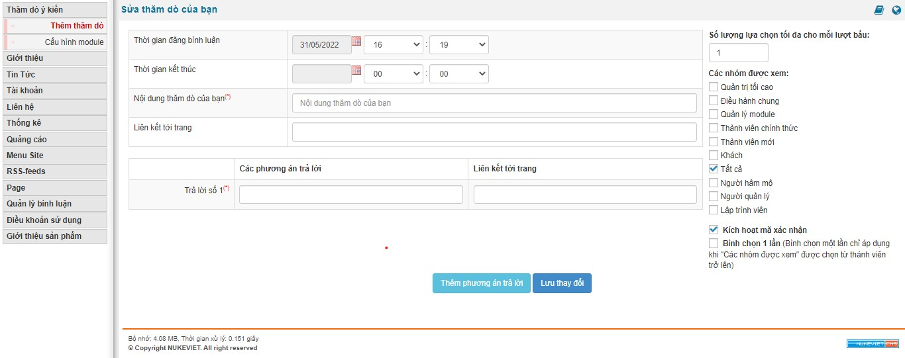
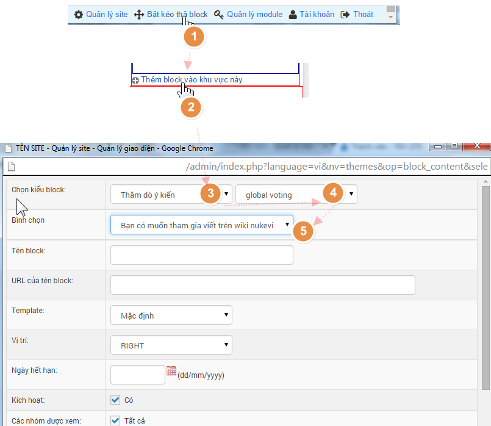
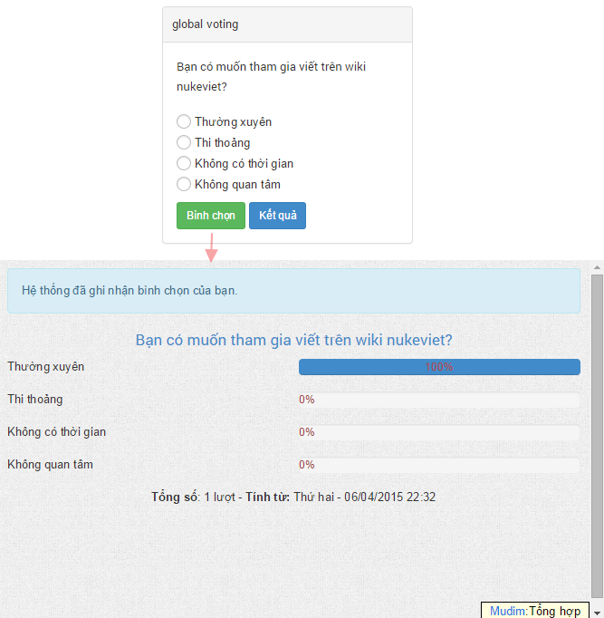

**So với Phiên bản NukeViet 4 thì từ phiên bản NukeViet 4.5.01 đến phiên bản NukeViet 4.5.06 có thêm tùy chọn xem "kết quả": **

## Thêm thăm dò

**So với phiên bản NukeViet 4 thì từ phiên bản NukeViet 4.5.01 đến phiên bản NukeViet 4.5.06 có một số thay đổi sau:**

\- Phần "các nhóm được xem" đã có sự thay đổi về thứ tự các mục, một số đối tượng tùy chọn đã được thay đổi và thêm vào:

-  tùy chọn "thành viên" tách thành: "thành viên chính thức" và "thành viên mới"
-  tùy chọn "người hâm mộ" đã được thêm vào
-  tùy chọn "người quản lý" đã được thêm vào
-  tùy chọn "it già" đổi tên thành: "lập trình viên"

\- Đã có thêm mục tùy chọn "kích hoạt mã xác nhận"

\- Đã có thêm mục tùy chọn "bình chọn 1 lần"

## Đăng thăm dò lên website

Cũng ương tự như việc đăng qoảng cáo  Và ta được kết quả 
