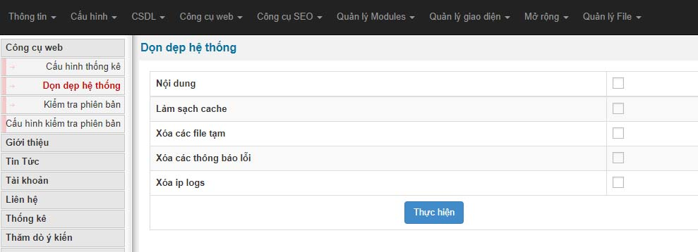
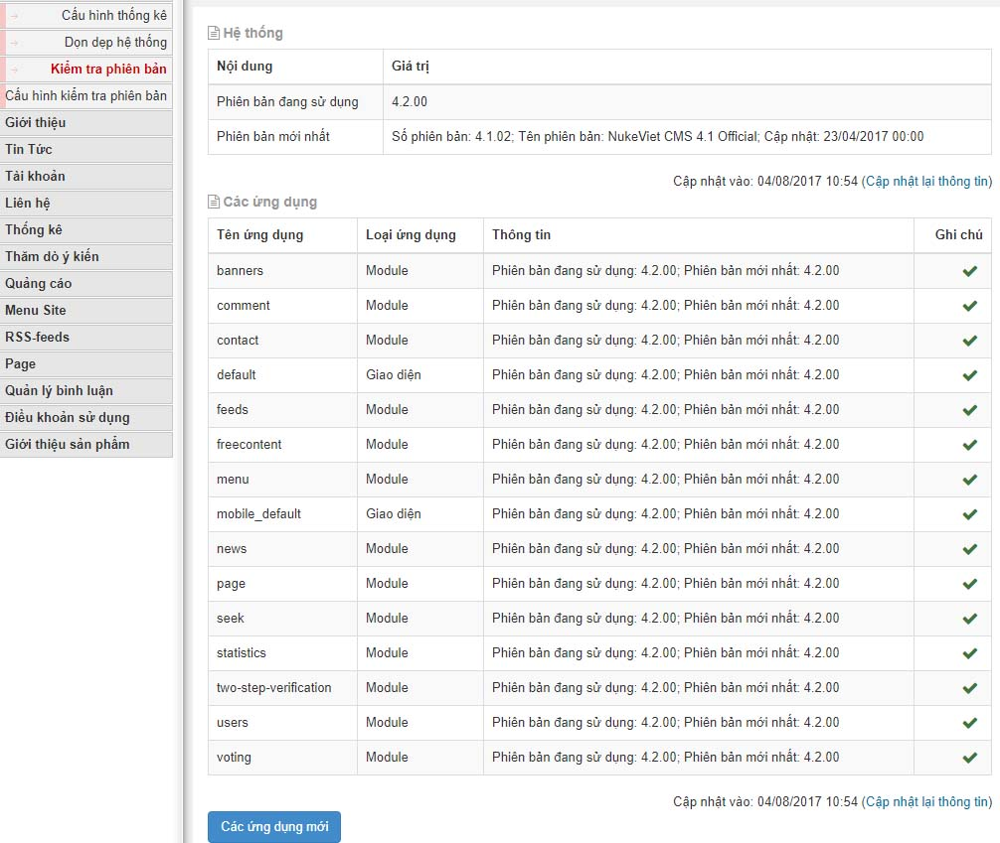
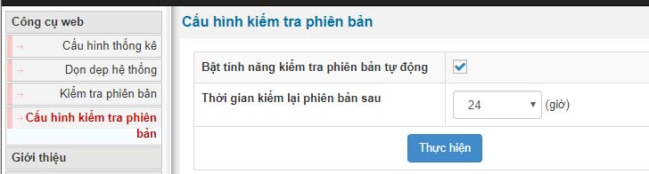
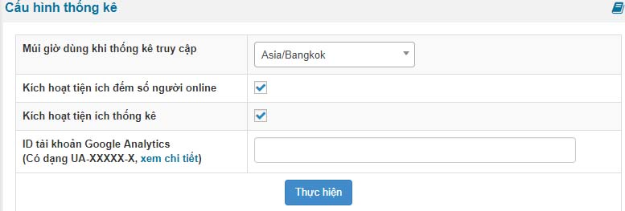
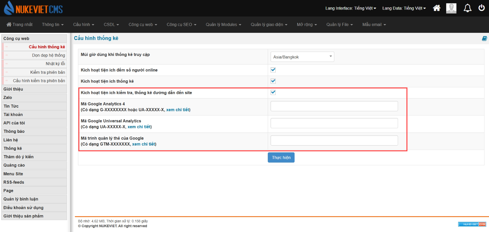

Công cụ web là danh sách các tính năng cần có như

- Cấu hình thống kê: dùng để thêm mã google analytics vào website và các tùy chọn múi giờ cúng như các tùy chọn khác
- Dọn dẹp hệ thống: giúp xóa cache đã phát sinh của người truy cập và giúp người truy cập load lại những thay đổi của giao diện.
- Kiểm tra phiên bản: tự động kiểm tra phiên bản nukeviet mới nhất nếu có
- Cấu hình kiểm tra phiên bản: cấu hình tự động thời gian request kiểm tra có phiên bản mới hay không

## Dọn dẹp hệ thống

Dọn dẹp cache dùng để xóa toàn bộ những file .cache phát sinh trong quá trình website hoạt động. Với mỗi lần truy cập site nó sẽ được nén dưới dạng cache để giảm tải việc người truy cập tạo request nhiều lần đãn đế làm máy chủ hoạt động nhiều.

Dọn dẹp cache còn giúp việc người truy cập load lại những file code css, html, js mới sau khi bạn tiến hành sửa đổi

Bước 1: đăng nhập admin

Bước 2: chọn Công cụ web

Bước 3: tích chọn toàn bộ và bấm Thực hiện

## Kiểm tra phiên bản

- Hiển thị thông tin phiên bản hiện bạn đang sử dụng và phiên bản mã nguồn nukeviet mới nhất trên kho code
- Hiển thị danh sách các module bạn đang sư dụng và thông tin phiên bản của bạn mới nhất hay chưa

## Cấu hình Kiểm tra phiên bản

- Kích hoạt tính năng tự động kiểm tra phiên bản
- Thiết lập thời gian tự động kiểm tra phiên bản

## Cấu hình thống kê

- Thiết lập múi giờ theo ý muốn
- Kích hoạt tiện ích đếm số người online và thống kê
- Thêm ID của Google Analytics vào thống kê

### Phiên bản NukeViet 4.6.0

- Có thêm *‘Kích hoạt tiện ích kiểm tra, thống kê đường dẫn đến site’*, *‘Mã Google Analytics 4’*, *‘Mã Google Universal Analytics’*, *‘Mã trình quản lý thẻ của Google’*

