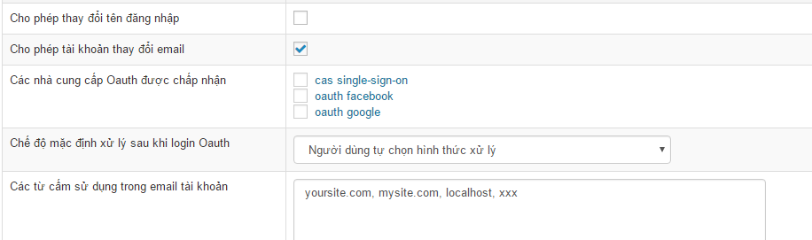

NukeViet mặc định cung cấp phương thức đăng nhập thành viên thông qua 4 nhà cung cấp Oauth, ngoài ra quản trị wesite cũng có thể thay đổi, thêm hoặc bớt nhà cung cấp Oauth. Các phương thức đăng nhập/đăng ký bằng Oauth sẽ không được kích hoạt sẵn, để kích hoạt, quản trị viên phải vào khu vực cấu hình module của module users để kích hoạt. Trước khi có thể kích hoạt, quản trị phải nhấp vào tên các Oauth để nhập thông tin cấu hình trước. Chi tiết như ảnh bên dưới.

# Bổ sung kết nối tới các nhà cung cấp Oauth ngoài danh sách có sẵn

Dữ liệu về các nhà cung cấp Oauth được lưu ở thư mục `modules/users/login`.

Để thêm một nhà cung cấp Oauth, thực hiện các thao tác sau:

- Thêm vào thư mục `modules/users/login` file oauth-name.php. Trong đó `name` là tên nhà cung cấp Oauth. Chú ý nhà cung cấp được thêm vào phải được hỗ trợ từ thư viện [Oauth](https://packagist.org/packages/and/oauth). Nếu không có cần viết mới cho thư viện and/Oauth
- Vào `Admin Control Panel/ Thành viên/ cấu hình module`, tại mục `Các nhà cung cấp Oauth được chấp nhận`, chọn nhà cung cấp vừa thêm sau đó lưu lại.
- Thêm một ảnh có tên ten-nha-cung-cap.png vào theme hiện dùng theo đường dẫn `themes/ten-theme/images/users/`

# Tham khảo

- Kết nối vào cổng Oauth do NukeViet.VN cung cấp
