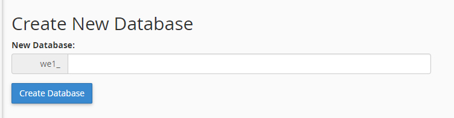
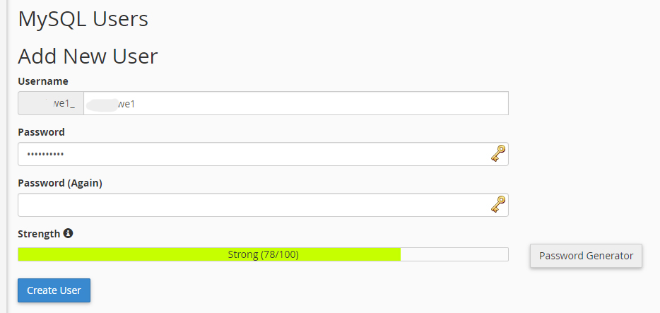
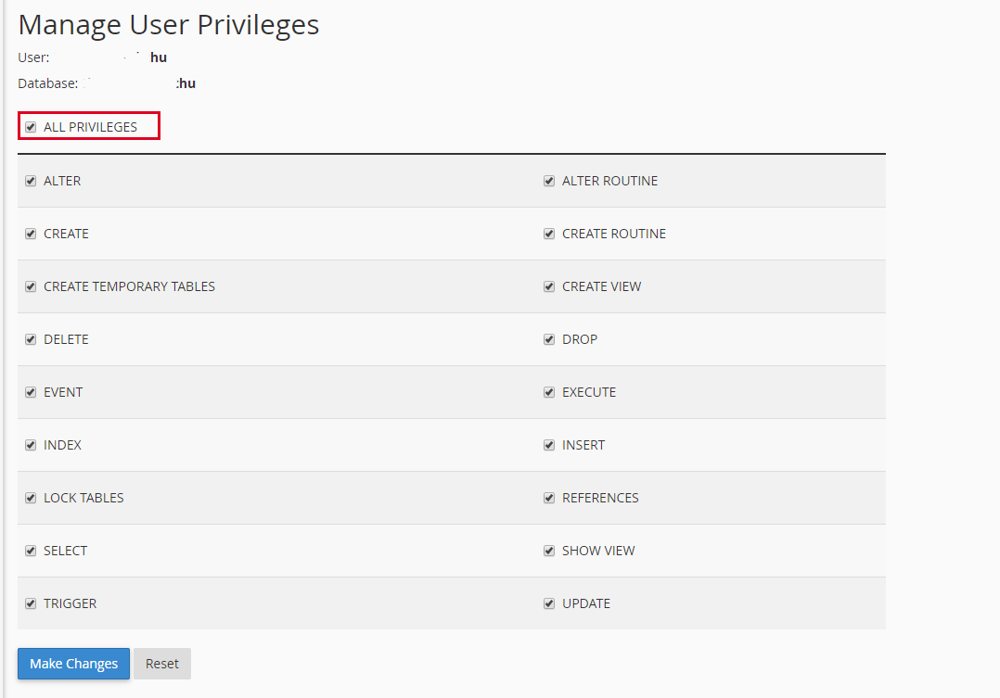

Việc tạo cơ sở dữ liệu trên hosting cũng không khó gì cả nhưng tùy vào mỗi phần mềm quản trị hosting khác nhau. Ở bài này demo sẽ là directadmin và cpanel. Bởi vì 2 phần mềm quản trị hosting này thường được sử dụng phổ biến nhất hiện nay

**Cpanel**

Đối với cpanel thì bạn cần tìm tới tên "MySQL® Databases" và click chuột vào đó

Sau khi đã vào phần tạo database của cpanel thì bạn cần tạo database và tạo user cho database

Tạo database:

Tạo user cho database

Sau khi tạo xong lấy mật khẩu để kết nối thì bạn tiếp tục add user vào database để các kết nối thông suốt

Bạn tích chọn hết và chọn "Make Changes" để lưu kết quả
