Hướng dẫn cài đặt NukeViet 4 trên hosting DirectAdmin Việc cài đặt NukeViet trên DirectAdmin thực hiện tuần tự các bước bên dưới. (Lưu ý: Hướng dẫn này được sử dụng trong HĐH windows. Trong HĐH khác có thể có điểm khác biệt. ) 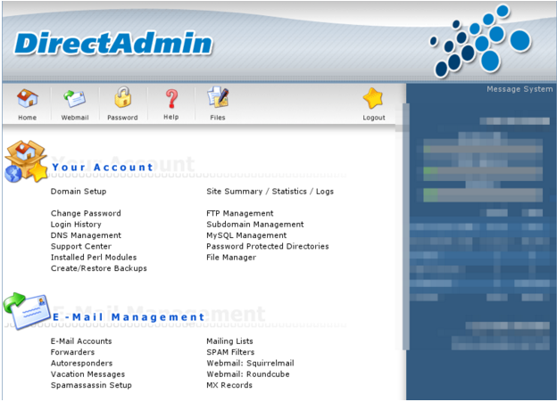 Giao diện chính DrirectAdmin

Yêu cầu bắt buộc: [Những yêu cầu sử dụng NukeViet 4](/nukeviet4/setup/requirements)

## I. Tạo CSDL rỗng

1\. Trên giao diện chính, chọn menu “MySQL Management” 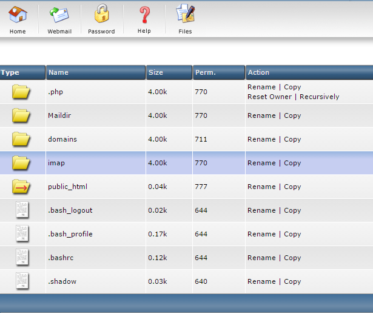

2\. Tại trang Quản lý cơ sỡ dữ liệu, chọn “Create New Database” để tạo mới CSDL cài đặt NukeViet 4 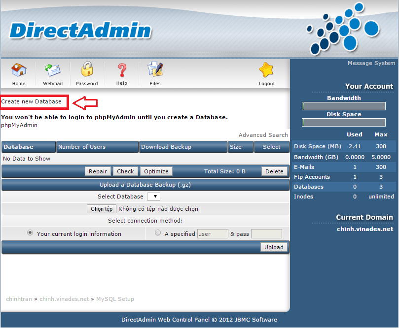

3\. Nhập tên CSDL, tài khoản đăng nhập CSDL (có thể nhập hoặc click Random để lấy mật khẩu ngẫu nhiên). Nhấn Create để tạo. 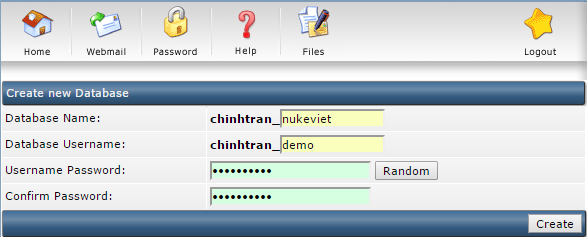

4\. Sau khi nhấn Create, hệ thống hiển thị tất cả các thông tin về CSDL. Hãy lưu lại thông tin này, nó sẽ được sử dụng trong quá trình cài đặt NukeViet 4 bên dưới. 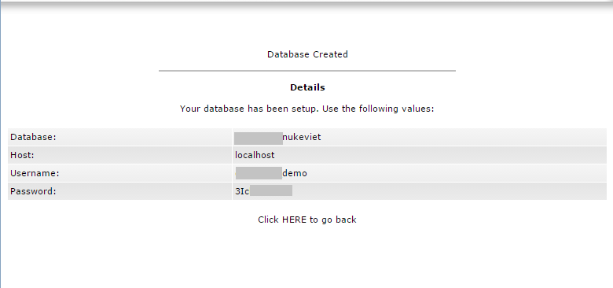

## II. Upload mã nguồn NukeViet lên hosting

1\. Truy cập Mã nguồn NukeViet ( [http://nukeviet.vn/](http://nukeviet.vn/) ) để download phiên bản NukeViet mới nhất. 2. Giải nén tập tin vừa tải về, tìm đến đúng cấu trúc thư mục cần lưu trữ, sau đó nén lại với định dạng \*.zip 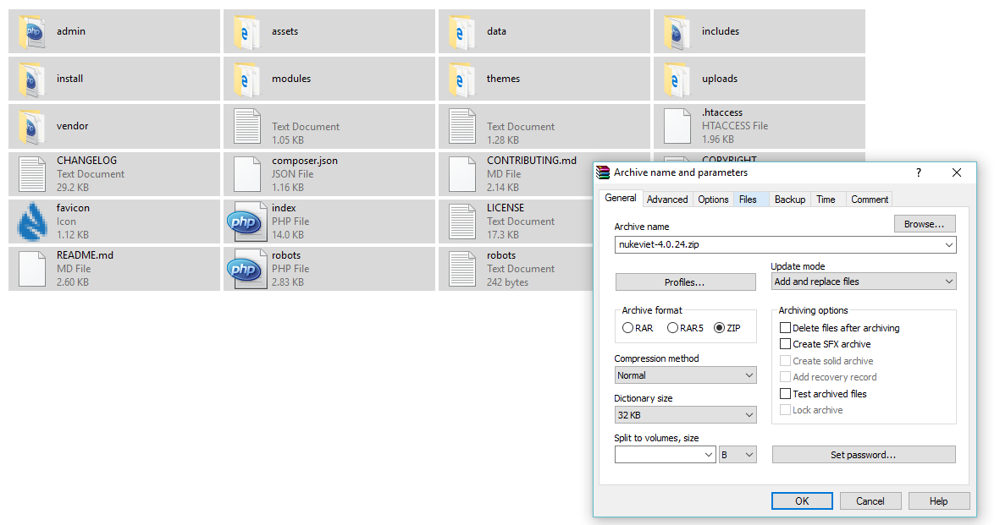

3\. Trên giao diện chính, chọn menu “File Manage”, 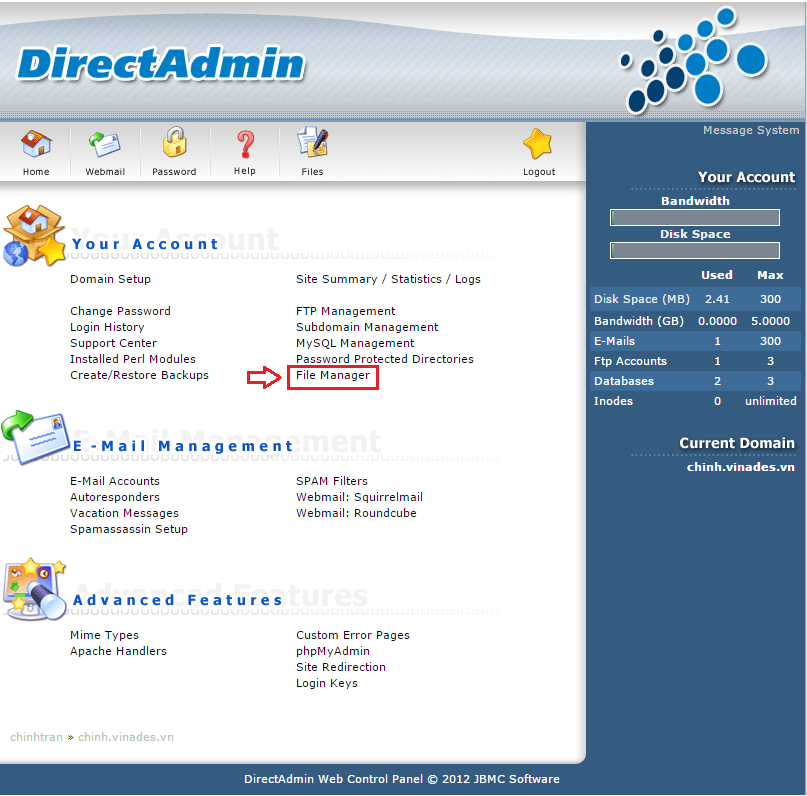

chọn đến thư mục public_html. Mặc định thư mục này sẽ có cấu trúc như hình. 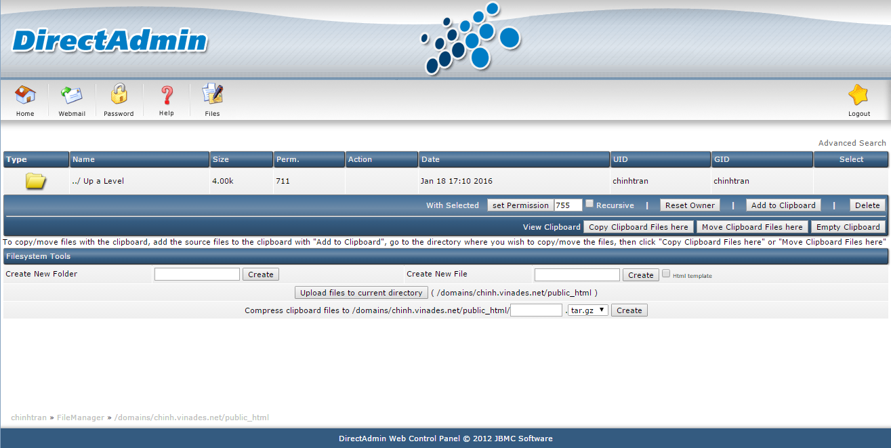

4\. Ở cuối trang, chọn “Upload files to current directory” sau đó tìm đến file nén vừa tạo ra ở trên, upload lên hosting. 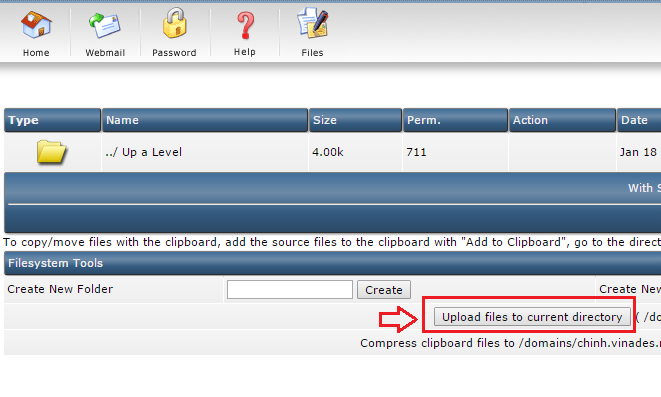

5\. Chọn “Extract” để giải nén tập tin. 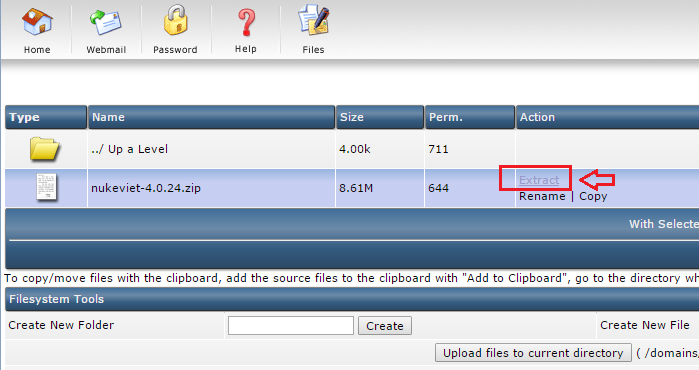

Sau khi giải nén....và các thư mục bên trong. 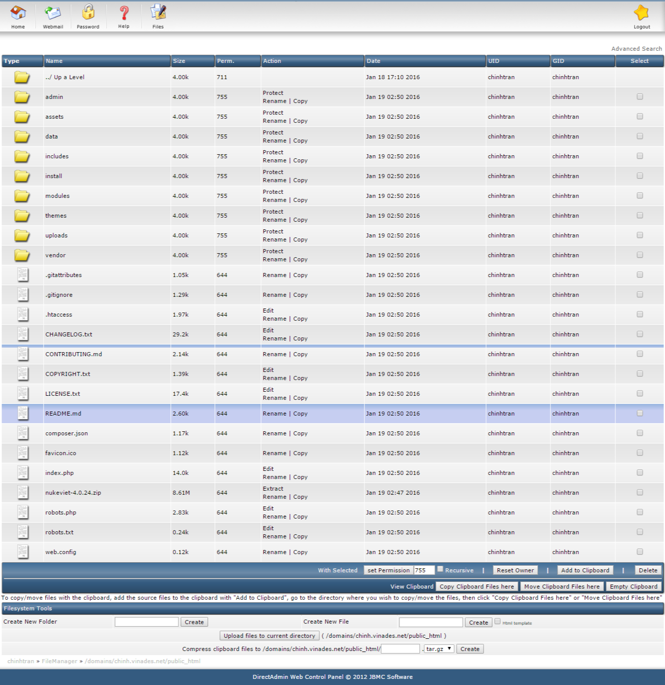

## III. Cài đặt NukeViet 4

Sau khi tạo CSDL rỗng, upload mã nguồn và thiết đặt quyền đọc ghi file cần thiết, truy cập qua tên miền đề cài đặt hệ thống. Trước khi bắt đầu, bạn cần xác định:

- Website có sử dụng đa ngôn ngữ hay không?
- Các thông số kết nối CSDL (Đã có ở bước tạo CSDL rỗng)
- Thông tin website, thông tin người quản trị.

**Tiến hành cài đặt**

- Truy cập domain trong lần đầu, hệ thống sẽ tự động chuyển đến trang cài đặt.

- Tiếp tục các bước cài đặt theo như **[bài hướng dẫn](/nukeviet4/setup/localhost)**
