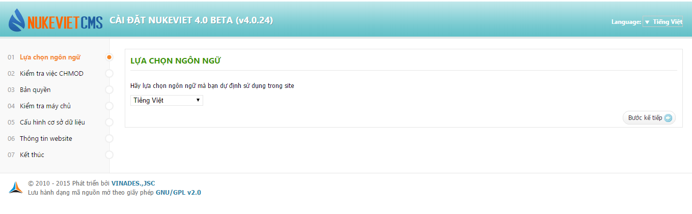
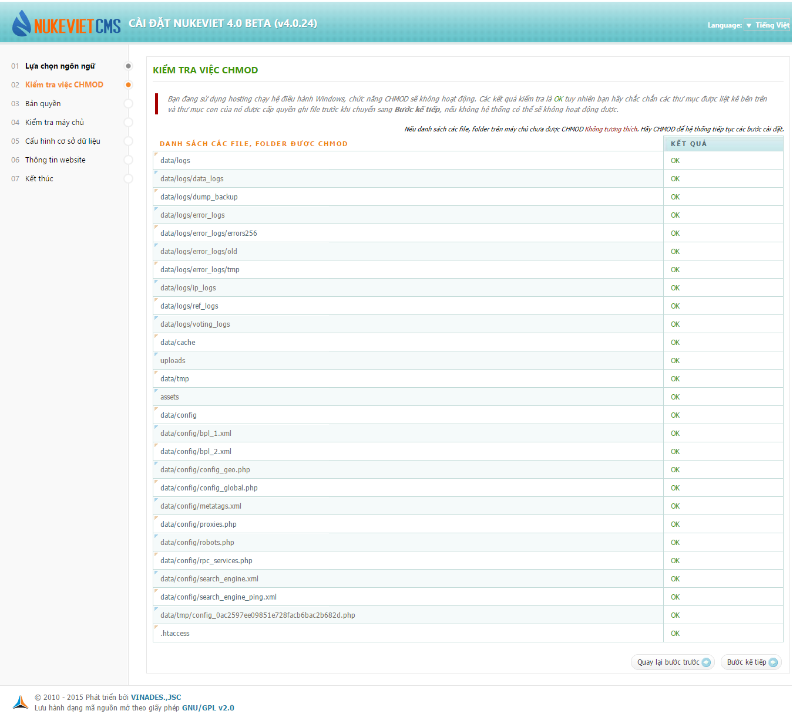
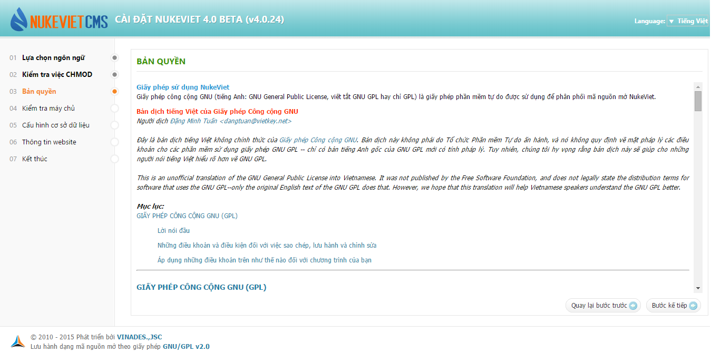
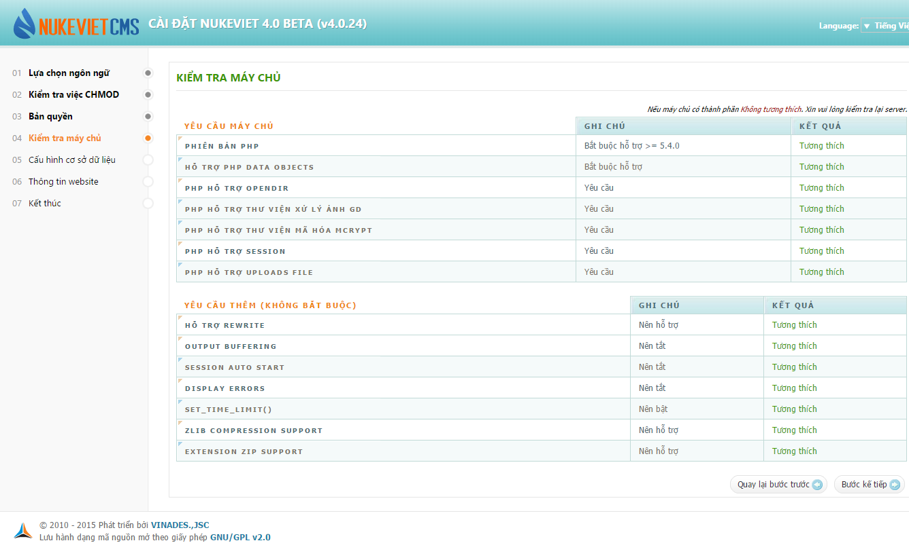
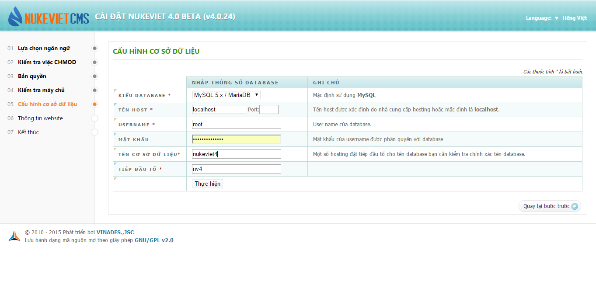
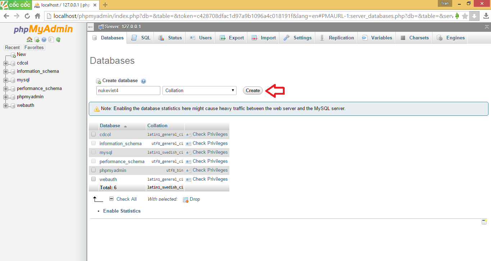
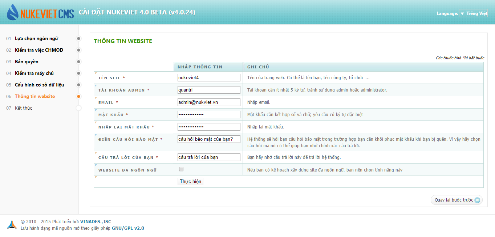
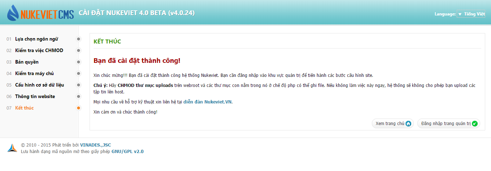

**Chuẩn bị cho việc cài đặt NukeViet**

- Tải Nukeviet 4 tại: [https://nukeviet.vn](https://nukeviet.vn)

- Cài đặt một trong các phần mềm web server như [Vertrigo](/web_server/vertrigo), [AppServ](/web_server/appserv)(Windows) hoặc [Xampp](/web_server/xampp)Xampp (Windows, Linux/Ubuntu).

Lưu ý: Hình minh họa dưới đây được chụp trong môi trường sử dụng hệ điều hành được sử dụng là Windows 8, phần mềm webserver được sử dụng là xampp version 3.2.1 , trình duyệt Coccoc version 53.2.109. Các môi trường khác có thể sẽ có đôi chút khác biệt.

**Cài đặt NukeViet**

Giải nén bộ cài NukeViet vào thư mục htdocs trên localhost sao cho thư mục nukeviet nằm trong thư mục htdocs(trên hosting thì nó là thư mục public_html). Tiến hành cài đặt bằng việc mở trình duyệt (FireFox, Chrome, Internet Explorer, Opera..) của bạn lên và truy cập địa chỉ [http://localhost/nukeviet/](http://localhost/nukeviet/) (Bạn cần chắc chắn rằng phần mềm Xampp đang chạy bằng cách truy cập địa chỉ [http://localhost/phpmyadmin](http://localhost/phpmyadmin) xem có được không).

Ghi chú: Hướng dẫn này chỉ dẫn cách cài NukeViet trên localhost Windows sử dụng Xampp. Bạn cũng có thể tham khảo [Hướng dẫn cài NukeViet trên hosting](/nukeviet/setup/hosting) và [hướng dẫn cài NukeViet trên localhost Linux (Ubuntu)](/nukeviet/setup/localhost_ubuntu).

Quá trình cài đặt mới 1 website sử dụng NukeViet sẽ qua 07 bước như sau:

**Bước 1: Lựa chọn ngôn ngữ**

 Hình 1: Chọn ngôn ngữ cài đặt.

Gợi ý: Bạn có thể chọn cài đặt với ngôn ngữ bất kỳ. Sau khi cài đặt bạn vẫn có thể bổ sung các ngôn ngữ khác tải về từ website nukeviet.vn.

**Bước 2: Kiểm tra việc CHMOD**  Hình 2: Kiểm tra điều kiện cài đặt.

Sau khi hoàn thành quá trình CHMOD bạn có thể nhấn vào nút “Bước kế tiếp” để chuyển qua bước tiếp theo.

**Bước 3: Bản quyền**  Hình 3: Thông báo bản quyền.

Phần mềm sẽ hiển thị thông tin bản quyền về phần mềm nguồn mở theo giấy phép GNU/GPL và giải thích các điều khoản bạn được phép và không được phép. Bạn nhấp nút “Bước kế tiếp” để chuyển sang bước tiếp theo.

**Bước 4: Kiểm tra máy chủ**  Hình 4: Kiểm tra môi trường máy chủ.

Để hệ thống NukeViet có thể chạy được thì yêu cầu máy chủ bắt buộc phải hỗ trợ Phiên bản PHP 5.4 trở lên . Nếu hai điều kiện này không thỏa mãn thì quá trình cài đặt không thể tiếp tục. Ngoài ra hệ thống còn đưa ra những khuyến cáo về những tính năng khác của máy chủ. Nếu những yêu cầu thêm này không thỏa mãn bạn vẫn có thể cài đặt NukeViet nhưng hệ thống sẽ mất đi một số chức năng tiện ích.

**Bước 5: Cấu hình cơ sở dữ liệu**  Hình 5: Cấu hình cơ sở dữ liệu.

Bạn phải điền đầy đủ các thông tin về thông số database của bạn sau đó nhấn vào nút “Thực hiện”. Thông số Username và Mật khẩu do phần mềm Xampp quản lý (mặc định Username là root và mật khẩu để trống, bạn có thể đặt lại mật khẩu theo ý muốn). Riêng Tên cơ sở dữ liệu cần được tạo trước bằng cách truy cập địa chỉ: [http://localhost/phpmyadmin/](http://localhost/phpmyadmin/), vào mục Database, tạo cơ sở dữ liệu mới tại ô Creat new database.

 Hình 5.b : Tạo cơ sở dữ liệu rỗng.

VD (hình 5.b) đặt tên csdl là: nukeviet4 và định dạng csdl: unicode

**Bước 6: Thông tin website** 

Hình 6: Khai báo thông tin website.

Ở bước này các bạn phải điền đầy đủ thông tin vào những ô được đánh dấu (\*), bên cạnh là cột ghi chú giúp bạn có thể hiểu rõ hơn quá trình nhập thông tin. Sau khi nhập thông tin xong bạn nhấn vào nút “Thực hiện” để hoàn tất.

**Bước 7: Kết thúc** 

Hình 7: Thông báo cài đặt thành công.

Khi hoàn thành 6 bước trên hệ thống sẽ chuyển bạn qua bước cuối cùng. Tại đây bạn sẽ nhìn thấy thông báo chúc mừng bạn đã cài đặt thành công. Đồng thời, hệ thống cũng nhắc bạn hãy CHMOD ngay thư mục uploads trên webroot (thư mục gốc của website) và các thư mục con nằm trong thư mục uploads ở chế độ 777. Bạn chỉ cần làm việc này nếu sử dụng hệ điều hành Linux (kể cả hosting linux). Riêng với Windows, thư mục này cần được loại bỏ thuộc tính (properties) chỉ đọc (Read-only) nếu nó đang có thuộc tính này. Sau khi xong các bước hệ thống yêu cầu bạn có 2 lựa chọn: Xem trang chủ hoặc Đăng nhập trang quản trị. Bạn có thể đăng nhập trang quản trị bằng cách gõ thêm /admin/ sau địa chỉ cài đặt NukeViet, vd: [http://localhost/nukeviet/admin/](http://localhost/nukeviet/admin/)

Chú ý:

- Nếu bạn muốn cài đặt lại website hãy xóa file config.php ở thư mục gốc của NukeViet. Sau đó tiếp tục các bước như trên để cài lại hệ thống NukeViet 4.x

- Việc cài NukeViet trên máy chủ mạng hoặc hosting cũng hoàn toàn tương tự. Trong trường hợp sử dụng hosting, chúng tôi khuyên bạn hãy sử dụng hosting linux có công cụ quản lý bằng Cpanel, hỗ trợ PHP 5.4 trở nên và MySQL và một tên miền trỏ sẵn về hosting này. Bạn có thể tìm thấy danh sách các nhà cung cấp hosting tương thích NukeViet tại địa chỉ [nukeviet.vn/vi/partner/hosting.html](https://nukeviet.vn/vi/partner/hosting.html)
