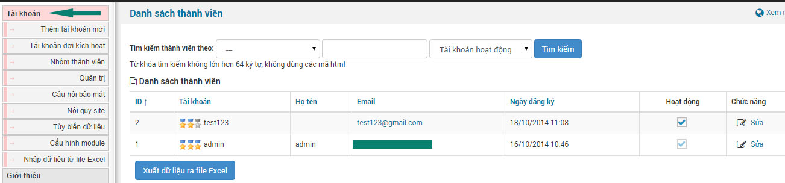
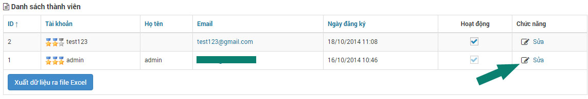
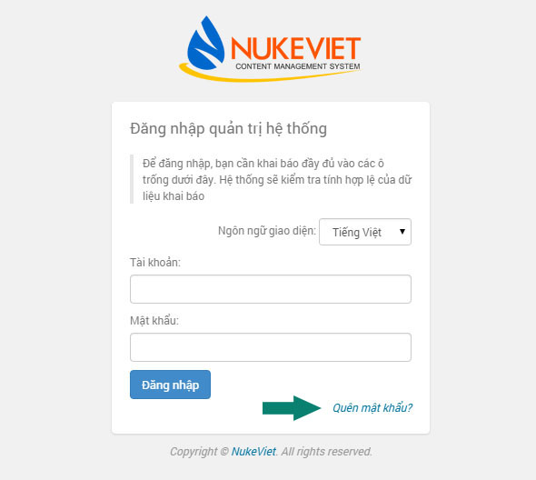
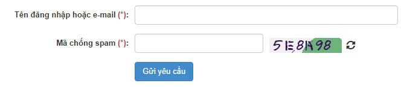
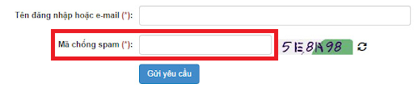
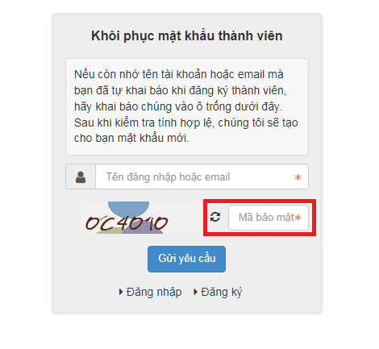

Tài khoản quản trị là tài khoản tối cao và các tài khoản cấp thấp hơn điều hành website

# Thay đổi thông tin tài khoản quản trị

Để thay đổi thông tin tài khoản quản trị bạn tiến hành theo các bước sau:

**Bước 1:** Bạn tiến hành click vào module Tin tức (khối menu bên trái) và hiển thị danh sách tài khoản quản trị và tài khoản thông thường như hình sau:

**Bước 2:** Bạn click vào nút "Sửa" chính tài khoản quản trị của bạn như hình:

Lưu ý: Danh sách có thể có nhiều tài khoản khác: bao gồm tài khoản quản trị và tài khoản thông thường

# Quy trình xử lý khi quên mật khẩu

Khi bạn đăng nhập không thành do bạn quên mật khẩu thì bạn tiến hành click vào "Quên mật khẩu?" như hình sau để tiến hành lấy lại mật khẩu.

Sau khi bạn click, website sẽ chuyển hướng bạn đến phần điền thông tin gmail và mã chống spam để bạn lấy lại mật khẩu như hình sau:

Tại đây bạn tiến hành điền thông tin đầy đủ và gửi yêu cầu.

Bước cuối cùng là bạn vào mail để nhận thông tin mật khẩu mới và tiến hành đổi mật khẩu để đảm bảo an toàn.

Lưu ý: Mail để lấy lại thông tin mật khẩu là mail bạn sử dụng cho tài khoản quản trị

**Giao diện phần “Quên mật khẩu”:**

Ở tài liệu được gọi là “mã chống spam”

Phiên bản NukeViet 4.5.01: ở phiên bản này được gọi là “mã bảo mật”

Cả 2 tuy khác nhau tên gọi nhưng có chung chức năng là bắt người dùng nhập 1 mã để có thể gửi yêu cầu quên mật khẩu để tạo mật khẩu mới.

# Các lưu ý bảo mật tài khoản

Hệ thống NukeViet là hệ thống rất mạnh về việc phân quyền quản trị site, nếu một cách hợp lý bạn có thể ngăn ngừa các nguy cơ “tấn công nội bộ” hoặc “tấn công vào các tài khoản quản trị”. Sau đây là một số lưu ý:

- Không tạo thêm tài khoản quản trị tối cao. Bạn không nên tạo nhiều tài khoản này bằng cách sửa cơ sở dữ liệu. Không phải tự dưng mà NukeViet chỉ cho phép có 1 Người quản trị tối cao ([God admin](/nukeviet/concepts/god_admin)).
- Không nên sử dụng tài khoản quản trị tối cao cho những hoạt động thông thường (Ví dụ đăng tin, post bài…) Thay vào đó bạn nên tạo thêm tài khoản khác để sử dụng riêng cho nhu cầu này. Ví dụ việc tạo thêm cho mình một tài khoản Điều hành chung hoặc với quyền thấp hơn là Người điều hành module (tất cả module) để xử lý các công việc này, đây là một ý tưởng không tồi (đừng quên là sử dụng các mật khẩu đủ mạnh và khác nhau).
- Không nên trao quá nhiều quyền không cần thiết cho một tài khoản nào đó. Chỉ cấp quyền truy cập cho họ vào những khu vực phù hợp.
- Thường thì chúng ta vẫn đặt tên tài khoản quản trị là admin hoặc administrator. Như vậy thay vì phải dò cả tên đăng nhập và mật khẩu thì giờ đây hacker chỉ cần đoán được mật khẩu là có thể vào được site của bạn. Do đó bạn nên đổi tên tài khoản admin thành 1 tên riêng nào đó chỉ có site bạn sử dụng.
