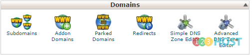
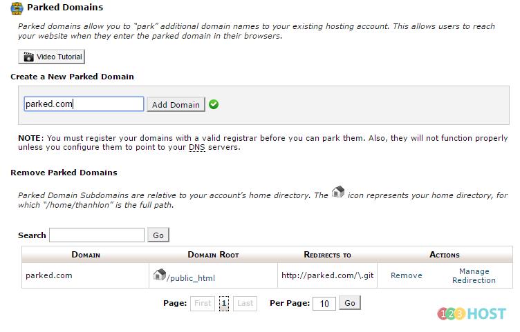

cPanel cho phép chúng ta có thể tạo các tên miền phụ cũng như các các domain chạy song song hoặc độc lập với domain chính của hosting. Bài viết dưới đây sẽ hướng dẫn các bạn tạo các domain như trên.

\_ Đăng nhập cPanel

\_ Mục Domains

\+ Parked Domain: Đây là dạng domain chạy song song với domain chính của hosting, nói cách khác, đây là dạng domain chạy cùng một source web với nhau (cùng một nội dung website, cùng 1 document root) .

Ta chỉ việc điền tên domain mà ta đã mua, sau đó Add Domain, trỏ domain đó về IP hosting là có thể chạy được rồi nhé. Nếu chưa có hosting, bạn có thể [đăng ký hosting tại đây](https://123host.vn/web-hosting.html)
