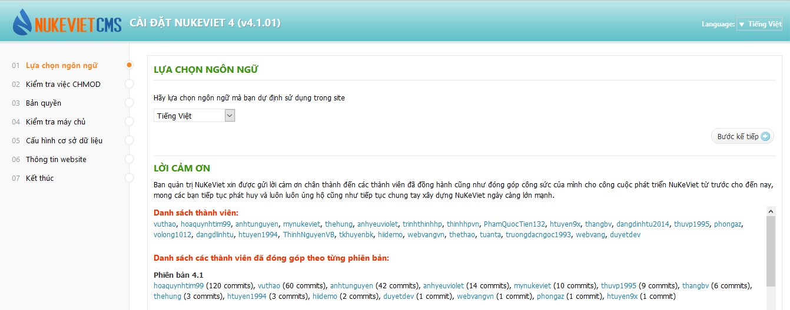

## Thống kê người commit

Thống kê này ghi nhận theo tài khoản người commit, bất kể người đó thuộc tổ chức nào.

## Thống kê theo tác giả

Kể từ khi đưa lên github, NukeViet đã hướng dẫn các cá nhân thuộc các tổ chức tham gia đóng góp thông qua kho của các tổ chức, xem [Nguyên tắc quản lý kho code NukeViet trên Github - Gợi ý cho các doanh nghiệp tham gia phát triển code](/programming/github_rule). Tuy nhiên bắt đầu từ phiên bản NukeViet 4.1.01, NukeViet đã có hướng dẫn đóng góp theo tác giả để tiện cho việc thống kê chi tiết tác giả của đóng góp đó.

## Vinh danh các đóng góp

Cũng bắt đầu từ phiên bản NukeViet 4.1.01, NukeViet đã bổ sung thông tin thống kê các đóng góp vào phần "Lời cảm ơn" ngay trong bước 1 của công cụ cài đặt NukeViet (xem ảnh dưới).

Đóng góp của Team code cho phiên bản hiện tại sẽ được ghi nhận cùng với các đóng góp của các team khác tại đây.
