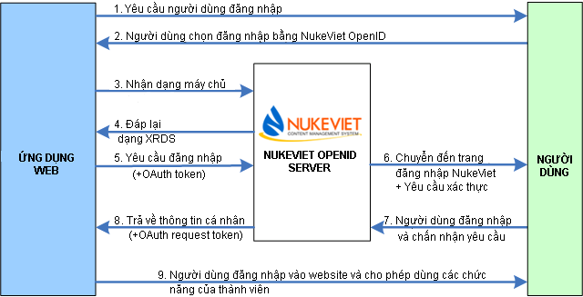
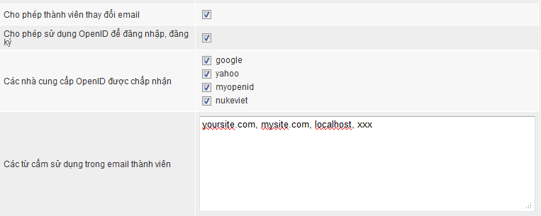

Từ ngày 01/09/2011, Website chính thức của NukeViet sẽ cung cấp khả năng xác thực đăng nhập từ website nukeviet.vn cho các website đăng ký. Như vậy NukeViet.vn đã trở thành một nhà cung cấp OpenID. Với các website sử dụng NukeViet, từ phiên bản NukeViet 3.3 cổng OpenID do NukeViet.vn cung cấp đã được tích hợp sẵn.

## 1. Tổng quan về openid

OpenID là một hệ thống đăng nhập một lần không có tính tập trung. Đối với những trang web có sử dụng OpenID thì người sử dụng không cần phải nhớ các thông tin về username và password cho riêng trang đó nữa. Thay vào đó họ chỉ cần đăng ký trước 1 tài khoản OpenID tại một trong những nhà cung cấp OpenID, hay thường gọi là i-broker. Do OpenID không mang tính tập trung nên bất kỳ trang web nào cũng có thể sử dụng được OpenID như là một cách đăng nhập cho người dùng.

OpenID hiện đang được ứng dụng rộng rãi trong các trang web lớn như AOL, Facebook, Yahoo, Gmail... Thêm vào đó, việc tích hợp hỗ trợ OpenID có mức ưu tiên cao trong bản Firefox 3. Microsoft cũng đang tiến hành phát triển OpenID 2.0 cho bản Windows Vista và windows 7 của họ.

## 2. NukeViet OpenID

NukeViet OpenID hỗ trợ OpenID 2.0 Directed Identity protocol, cho phép những tên miền được lưu trữ trên máy chủ có thể yêu cầu xác thực. Khi có yêu cầu từ một trang web thứ ba NukeViet OpenID sẽ thực hiện việc kiểm tra xác thực tên miền hợp lệ, Tên miền được mã hóa như một ID và lưu trữ trên máy chủ của NukeViet, nếu ID này là phù hợp, một yêu cầu xác thực sẽ được trả về cho người dùng yêu cầu họ cho phép gửi thông tin trả về website thứ ba. Nếu người dùng chưa đăng nhập trên máy chủ NukeViet, một yêu cầu đăng nhập sẽ được gửi về.

Trong trường hợp tính năng OpenID chỉ được bật cho những website đã đăng ký với NukeViet.VN, nếu địa chỉ website thứ ba không tồn tại trên máy chủ, yêu cầu xác thực sẽ bị từ chối.

## 3. Tổng quan quá trình tương tác

OpenID login authentication cho các ứng dụng web liên quan đến một chuỗi các tương tác giữa ba thành phần, NukeViet OpenID lưu trữ trên máy chủ tên miền hợp lệ, dịch vụ chứng thực đăng nhập của NukeViet(đã được tích hợp trong các phiên bản nukeviet), và người dùng cuối. Sơ đồ và trình tự dưới đây mô tả quá trình của một phiên đăng nhập.



\- Các ứng dụng web sẽ yêu cầu người dùng cuối để đăng nhập bằng cách cung cấp một tập hợp các lựa chọn (đăng nhập thông thương và đăng nhập bằng các nhà cung cấp OpenID trong đó có NukeViet).

\- Người sử dụng lựa chọn để đăng nhập vào bằng cách sử dụng một tài khoản NukeViet trên [http://nukeviet.vn](http://nukeviet.vn).

\- Các ứng dụng web thực hiện phát hiện dịch vụ được định nghĩa trong tài liệu xrds.

\- NukeViet trả về một tài liệu xrds.

Ví dụ:

``` xml
     <Service Xmlns="xri://$xrd*($v*2.0)">

       <Type> Http://specs.openid.net/auth/2.0/return_to</Type>

       <URI> Http://consumer.example.com/return</URI>

     </Service>
```

\- Các ứng dụng web sẽ gửi một yêu cầu chứng thực đăng nhập (Các tùy chọn đã có sẵn) đến NukeViet.

\- Chuyển hướng đăng nhập nếu người dùng chưa đăng nhập trên nukeviet.vn sau đó yêu cầu người dùng chấp nhận xác thực đăng nhập của ứng dụng web đó.

\- Người sử dụng đăng nhập vào nukeviet.vn và xác thực yêu cầu.

\- Trả về chứng thực đăng nhập.

\- Ứng dụng web nhận chứng thực và xác minh người dùng sau đó cho phép người dùng đăng nhập vào hệ thống của mình với vai trò thành viên.

## 4. Cân nhắc về vấn đề an ninh

Để tăng thêm tính bảo mật cho người dùng, NukeViet OpenID đặt ở chế độ luôn luôn xác nhận, qua đó mọi yêu cầu xác thực đăng nhập cần phải qua sự đồng ý của người dùng.

Ngoài ra, OpenID sử dụng lại các tài nguyên có sẵn của NukeViet như các class Hash, IP, Flood, chống quá tải máy chủ để đảm bảo an ninh.

## 5. Dành cho người dùng NukeViet

NukeViet 3.1 trở về trước đang tích hợp 3 nhà cung cấp OpenID đó là yahoo, google và myopenid

Để chọn NukeViet OpenID cho website của mình, quản trị viên cần thực hiện các bước sau:

1\) Mở file openid.php trong thư mục includes/ thực hiện thêm vào:

``` php
    $openid_servers['nukeviet'] = array( //

        'identity' => 'https://nukeviet.vn/openid/index.php', //

        'required' => array( //

            'email' => 'contact/email', //

            'nickname' => 'namePerson/friendly', //

            'fullname' => 'namePerson', //

            'gender' => 'person/gender', //

        ) //

    );
```

2\) Thêm logo NukeViet vào theme hiện tại đang dùng.

Ví dụ: `themes/default/images/users/nukeviet.gif`

[http://nukeviet.vn/themes/default/images/users/nukeviet.gif](http://nukeviet.vn/themes/default/images/users/nukeviet.gif)

3\) Vào phần quản trị website cấu hình cho phép chấp nhận NukeViet OpenID:



4\) Đăng kí APP trên [http://nukeviet.vn](http://nukeviet.vn):

Truy cập địa chỉ [http://nukeviet.vn/vi/openid/](http://nukeviet.vn/vi/openid/) hoặc [http://nukeviet.vn/vi/openid/content/](http://nukeviet.vn/vi/openid/content/)

Nếu chưa đăng nhập, hệ thống sẽ yêu cầu đăng nhập sau đó thực hiện đăng kí APP cho website.

Cần khai báo thật chính xác các thông tin:

\- Tên APP: tên tùy ý

\- Website: Nhập thật chính xác website của bạn, ví dụ [http://webnhanh.vn](http://webnhanh.vn), [http://vinhthanh.info.vn](http://vinhthanh.info.vn) . Nếu nhập sai, website sẽ không thể sử dụng dịch vụ OpenID

\- Hình ảnh: Chọn một ảnh đại diện (48x48) cho APP

\- Mô tả: Mô tả về website hoặc APP.

Sau khi đăng kí, APP của bạn sẽ ở trạng thái chờ duyệt, vui lòng chờ đến khi có thông báo APP được duyệt.

Sau khi APP được duyệt, website đăng kí sẽ chính thức được sửa dụng hệ thống NukeViet OpenID.

<u>**Ghi chú**</u>:

- Kể từ phiên bản NukeViet 3.2, NukeViet OpenID được tích hợp sẵn trong phần mềm nguồn mở NukeViet được phát hành.
- Kể từ NukeViet 3.4.01, NukeViet OpenID mở cửa cho tất cả các website sử dụng mà không cần đăng ký.

## 6. Tài liệu tham khảo

\- Randomness Recommendations for Security [ftp://ftp.isi.edu/in-notes/rfc1750.txt](ftp://ftp.isi.edu/in-notes/rfc1750.txt)

\- Hypertext Transfer Protocol -- HTTP/1.1 [ftp://ftp.isi.edu/in-notes/rfc2616.txt](ftp://ftp.isi.edu/in-notes/rfc2616.txt)

\- Extensible Resource Identifier (XRI) Resolution V2.0 - Committee Draft 02 [http://www.oasis-open.org/committees/download.php/17293](http://www.oasis-open.org/committees/download.php/17293)

\- Extensible Resource Identifier (XRI) Syntax V2.0 [http://www.oasis-open.org/committees/download.php/15376](http://www.oasis-open.org/committees/download.php/15376)

\- Yadis Specification [http://yadis.org/papers/yadis-v1.0.pdf](http://yadis.org/papers/yadis-v1.0.pdf)

## 7. Thư viện sử dụng

NukeViet OpenID sử dụng thư viện Janrain OpenID Libraries. Website: [https://github.com/openid/php-openid](https://github.com/openid/php-openid)
