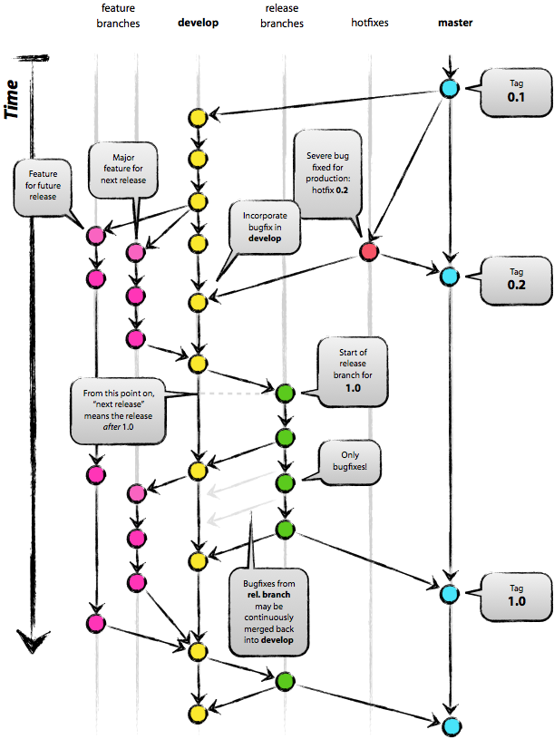

## Tài khoản quản lý

- Kho code chính của NukeViet (NukeViet Repository) được quản lý thông qua tài khoản của tổ chức [NukeViet](https://github.com/nukeviet) (Nukeviet Organization).
- Tài khoản của tổ chức NukeViet được quản lý bởi Ban quản trị NukeViet và đội ngũ phát triển code chính.

## Địa chỉ kho code

- NukeViet Repositosy: [https://github.com/nukeviet/NukeViet](https://github.com/nukeviet/NukeViet)

## Nguyên tắc phát triển code

- Tự do đóng góp: Tất cả mọi người dù là người quản lý kho code, thành viên đội code hay những người đóng góp thuộc các tổ chức, công ty, các cá nhân... đều có thể đóng góp phát triển code một cách tự do.
- Ghi công đóng góp: Việc phát triển code phải thực hiện trên kho code riêng, không được code trực tiếp trên kho code chính của NukeViet (kể cả tài khoản của người quản lý kho code).
- Kiểm duyệt chéo: Những người quản lý kho code sẽ chịu trách nhiệm việc kiểm duyệt code được đóng góp vào kho code chính. (Nên hạn chế việc tự duyệt code của mình trên kho code chính).

## Quy trình tham gia phát triển code

- Để tham gia phát triển code, chỉ cần 1 tài khoản trên Github. Sau đó truy cập kho code của nukeviet, ấn nút Fork để copy project có sẵn thành project của mình, rồi sau đó ta có thể tự do chỉnh sửa project đó của mình.
- Chỉnh sửa xong thì ấn nút Pull Request để gửi yêu cầu đóng góp lên cho những người quản lý kho code.
- Những người quản lý kho code sẽ kiểm tra và phê duyệt các đóng góp này. Nếu đóng góp chưa đạt hoặc cần chỉnh sửa thì những người quản lý có thể viết góp ý ngay tại yêu cầu đóng góp và trả lại để người đóng góp chỉnh sửa theo góp ý và gửi lại sau khi đã sửa xong. Quá trình này diễn ra cho đến khi yêu cầu đóng góp được chấp nhận, đóng góp đó sẽ được trộn (merge) vào các nhánh phù hợp với dự án được đóng góp.
- Để tăng hiệu suất quản lý, toàn bộ công việc chỉnh sửa, xử lý xung đột... trước khi gửi đóng góp lên sẽ do người đóng góp xử lý. Người quản lý kho code sẽ chỉ việc kiểm tra và trả lời chứ không phải mất công để sửa lại code được đóng góp.

### Gợi ý cho các doanh nghiệp tham gia phát triển code

Nếu doanh nghiệp của bạn có nhiều nhân viên tham gia phát triển code thì thay vì tham gia dự án dưới tư cách của cá nhân, các bạn có thể tham gia phát triển dự án dưới tư cách của doanh nghiệp (trường hợp doanh nghiệp trả lương cho nhân viên để phát triển code của NukeViet). Dưới đây là hướng dẫn:

- Đại diện doanh nghiệp đăng ký tài khoản code, tạo tổ chức mang tên doanh nghiệp và add các thành viên vào tổ chức của mình.
- Đại diện doanh nghiệp fork dự án về kho code của doanh nghiệp.
- Các thành viên trong doanh nghiệp fork dự án từ kho code của doanh nghiệp về kho code của cá nhân. Nhân viên doanh nghiệp Pull Request vào kho code của doanh nghiệp sau đó doanh nghiệp Pull Request vào kho code chung của NukeViet.

Theo hình thức này, một cá nhân vừa có thể tham gia trực tiếp vào dự án của NukeViet (phát triển ngoài giờ làm việc) và tham gia dưới tư cách là nhân viên của doanh nghiệp (phát triển trong giờ làm việc).

### Các chú ý

- Trong quá trình làm phải commit thường xuyên lên nhánh develop, khi xong xuôi thì merge/rebase vào nhánh master. Không nên chờ đến khi có kết quả cuối cùng mới commit lên kho code chính, vì như thế sẽ gia tăng nguy cơ xung đột code giữa các thành viên trong nhóm và giữa các nhóm với nhau.

## Cấu trúc tổ chức kho code

Cấu trúc tổ chức kho code của NukeViet tuân theo [mô hình phân nhánh Git](http://nvie.com/posts/a-successful-git-branching-model/) như hình dưới. 

**Nhánh chính (là nhánh Master)**

Nhánh này luôn đảm bảo rằng code được lưu trữ trên đó là phiên bản chính thức mới nhất đang được phát hành trên website nukeviet.vn

**Nhánh release branches**

(ví dụ đặt tên: nukeviet3.4, nukeviet4.3 ....)

Khi thông báo phát hành 1 phiên bản beta mới từ nhánh develop thì mới cần tạo 1 nhánh để duy trì sau này.

Nhánh hỗ trợ vá lỗi trong quá trình phát triển phiên bản đang phát hành. Hạn chế việc phát triển tính năng mới cho các nhánh này.

Code được trộn vào trong các nhánh này có thể bao gồm thêm các tính năng mới, nhưng cần được nâng cấp tự động không gây ảnh hưởng đến site khi nâng cấp. Nếu tính năng mới ảnh hưởng đến giao diện của site thì cần chuyển sang phiên bản tiếp theo.

Mỗi nhánh sẽ được duy trì từ lúc phát hành đế lúc kết thúc không nhỏ hơn 2 năm.

**Nhánh Develop**

Là nhánh được cập nhật liên tục các đóng góp của tất cả mọi người ở mọi thời điểm. Nhánh này sẽ tiếp nhận các đóng góp của mọi người gửi đến thông qua việc tiếp nhận Pull Request cũng như tiếp nhận việc nhập các nhánh khác vào.

Khi nhánh Develop sau khi được release phiên bản trước đạt độ chín mùi dự kiến 2 năm sẽ ra 1 phiên bản mới. Lúc này sẽ cần công bố:

- Các tính năng đã được phát triển mới so với bản trước.
- Các tính năng cần hòan thiện khi phát hành.
- Các công việc liên quan đến khi phát hành chính thức: Tài liệu, hướng dẫn nâng cấp …

Trong quá trình phát triển nhánh Develop, Nếu 1 tính năng mới cần được viết mới hoặc sửa đổi, thì tạo ra các nhánh mới (Feature branches: nó chỉ tồn tại trong một giai đoạn nào đó của dự án nhằm phục vụ những mục đích nhất định). Khi nào ổn định mới đưa vào nhánh Develop

**Nguyên tắc phát triển chung**

Nguyên tắc để được trộn vào các nhánh là cần có issues về việc sửa chữa tính năng này [https://github.com/nukeviet/nukeviet/issues](https://github.com/nukeviet/nukeviet/issues)

- Nếu là tính năng mới dự định sẽ làm cho các phiên bản nào.
- Nếu là lỗi xác định lỗi này xẩy ra trên các phiên bản nào.

Nếu là sửa lỗi, thì tạo 1 Hotfix branches từ nhánh có phiên bản thấp nhất cần phát triển ví dụ đặt tên hotfix-name. Sau khi sửa lỗi đó xong, tạo Pull Request đến các nhánh cần sửa để fix lỗi cho các phiên bản mới hơn có thể sửa. Khi tính năng hòan thiện đã được trộn thì xóa nhánh này trên kho code của mình đi.(Lịch sử đóng góp vấn được đảm bảo)

Việc phát triển tính năng mới cũng làm tương tự như việc sửa lỗi.

## Thống kê kho code

### Nguyên tắc thống kê

Xem [Nguyên tắc thống kê đóng góp code trên kho NukeViet](/programming/code_statistic_rule)

## Tham khảo

### Các bài viết liên quan

- [Hướng dẫn làm việc với Git trên Github](/programming/vcs/git)

### Chú ý

- Git-flow là tài liệu từ năm 2010, thường phù hợp với các dự án quy củ. Các dự án đơn giản hơn được khuyến khích sử dụng Github flow để thay thế.

### Nguồn bên ngoài

- Git-flow - Một mô hình phân nhánh git thành công: [http://nvie.com/posts/a-successful-git-branching-model/](http://nvie.com/posts/a-successful-git-branching-model/)
- Github flow - Mô hình phân nhánh đơn giản cho các dự án làm việc liên tục: [https://guides.github.com/introduction/flow/](https://guides.github.com/introduction/flow/)
