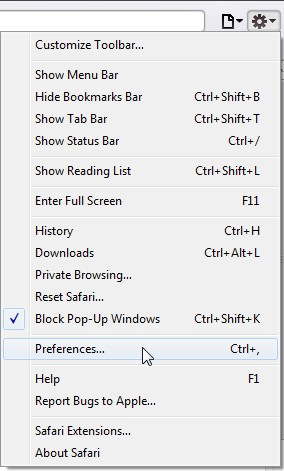
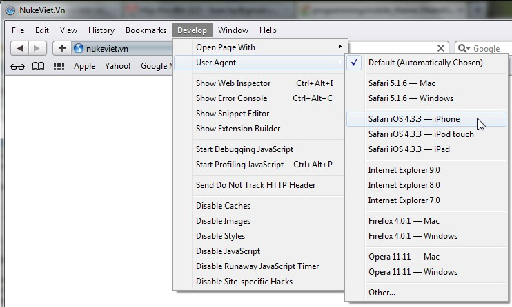

## Giả lập môi trường thử nghiệm

### Giả lập opera mini

- Công cụ giả lập Opera mini 6.5 [http://demo.opera-mini.net/public/index.html](http://demo.opera-mini.net/public/index.html)
- Công cụ giả lập Opera mini 4.2 [http://demo.opera-mini.net/demo.html](http://demo.opera-mini.net/demo.html)

### Giả lập iphone, ipad

iphone, ipad của Apple sử dụng trình duyệt safari, phiên bản Safari dành cho windows cho phép giả lập các phiên bản khác để thử nghiệm, bạn có thể sử dụng chức năng này bằng cách:

- Mở Safary, vào menu `Edit->Preferences`. Tại tab `Advanced`, chắc chắn rằng “Show Develop menu in menu bar” đã được đánh dấu (hình 1).
- Truy cập menu Develop (nếu không thấy menu này, ấn phím ALT để nó hiện ra)-\>User Agent-\>Safari iOS (hình 2)
- Truy cập vào website và bắt đầu trải nghiệm!

| Hình 1 | Hình 2 |
|:--:|:--:|
|  |  |
