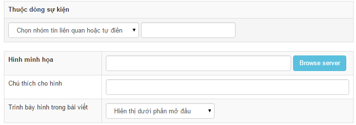

Thông thường để kiểm tra file hoặc thư mục tồn tại ta dùng hàm file_exists, để kiểm tra file tồn tại dùng hàm is_file, để kiểm tra thư mục tồn tại dùng hàm is_dir. Tuy nhiên, cách kiểm tra này không an toàn đối với đường dẫn file do người dùng nhập vào, theo đó người dùng có thể thông qua ô nhập liệu để dò ra các file bí mật như file config, các file ngầm định không cho người dùng biết... Ví dụ: Trong module news, khi thêm bài viết có ô chọn hình minh họa như ảnh  Nếu chỉ thực hiện việc đọc dữ liệu sau đó kiểm tra is_file:

``` php
$rowcontent['homeimgfile'] = $nv_Request->get_title( 'homeimg', 'post', '' );

if( is_file( NV_DOCUMENT_ROOT . $rowcontent['homeimgfile'] ) )
{
    $lu = strlen( NV_BASE_SITEURL . NV_UPLOADS_DIR . '/' . $module_upload . '/' );
    $rowcontent['homeimgfile'] = substr( $rowcontent['homeimgfile'], $lu );
}
```

Thì sau khi kiểm tra giá trị \$rowcontent\['homeimgfile'\] được ghi vào CSDL, kẻ phá hoại có thể dựa vào dữ liệu đó để kiểm tra sự tồn tại của các file hệ thống.

Để đảm bảo an toàn, người lập trình module cần sử dụng hàm nv_is_file thay vì is_file hay file_exists. Khi đó đoạn code trên được viết lại

``` php
$rowcontent['homeimgfile'] = $nv_Request->get_title( 'homeimg', 'post', '' );

if( nv_is_file( $rowcontent['homeimgfile'], $uploads_dir_user ) )
{
    $lu = strlen( NV_BASE_SITEURL . NV_UPLOADS_DIR . '/' . $module_upload . '/' );
    $rowcontent['homeimgfile'] = substr( $rowcontent['homeimgfile'], $lu );
}
```

Cách sử dụng hàm [nv_is_file](/programming/function) tham khảo tại [Đây](/programming/function)
