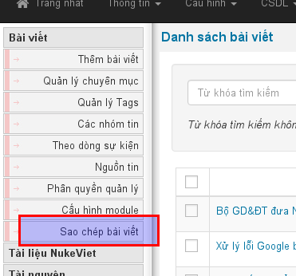

NukeViet 4 hỗ trợ việc thêm một chức năng mở rộng (plugin) cho module **tại khu vực quản trị**, mà không cần can thiệp vào cấu trúc của module. Các plugin này sẽ hỗ trợ module thực hiện một chức năng nào đó mà module gốc chưa được phát triển (hoặc chưa làm được), dựa trên các tài nguyên của module đó cung cấp.

**Ví dụ:** Muốn thêm chức năng sao chép bài viết (từ chủ để này sang chủ đề khác) cho module news, thay vì chỉnh sửa vào code của module news để thêm chức năng này, lâp trình viên có thể thực hiện theo hướng dẫn bên dưới để thêm chức năng này chạy cùng module news.

## Cấu trúc chức năng mở rộng

- modules/module_name/admin/**func_name**.php
- modules/module_name/language/plugin\_**plugin_name**\_admin\_**lang**.php
- modules/module_name/plugin/**plugin_name**\_admin.php (Nếu không tồn tại thư mục plugin, bạn cần tạo mới)
- themes/admin_default/modules/module_name/**func_name**.tpl

Trong đó:

- func_name: Tên func (Theo quy tắc đặt tên func của module)
- plugin_name: Tên plugin (Theo quy tắc đặt tên func của module)
- lang: ký hiệu ngôn ngữ (vi, en, .....)

## Lập trình chức năng mở rộng

Chức năng này kế thừa tài nguyên module gốc cung cấp, nên phương án lập trình cũng tương tự như lập trình chức năng của module. Để dễ hình dung, lấy ví dụ là “Chức năng copy bài viết” (Từ chủ đề này sang chủ đê khác của module news)

### Tạo file modules/news/admin/tool_copy.php

``` php
<?php

/**
 * @Project NUKEVIET 4.x
 * @Author VINADES.,JSC (contact@vinades.vn)
 * @Copyright (C) 2015 VINADES.,JSC. All rights reserved
 * @License GNU/GPL version 2 or any later version
 * @Createdate Tue, 02 Jun 2015 07:53:31 GMT
 */

if ( ! defined( 'NV_IS_FILE_ADMIN' ) ) die( 'Stop!!!' );

// Code xử lý ở đây
```

### Tạo file modules/news/language/plugin_tool_copy_admin_vi.php

``` php
<?php

/**
 * @Project NUKEVIET 4.x
 * @Author VINADES.,JSC (contact@vinades.vn)
 * @Copyright (C) 2015 VINADES.,JSC. All rights reserved
 * @License GNU/GPL version 2 or any later version
 * @Createdate Fri, 05 Jun 2015 08:59:50 GMT
 */

if( ! defined( 'NV_ADMIN' ) or ! defined( 'NV_MAINFILE' ) ) die( 'Stop!!!' );

// Code biến ngôn ngữ ở đây
$lang_module['tool_copy'] = 'Sao chép bài viết';
```

### Tạo file modules/module_name/plugin/tool_copy_admin.php

Nội dung file này tương tư như **admin.menu.php**

``` php
<?php

/**
 * @Project NUKEVIET 4.x
 * @Author VINADES.,JSC (contact@vinades.vn)
 * @Copyright (C) 2015 VINADES.,JSC. All rights reserved
 * @License GNU/GPL version 2 or any later version
 * @Createdate Fri, 05 Jun 2015 08:59:50 GMT
 */

 if( ! defined( 'NV_ADMIN' ) ) die( 'Stop!!!' );

// Khai báo thêm vào menu
$submenu['tool_copy'] = $lang_module['tool_copy'];

 // Khai báo thêm vào allow_func
$allow_func[] = 'tool_copy';
```

### Tạo file themes/admin_default/modules/news/tool_copy.tpl

``` html
<!-- BEGIN: main -->
// Code giao diện chức năng
<!-- END: main -->
```

### Khi tìm thấy những tập tin chức năng mở rộng, hệ thống sẽ tự động thêm chức năng vào menu của module


