## 1. Tải về và cài đặt

> Lưu ý: Hướng dẫn này tương thích phiên bản 2021-06 R trở lên. Để tối ưu bạn nên cài phiên bản mới nhất. Ví dụ phiên bản 2021-06 R có tốc độ làm việc có thể gấp 3 lần phiên bản 2018-09 R

- Cài đặt Java JDK nếu chưa có: [http://www.oracle.com/technetwork/java/javase/downloads/index.html](http://www.oracle.com/technetwork/java/javase/downloads/index.html) nên cài mới nhất, bắt buộc tối thiểu v11
- Eclipse có thể cài đặt trên nhiều hệ điều hành khác nhau (Windowns, Linux,....), bạn có thể tìm thấy gói download phù hợp tại [https://www.eclipse.org/downloads/packages/](https://www.eclipse.org/downloads/packages/). Cụ thể, trong trường hợp này (Lập trình PHP) chúng ta tiến hành download gói có tên là Eclipse for PHP Developers
- Việc cài đặt Eclipse diễn ra bình thường, tương tự như việc các phần mềm thông dụng khác.
- Khi đã cài đặt jdk 11 mà eclipse vẫn báo lỗi thiếu java cần thêm vào đầu file eclipse.ini đoạn sau

``` text
-vm
C:\Program Files\Java\jdk-11.x.y\bin\javaw.exe
```

## 2. Thêm định dạng file cần thiết

Cấu hình định dạng file: 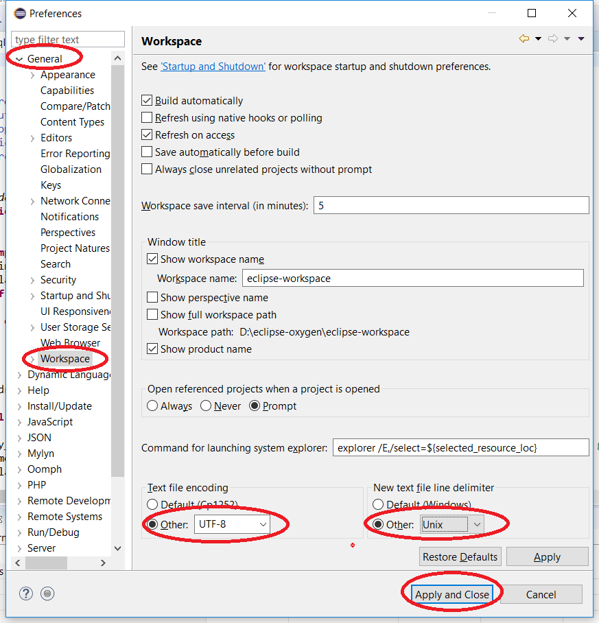

Một số mã nguồn sử dụng các định dạng file mà trình soạn thảo chưa được ghi nhận, ví dụ: giao diện CMS NukeViet sử dụng \*.tpl thay vì \*.html. Vậy nên, chúng ta cần phải thêm định dạng \*.tpl hiển thị như \*.html.

Trong cửa sổ Freferences, đi đến General / Editors / File Associations

``` text
  Click Add (1), nhập vào định dạng file muốn thêm vào (*.tpl). Nhấn OK để hoàn tất
  Click Add (2), chọn định dạng muốn áp dụng cho định dạng (*.tpl) vừa thêm ở trên. VD chọn HTML Editor
```

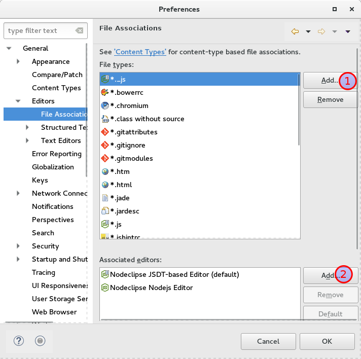

Trong cửa sổ Freferences, đi đến General / Content Types. Tại cây thư mục Text / HTML ấn nút add và thêm `*.tpl` như ảnh dưới

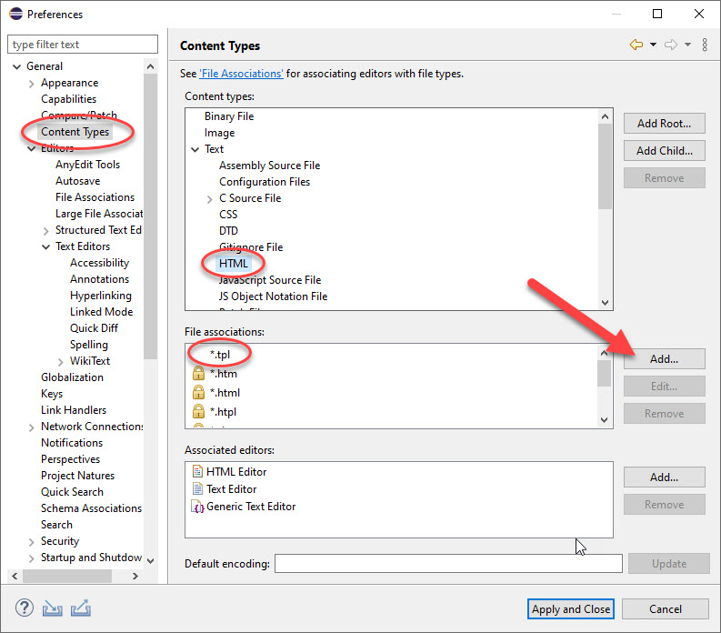

Kết quả: Khi mở một file có định dạng \*.tpl, thì code hiển thị như \*.html

Làm tương tự với file có định dạng \*.ini được mở bằng XML Editor

## 3. Thay đổi font chữ, kích thước chữ

Font, kích thước chữ ở đây là code khi bạn soạn thảo, không phải chữ của các menu hệ thống. Đi đến General / Appearance / Color and Fonts. Chọn đối tượng định dạng (1), chọn Edit (2) để thay đổi font và kích thuớc chữ, nhấn OK (3) để áp dụng. Bạn có thể chọn các đối tượng hiển thị khác nhau ở phần (1), sau đó thay đổi tuơng tự.

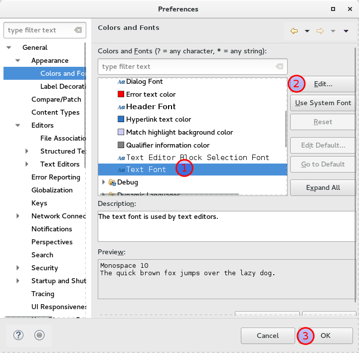

## 4. Thay đổi mẫu định dạng code

Bạn có thể thay đổi mẫu định dạng mã PHP theo ý bạn, truy cập PHP / Code style / Formater. Chọn mẫu hoặc import mẫu bạn mong muốn [nukeviet.eclipse.2020.zip](/images/programming/nvtools/nukeviet.eclipse.2020.zip) Nhấn OK để hoàn tất.

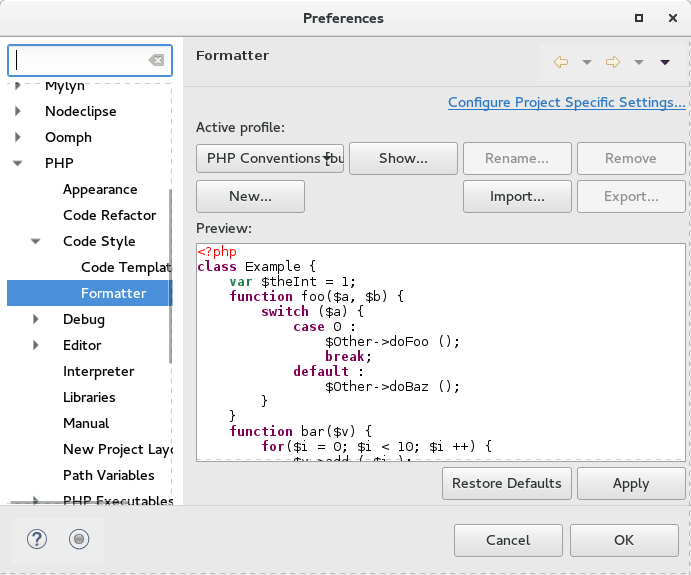

Áp dụng bằng cách nhấn Ctrl + F để định dạng tự động cho nội dung tập tin đang mở. Hoặc định dạng cho toàn bộ tập tin (PHP) trong một thư mục bằng cách Click phải chuột lên thư mục (ở cửa sổ PHP Explorer),, chọn Source, chọn Format

## 5. Cấu hình Format cho Javascript

Cấu hình tương tự như PHP bằng cách truy cập: Javascript/ Code style / Formater [eclipse_neon_3_nukeviet4_js.zip](/images/programming4/eclipse_neon_3_nukeviet4_js.zip)

Với Eclipse IDE 2020-06 hoặc mới hơn cần cài thêm: Eclipse Web JavaScript Developer Tools Cấu hình web/ Client-side Javascript/ Code style / Formater

## 6. Cấu hình xóa khoảng trống khi lưu file

Với PHP 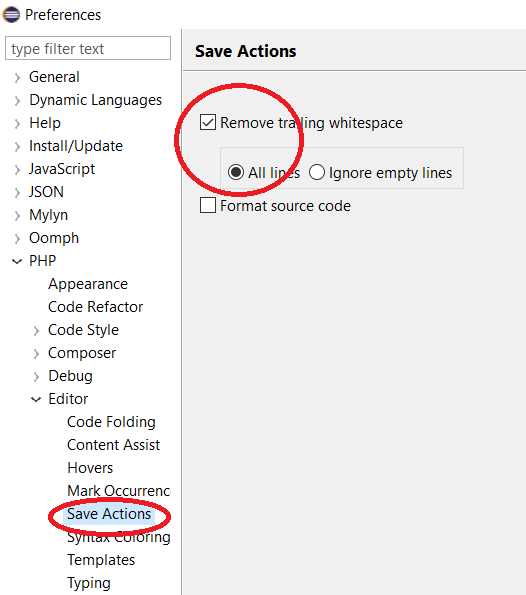

Với JavaScript: Truy cập "Toolbar --\> Window --\> Preferences --\> JavaScript --\> Editor --\> Save Actions".

1.  Find and enable "Perform the selected actions on save".
2.  Find and enable "Additional actions".
3.  Press the button "Configure...".
4.  Select the tab "Code Organizing".
5.  Find and enable "Remove trailing whitespace".
6.  Find and select "All lines".
7.  Press "OK" to continue.

Khi bạn đã xong, bấm "OK" để lưu và đóng cửa sổ Preferences. 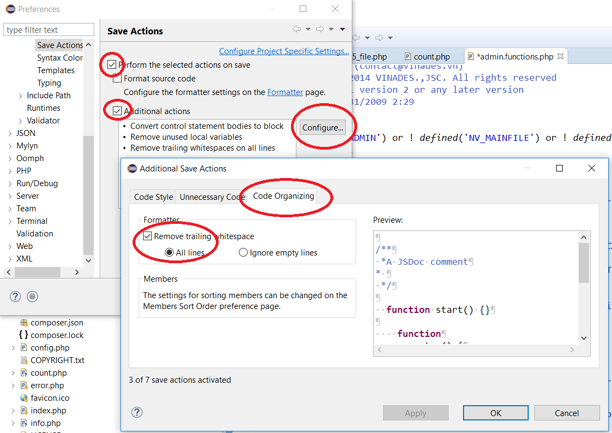

## 7. Cấu hình cho CSS

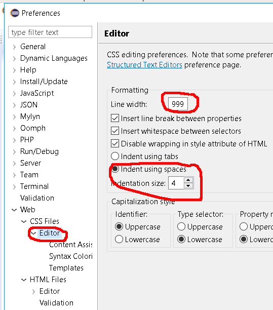

## 8. Cấu hình cho html

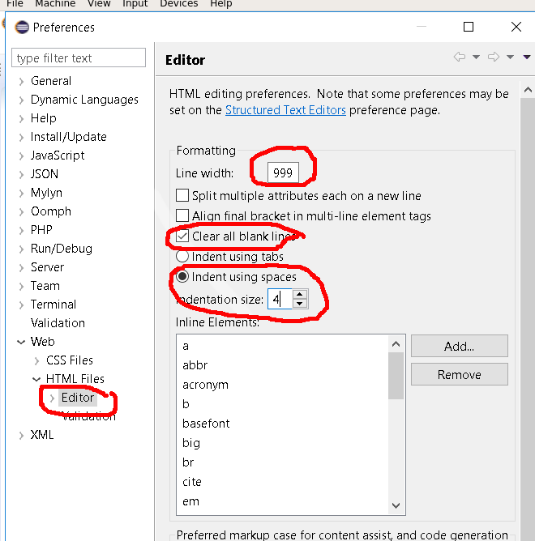

Xóa hai thẻ mặc định `td` và `th` ra khỏi danh sách *inline elements* 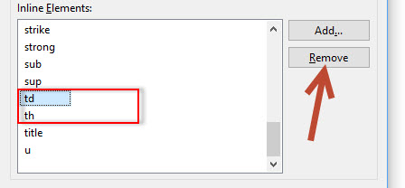

Các thẻ cần remove:

- td
- th
- input

## 9. add FTP support to Eclipse

Chức năng này mặc định chưa có trong Eclipse trên windows, bạn cần cài đặt nó theo các bước sau:

1.  Go to 'Help' -\> 'Install New Software' (in older Eclipses, this is called something a bit different)
2.  In the 'Work with:' drop-down, select your version's plugin release site. Example: for oxygenr, this is: Oxygen - [http://download.eclipse.org/releases/oxygen](http://download.eclipse.org/releases/oxygen)
3.  In the filter field, type 'remote'.
4.  Check the box next to 'Remote System Explorer End-User Runtime'
5.  Click 'Next', and accept the terms. It should now download and install.
6.  After install, Eclipse may want to restart.

Using it, in Eclipse:

1.  Window -\> Open Perspective -\> (perhaps select 'Other') -\> Remote System Explorer
2.  File -\> New -\> Other -\> Remote System Explorer (folder) -\> Connection (or type Connection into the filter field)
3.  Choose FTP from the 'Select Remote System Type' panel.
4.  Fill in your FTP host info in the next panel (username and password come later).
5.  In the Remote Systems panel, right-click the hostname and click 'connect'.
6.  Enter username + password and you're good!
7.  Well, not exactly 'good'. The RSE system is fairly unusual, but you're connected.
8.  And you're one smart cookie! You'll figure out the rest.

Tham khảo: [https://mynukeviet.net/chu-de/su-dung-cong-cu-eclipse-trong-lap-trinh-php/](https://mynukeviet.net/chu-de/su-dung-cong-cu-eclipse-trong-lap-trinh-php/)

## 10. Một số phím tắt thông dụng

- `Ctrl + Alt + Up` nhân đôi đoạn được chọn hoặc dòng hiện tại lên trên.
- `Ctrl + Alt + Down` nhân đôi đoạn được chọn hoặc dòng hiện tại xuống dưới.
- `Ctrl + Shift + Y` lowercase nội dung chọn
- `Ctrl + Shift + X` uppercase nội dung chọn
- `Ctrl + Alt + J` tạo document cho hàm, class

## 11. Cài đặt AnyEdit Tools để tự động định dạng file

AnyEdit Tools là plugin có chức năng tự động định dạng các file khi lưu ví dụ như:

- Tự động xóa ký tự trống bên phải
- Tự động tạo 1 dòng trống cuối file
- Tự chuyển CRLF sang LF
- Tự chuyển Tab sang space
- ....

Hướng dẫn cài đặt:

1.  Vào Eclipse Marketplace từ menu help như ảnh 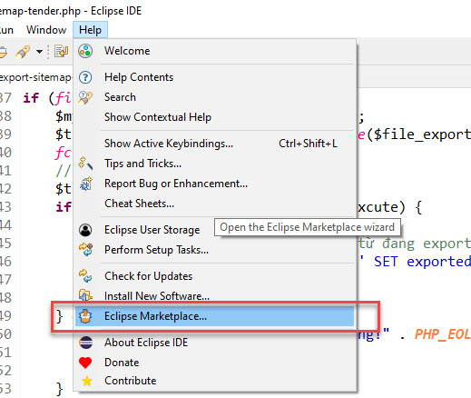
2.  Tìm Anyedit và cài đặt như ảnh 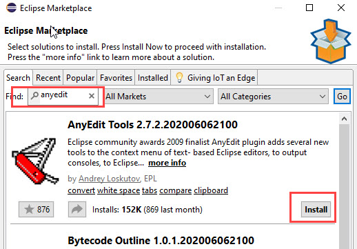

**Cấu hình:** Vào menu Window =\> Preferences chỉnh như hai ảnh sau:

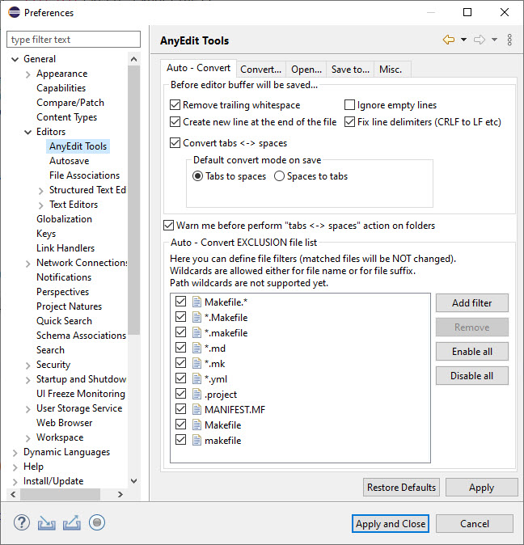 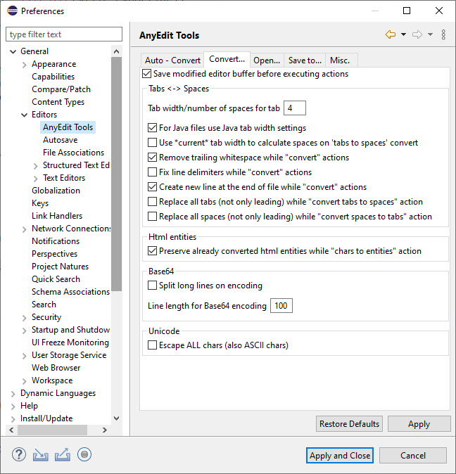

## 12. eclipse backup project explorer

\- Cần backup thư mục workspace/.metadata/.plugins/org.eclipse.core.resources

## 13. Tự động gợi ý class CSS

Bạn cài Eclipse WTP WebResources [https://github.com/angelozerr/eclipse-wtp-webresources](https://github.com/angelozerr/eclipse-wtp-webresources) để có tính năng này. Xem thêm tính năng tại [https://github.com/angelozerr/eclipse-wtp-webresources/wiki/CSS-Features](https://github.com/angelozerr/eclipse-wtp-webresources/wiki/CSS-Features)

> Lưu ý: Theo thông báo của tác giả đây là plugin ổn định, đã dừng phát triển. Tác giả đang tích hợp từng bước nó vào WTP HTML (có sẵn trong Eclipse Web Javascript Developer Tools) tuy nhiên đến thời điểm hiện tại (bản 2021-06 R) nó vẫn chưa khả dụng, vì vậy plugin này vẫn cần thiết.

Cài đặt theo hướng dẫn ở [https://github.com/angelozerr/eclipse-wtp-webresources/wiki/Installation-Update-Site](https://github.com/angelozerr/eclipse-wtp-webresources/wiki/Installation-Update-Site) hoặc như ảnh sau

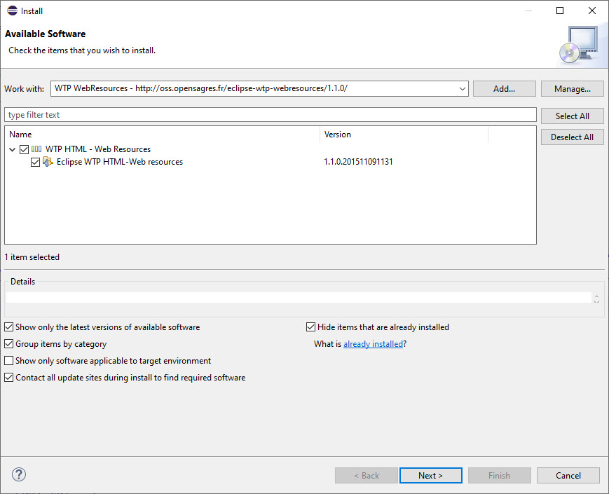

Link [http://oss.opensagres.fr/eclipse-wtp-webresources/1.1.0/](http://oss.opensagres.fr/eclipse-wtp-webresources/1.1.0/)

Sau khi cài đặt bạn chỉnh như cấu hình sau và khởi động lại Eclipse để có thể gợi ý class

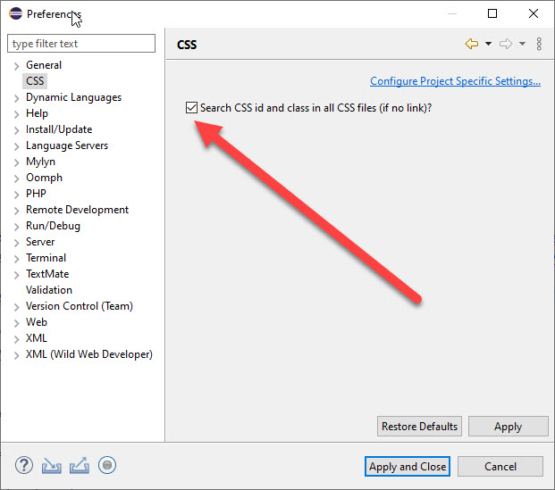 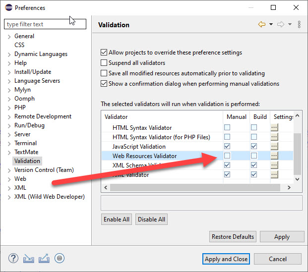

## 14. Một số snippet cho PHP

Bạn tải về file này [templates-php.zip](/images/programming/nvtools/templates-php.zip) giải nén được file templates-php.xml. Mở Eclipse vào Window =\> Preferences =\> PHP =\> Editor =\> Templates. Nhấp nút import và chọn file xml vừa rồi để nhập.

Danh sách và mô tả các snippet này

| Khóa | Mô tả |
|----|----|
| `nv_C` | Nhập nhanh biến `$nv_Cache->` |
| `nv_R` | Nhập nhanh biến `$nv_Request->` |
| nv4GetUsersFromIds | Lấy danh sách thành viên từ một mảng userid |
| nv5smartyRegisterFunction | Xuất hàm trong PHP ra để gọi trong TPL Smarty |
| nv5smartySiteTemplate | Mẫu gọi Smarty ngoài site |
| nvdebugCmd | Debug và kết thúc trong CMD, BASH |
| nvdebugVariable | Debug biến và kết thúc trong trình duyệt |
| nvdebugVariableIP | Debug biến và kết thúc nếu IP cố định nào đó |
| nvdebugVariableToFile | Ghi nội dung biến ra file debug.log ở thư mục gốc để xem lỗi |
| nvdetectSubmitPostForm | Mẫu bắt event submit một form dạng Post |
| nvfileAdminListSimple | Mẫu file dạng danh sách, tìm kiếm đơn giản trong quản trị |
| nvgenPageAdmin | Xuất biến phân trang cho TPL |
| nvpdoFetchAllCache | Mẫu lấy tất cả các rows của bảng và cache kết quả |
| nvpdoFetchList | Truy vấn CSDL và lấy ra dạng rows |
| nvpdoFetchOneMultiLang | Lấy một row trong CSDL đa ngôn ngữ |
| nvpdoInsertIDSimple | Mẫu lưu vào CSDL và trả về ID mới lưu đơn giản |
| nvpdoInsertSimple | Mẫu chèn vào CSDL đơn giản, chạy trực tiếp query |
| nvsqlSearchAdminSimple | Mẫu query lấy row có tìm kiếm trong quản trị |
| nvtplAdmin | Mẫu gọi Xtemplate trong quản trị module |
| nvtplParseErrorVar | Xuất Xtemplate biến lỗi \$error |
| nvtplPostAction | Xuất biến FORM_ACTION cho Post Form |
| nvtplSearchGetVars | Xuất các biến cần thiết cho một form tìm kiếm dạng GET |

## 15. Một số snippet cho HTML+JS

Bạn tải về file này [templates-html-tpl-js.zip](/images/programming/nvtools/templates-html-tpl-js.zip) giải nén được file templates-html-tpl-js.xml. Mở Eclipse vào Window =\> Preferences =\> Web =\> HTML Files =\> Editor =\> Templates. Nhấp nút import và chọn file xml vừa rồi để nhập.

Danh sách và mô tả các snippet này

| Khóa | Mô tả |
|----|----|
| nv5smartyForeach | Mẫu vòng lặp foreach của Smarty |
| nv5smartyIfElse | Mẫu If - Else của Smarty |
| nv5smartyKeepSourceFormat | Thẻ giữ nguyên định dạng mã nguồn, không phân tích các biến |
| nvformContentTemplate | Mẫu template cho một form thêm/sửa nội dung |
| nvjsanimateToDiv | Cuộn trang đến vị trí thẻ DIV |
| nvjsclickevent | Event khi ấn chuột vào 1 thành phần nào đó |
| nvjsloaded | Windows event loaded |
| nvjsready | Document ready |
| nvmodal3 | Cấu trúc Modal của Bootstrap 3 |
