Hướng dẫn này viết cho phiên bản 2023-06. Bạn có thể tìm các hướng dẫn cho phiên bản khác [ở đây](/programming/nvtools/eclipse)

## 1. Tải về và cài đặt

- Cài đặt Java nếu chưa có [https://www.oracle.com/java/technologies/downloads/](https://www.oracle.com/java/technologies/downloads/)
- Tải về tại [https://www.eclipse.org/downloads/packages/release/2023-06/r/eclipse-ide-php-developers](https://www.eclipse.org/downloads/packages/release/2023-06/r/eclipse-ide-php-developers)
- Việc cài đặt diễn ra đơn giản như các phần mềm thông thường

## 2. Thiết lập EOL của các file

Vào `Window / Preferences / General / Workspace` chỉnh như ảnh sau 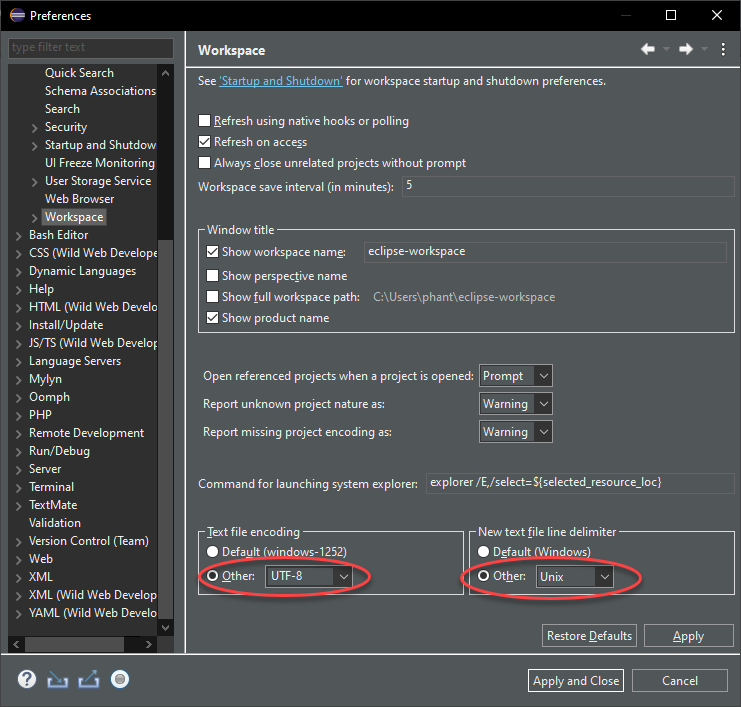

## 3. Thêm các định dạng cần thiết

NukeViet dùng Xtemplate hoặc Smarty, định dạng file của nó là .tpl (thực chất là HTML). Eclipse mặc định không nhận định dạng này. Cần cấu hình để nó nhận thành dạng html bằng cách

**Bước 1:** Vào `Window / Preferences / General / Content Types`, tại mục `Content types` chọn `Text / Wild Web Developers supported web dev file / HTML` ấn nút Add và thêm \*.tpl như ảnh 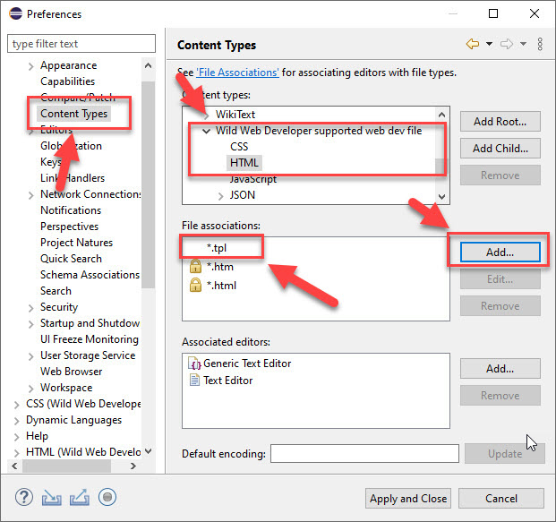

**Bước 2:** Vào `Window / Preferences / General / Editors / File Associations` ấn nút Add 1 thêm \*.tpl sau đó ấn nút Add 2 chọn HTML Editor sẽ được như ảnh 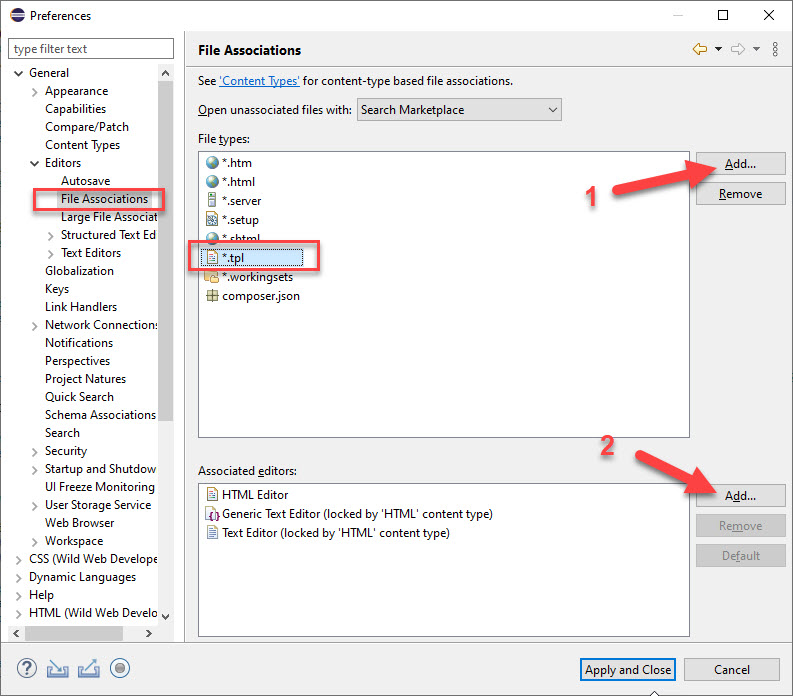

Sau khi thêm như trên bạn mở 1 file tpl Eclipse sẽ nhận diện giống như mở một file html.

**Chú ý:** Tại bước 1 mục `Content types` có một giá trị HTML ngay trong Text, bạn lưu ý chọn đúng `Text / Wild Web Developers supported web dev file / HTML` thay vì `Text / HTML`. Nếu nhầm lẫn eclipse vẫn mở file tpl lên bình thường nhưng các mã js trong tpl sẽ không có syntax highlight

## 4. Thay đổi font, kích thước chữ, màu sắc

Font, kích thước chữ ở đây là code khi bạn soạn thảo, không phải chữ của các menu hệ thống. Đi đến `General / Appearance / Color and Fonts`. Chọn đối tượng định dạng (1), chọn Edit (2) để thay đổi font và kích thuớc chữ, nhấn OK (3) để áp dụng. Bạn có thể chọn các đối tượng hiển thị khác nhau ở phần (1), sau đó thay đổi tuơng tự. 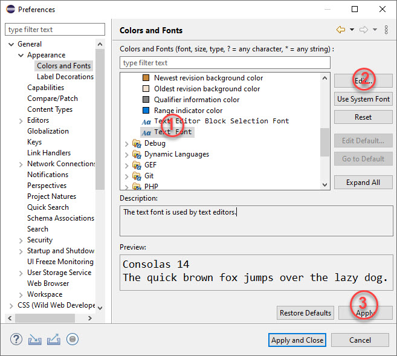

## 5. Cấu hình định dạng code

### 5.1. PHP

Vào `Window / Preferences / PHP / Editor / Save Actions` cấu hình như ảnh 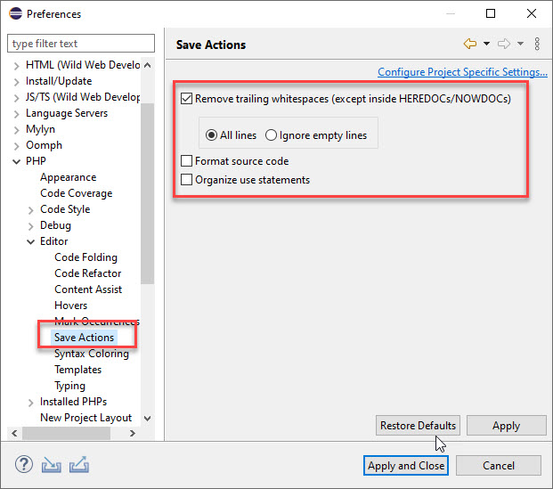

Vào `Window / Preferences / PHP / Code Style / Formatter` ấn nút Import nhập từ file NukeViet.xml (download [nukeviet.eclipse.2020.zip](/images/programming/nvtools/nukeviet.eclipse.2020.zip) và giải nén). Kết quả được như ảnh 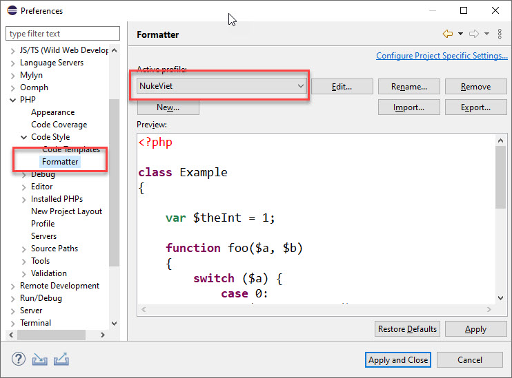

Nhấn Ctrl + F để định dạng tự động cho nội dung tập tin đang mở. Hoặc định dạng cho toàn bộ tập tin (PHP) trong một thư mục bằng cách Click phải chuột lên thư mục (ở cửa sổ PHP Explorer), chọn Source, chọn Format.

### 5.2. HTML

Vào `Window / Preferences / Web / HTML Files / Editor` cấu hình như ảnh 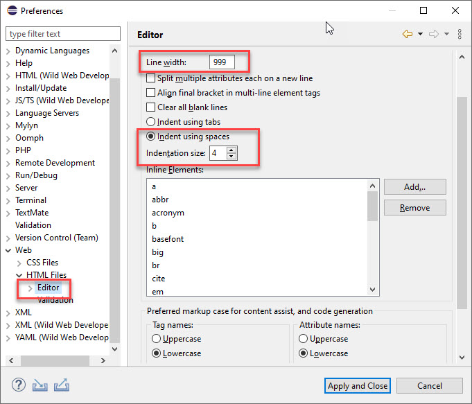

Xóa các thẻ ra khỏi danh sách *inline elements*:

- td
- th
- input

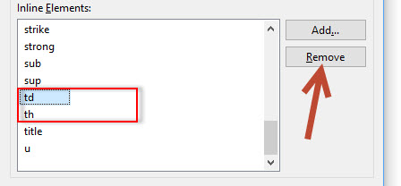

### 5.3. CSS

Vào `Window / Preferences / Web / CSS Files / Editor` cấu hình như ảnh 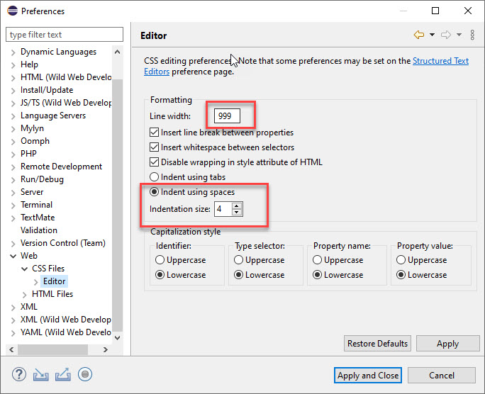

## 6. Cài đặt AnyEdit Tools để tự động định dạng file

AnyEdit Tools là plugin có chức năng tự động định dạng các file khi lưu ví dụ như:

- Tự động xóa ký tự trống bên phải
- Tự động tạo 1 dòng trống cuối file
- Tự chuyển CRLF sang LF
- Tự chuyển Tab sang space
- ....

Hướng dẫn cài đặt:

1.  Vào Eclipse Marketplace từ menu help như ảnh 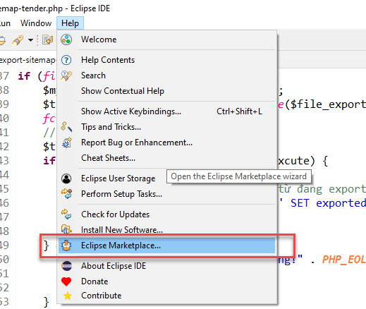
2.  Tìm Anyedit và cài đặt như ảnh 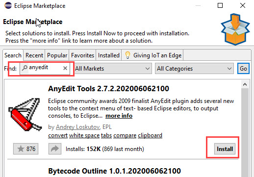

**Cấu hình:** Vào menu Window =\> Preferences chỉnh như hai ảnh sau:

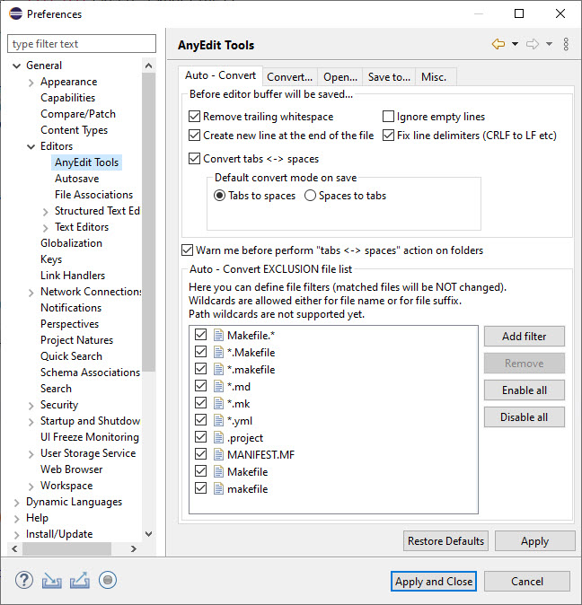 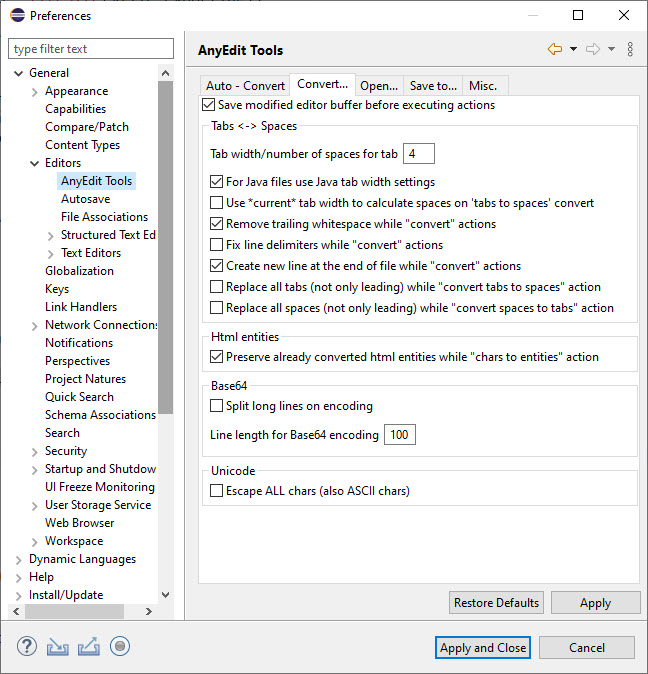

## 7. Một số snippet cho PHP

Bạn tải về file này [templates-php.zip](/images/programming/nvtools/eclipse/templates-php.zip) giải nén được file templates-php.xml. Mở Eclipse vào Window =\> Preferences =\> PHP =\> Editor =\> Templates. Nhấp nút import và chọn file xml vừa rồi để nhập.

Danh sách và mô tả các snippet này

| Khóa | Mô tả |
|----|----|
| `nv_C` | Nhập nhanh biến `$nv_Cache->` |
| `nv_R` | Nhập nhanh biến `$nv_Request->` |
| nv4GetUsersFromIds | Lấy danh sách thành viên từ một mảng userid |
| nv5smartyRegisterFunction | Xuất hàm trong PHP ra để gọi trong TPL Smarty |
| nv5smartySiteTemplate | Mẫu gọi Smarty ngoài site |
| nvdebugCmd | Debug và kết thúc trong CMD, BASH |
| nvdebugVariable | Debug biến và kết thúc trong trình duyệt |
| nvdebugVariableIP | Debug biến và kết thúc nếu IP cố định nào đó |
| nvdebugVariableToFile | Ghi nội dung biến ra file debug.log ở thư mục gốc để xem lỗi |
| nvdetectSubmitPostForm | Mẫu bắt event submit một form dạng Post |
| nvfileAdminListSimple | Mẫu file dạng danh sách, tìm kiếm đơn giản trong quản trị |
| nvgenPageAdmin | Xuất biến phân trang cho TPL |
| nvpdoFetchAllCache | Mẫu lấy tất cả các rows của bảng và cache kết quả |
| nvpdoFetchList | Truy vấn CSDL và lấy ra dạng rows |
| nvpdoFetchOneMultiLang | Lấy một row trong CSDL đa ngôn ngữ |
| nvpdoInsertIDSimple | Mẫu lưu vào CSDL và trả về ID mới lưu đơn giản |
| nvpdoInsertSimple | Mẫu chèn vào CSDL đơn giản, chạy trực tiếp query |
| nvsqlSearchAdminSimple | Mẫu query lấy row có tìm kiếm trong quản trị |
| nvtplAdmin | Mẫu gọi Xtemplate trong quản trị module |
| nvtplParseErrorVar | Xuất Xtemplate biến lỗi \$error |
| nvtplPostAction | Xuất biến FORM_ACTION cho Post Form |
| nvtplSearchGetVars | Xuất các biến cần thiết cho một form tìm kiếm dạng GET |

## 8. Một số snippet cho HTML+JS

Bạn tải về file này [templates-html-tpl-js.zip](/images/programming/nvtools/templates-html-tpl-js.zip) giải nén được file templates-html-tpl-js.xml. Mở Eclipse vào Window =\> Preferences =\> Web =\> HTML Files =\> Editor =\> Templates. Nhấp nút import và chọn file xml vừa rồi để nhập.

Danh sách và mô tả các snippet này

| Khóa | Mô tả |
|----|----|
| nv5smartyForeach | Mẫu vòng lặp foreach của Smarty |
| nv5smartyIfElse | Mẫu If - Else của Smarty |
| nv5smartyKeepSourceFormat | Thẻ giữ nguyên định dạng mã nguồn, không phân tích các biến |
| nvformContentTemplate | Mẫu template cho một form thêm/sửa nội dung |
| nvjsanimateToDiv | Cuộn trang đến vị trí thẻ DIV |
| nvjsclickevent | Event khi ấn chuột vào 1 thành phần nào đó |
| nvjsloaded | Windows event loaded |
| nvjsready | Document ready |
| nvmodal3 | Cấu trúc Modal của Bootstrap 3 |

## 9. Một số phím tắt thông dụng

- `Ctrl + Alt + Up` nhân đôi đoạn được chọn hoặc dòng hiện tại lên trên.
- `Ctrl + Alt + Down` nhân đôi đoạn được chọn hoặc dòng hiện tại xuống dưới.
- `Ctrl + Shift + Y` lowercase nội dung chọn
- `Ctrl + Shift + X` uppercase nội dung chọn
- `Ctrl + Alt + J` tạo document cho hàm, class

## 10. Một số plugin hữu ích

1.  [Bash Editor](https://marketplace.eclipse.org/content/bash-editor) Viết bash shell
