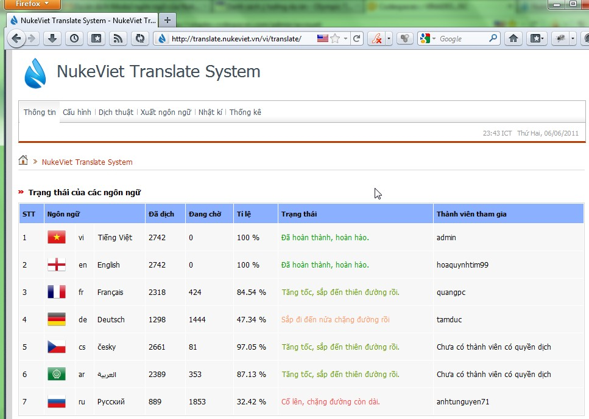
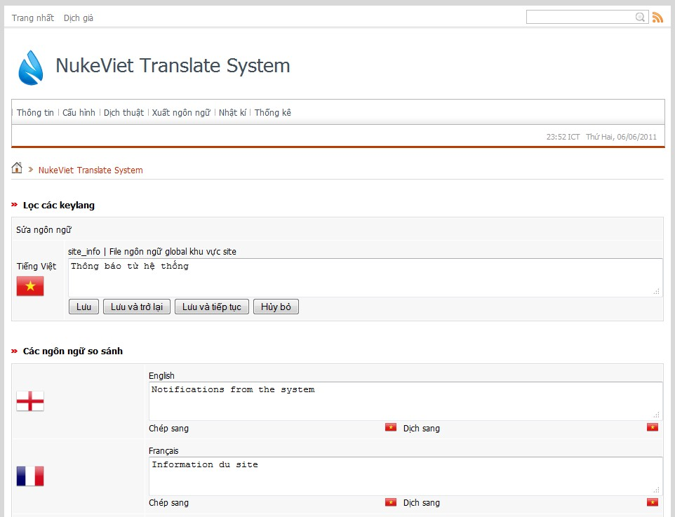

## Bộ công cụ dịch thuật trong Admin Control Panel của NukeViet

Xem: [Công cụ quản lý Ngôn ngữ của NukeViet](/nukeviet/admin/language)

## Bộ công cụ dịch thuật tập trung

Ngoài bộ công cụ dịch thuật có sẵn trong Admin Control Panel của NukeViet, từ tháng 6/2011, Ban Quản Trị NukeViet đã đưa trung tâm dịch thuật của NukeViet vào hoạt động tại địa chỉ: [http://translate.nukeviet.vn](http://translate.nukeviet.vn) để sử dụng sức mạnh cộng đồng trong việc tham gia cộng tác đẩy nhanh tiến trình dịch thuật cho NukeViet 3.  Thành viên muốn là người dịch thuật một ngôn ngữ cho NukeViet CMS cần dịch tối thiểu 10% số từ khóa (langkey). Sau đó đóng gói và gửi cho Ban Quản Trị NukeViet gói ngôn ngữ mà các bạn đã dịch về địa chỉ email: admin@nukeviet.vn

Ban Quản Trị NukeViet sẽ khởi tạo ngôn ngữ mới mà các bạn đề nghị (nếu nó chưa có) hoặc cấp quyền cho bạn tham gia dịch ngôn ngữ đã có. Sau khi được cấp quyền, bạn có thể tham gia dịch trực tiếp trên [http://Translate.NukeViet.vn](http://Translate.NukeViet.vn) cho gói ngôn ngữ mới nhất của NukeViet.  Người dịch trên 50% 1 ngôn ngữ sẽ là dịch giả chính thức cho ngôn ngữ đó. Những người còn lại là đồng dịch giả.

Xem thêm hướng dẫn tham gia dịch tại đây: [https://nukeviet.vn/vi/forum/Huong-dan-xay-dung-goi-ngon-ngu-cho-NukeViet-3-0-t10852/](https://nukeviet.vn/vi/forum/Huong-dan-xay-dung-goi-ngon-ngu-cho-NukeViet-3-0-t10852/)

## Xem thêm

- [Dịch thuật ngôn ngữ giao diện cho hệ thống (dịch thuật thủ công)](/programming/translate)
- [Chọn giải pháp đa ngôn ngữ (dành cho lập trình viên)](/programming/multi_language).
