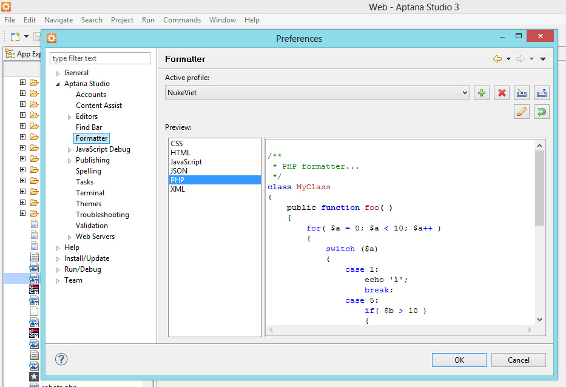
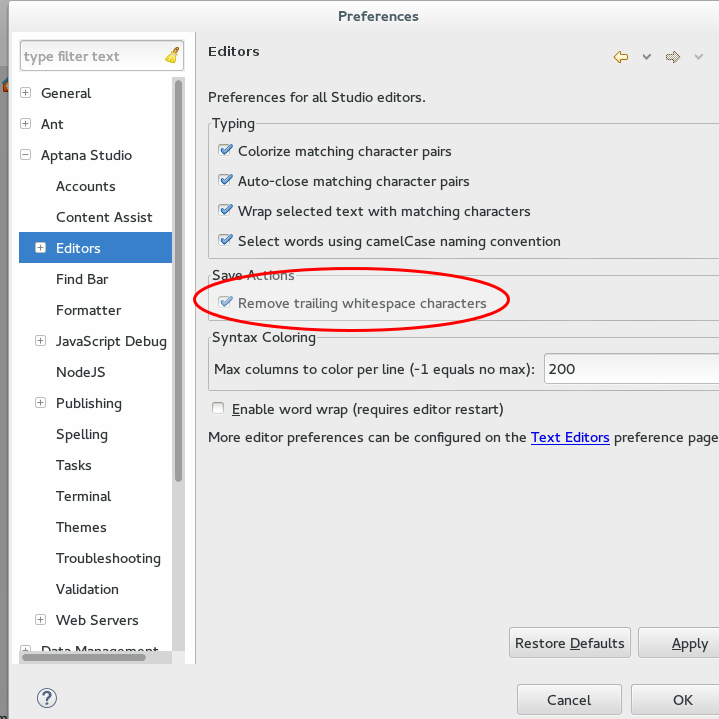
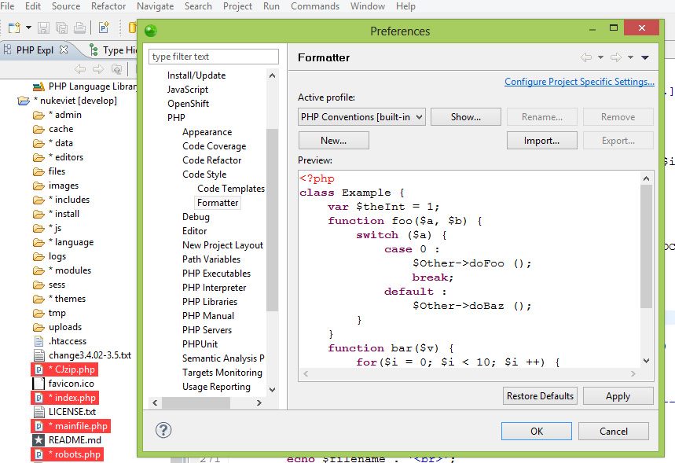
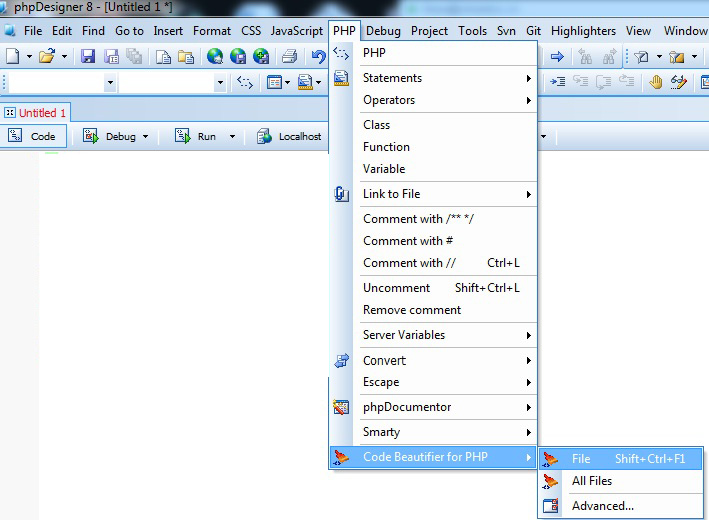
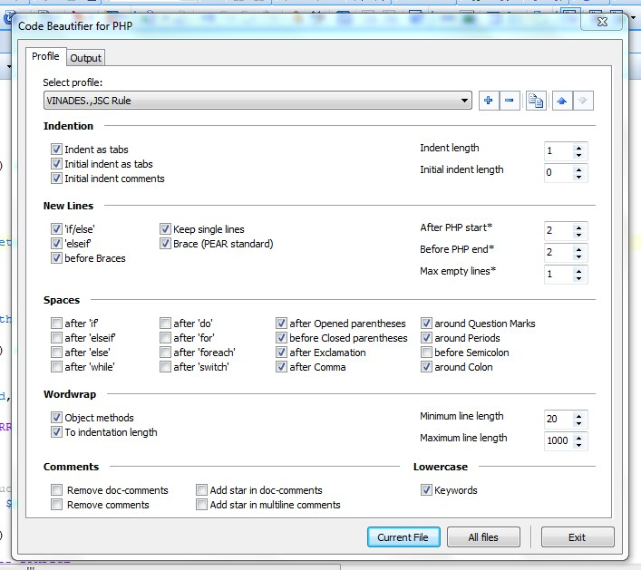

- Tên file đặt bằng tiếng Anh.
- Đặt tên file theo chức năng của file (ngoại trừ các file cố định) đó ví dụ file xử lý ảnh ta đặt image.php, file quản lý bình luận ta đặt comment.php.
- Tên file chỉ nên đặt bằng chữ cái thường, chỉ bao gồm số, chữ cái và dấu \_ (gạch dưới), tên file bắt đầu bằng chữ cái.

# Đối với các file PHP

- Các file PHP phải có định dạng UNIX (UNIX format).
- Các file PHP thông thường được mã hóa dạng ANSI, các file PHP có chứa ngôn ngữ UTF-8 được mã hóa dạng UTF-8 without BOM hoặc UTF-8.

File PHP mở đầu bằng

``` php
<?php
```

và kết thúc bằng (Kết thúc ?\> của file php nên bỏ trong các file thuần php)

``` php
?>
```

Giữa chúng phân cách với nội dung bằng ít nhất một dòng trống Ví dụ

``` text
<?php

// Some code here

?>
```

Không được viết

``` php
<?php
// Some code here
?>
```

## Mở đầu mỗi file

Sau \<?php, mỗi file cần được bắt đầu bằng mô tả theo dạng

``` php
<?php

/**
 * @Project NUKEVIET 3.x 
 * @Author VINADES.,JSC (contact@vinades.vn)
 * @Copyright (C) 2010 VINADES.,JSC. All rights reserved
 * @License GNU/GPL version 2 or any later version
 * @Createdate  12/3/2012, 1:2
 */

// Some code here

?>
```

Trong đó:

- Sau Project là tên dự án.
- Sau Author là thông tin về tên tác giả, email.
- Sau Copyright là thông tin bản quyền.
- Sau creatdate là thông tin về thời gian.

### Quy định riêng đối với file ngôn ngữ

``` php
<?php

/**
* @Project NUKEVIET 3.0
* @Author VINADES.,JSC (contact@vinades.vn)
* @Copyright (C) 2010 VINADES.,JSC. All rights reserved
* @Language Tiếng Việt
* @License CC BY-SA (http://creativecommons.org/licenses/by-sa/4.0/)
* @Createdate Jul 06, 2011, 04:38:01 PM
*/

// Some code here

?>
```

Ta thêm thông tin ngôn ngữ Language bên dưới thông tin về bản quyền.

## Khoảng cách giữa các dòng

Các khối code không liên quan đến nhau nên được phân cách bởi một dòng trống và chỉ phân cách bởi một dòng duy nhất. Ví dụ:

``` php
if( ! defined( 'NV_IS_FILE_LANG' ) ) die( 'Stop!!!' );

$page_title = $lang_module['countries'];

$array_lang_setup = array();
$array_lang_setup[] = array( '', $lang_module['site_lang'] );

$sql = "SELECT `lang` FROM `" . $db_config['prefix'] . "_setup_language` WHERE `setup`=1";
$result = $db->sql_query( $sql );

while( list( $lang_i ) = $db->sql_fetchrow( $result ) )
{
    if( in_array( $lang_i, $global_config['allow_sitelangs'] ) )
    {
        $array_lang_setup[$lang_i] = array( $lang_i, $language_array[$lang_i]['name'] );
    }
}
```

Không nên viết

``` php
if( ! defined( 'NV_IS_FILE_LANG' ) ) die( 'Stop!!!' );
$page_title = $lang_module['countries'];
$array_lang_setup = array();
$array_lang_setup[] = array( '', $lang_module['site_lang'] );
$sql = "SELECT `lang` FROM `" . $db_config['prefix'] . "_setup_language` WHERE `setup`=1";
$result = $db->sql_query( $sql );
while( list( $lang_i ) = $db->sql_fetchrow( $result ) )
{
    if( in_array( $lang_i, $global_config['allow_sitelangs'] ) )
    {
        $array_lang_setup[$lang_i] = array( $lang_i, $language_array[$lang_i]['name'] );
    }
}
```

Thụt đầu dòng bằng tab, không được thụt đầu dòng bằng kí tự trống hoặc bỏ qua thụt đầu dòng Ví dụ:

``` php
while( list( $lang_i ) = $db->sql_fetchrow( $result ) )
{
    if( in_array( $lang_i, $global_config['allow_sitelangs'] ) )
    {
        $array_lang_setup[$lang_i] = array( $lang_i, $language_array[$lang_i]['name'] );
    }
}
```

Không viết:

``` php
while( list( $lang_i ) = $db->sql_fetchrow( $result ) )
{
if( in_array( $lang_i, $global_config['allow_sitelangs'] ) )
{
$array_lang_setup[$lang_i] = array( $lang_i, $language_array[$lang_i]['name'] );
}
}
```

## Khoảng cách giữa các kí tự

- Đăt trước và sau kí tự = dấu cách
- Đặt sau ( một dấu cách
- Đặt sau dấu , một dấu cách
- Sau if, else, while, foreach, for.. nên bắt đầu ngay với ( không nên đặt dấu cách

## Đặt tên biến

- Các biến tạm nên bắt đầu bằng \_ ví dụ \$\_tmp, \$\_title.
- Tên biến không quá ngắn cũng không quá dài, mô tả đúng chức năng của biến
  ``` php
  $title, $module_content
  ```
- Sử dụng cùng tên biến đối với những câu lệnh cùng chức năng (nếu có thể) ví dụ
  - Truy vấn sql dùng
    ``` php
    $sql = "SELECT COUNT(*) FROM `" . NV_AUTHORS_GLOBALTABLE . "` WHERE `admin_id`=" . $userid;
    ```
  - Hay
    ``` php
    $result = $db->sql_query( $sql );
    ```

    ``` php
    $row = $db->sql_fetchrow( $result );
    ```

## Array

Nếu mảng ngắn từ một đến hai phần tử ta viết

``` php
$array = array( 'id' => $id, 'title' => $title );
```

Nếu dài hơn ta phải viết

``` php
$array = array( 
    'id' => $id, 
    'title' => $title 
);
```

Đối với mảng nhiều chiều ta viết

``` php
$array = array( 
    'id' => array(
        'id' => $_id,
        'content' => array(
            'sub' => $sub,
            'cat' => $cat
        ),
    ), 
    'title' => $title 
);
```

## if, else, while, for...

Nếu sau if chỉ có một câu lệnh ngắn ta viết câu lệnh cùng một dòng với if

``` php
if( $i > 0 ) die( 'Error!!!' );
```

Nếu sau if có nhiều hơn một câu lệnh, câu lệnh quá dài hoặc sau đó có else ta phải xuống hàng bởi \{

``` php
if( $title > 200 )
{
    echo( 'Tieu de qua lon' );
}
else
{
    echo( 'Tieu de hop le' );
}
```

Không được để kí tự \{ và \} ngang hàng với if, else, for, while:

``` php
if( $title > 200 ){
    echo( 'Tieu de qua lon' );
}else{
    echo( 'Tieu de hop le' );
}

while( $i ){
    $title .= 'title';
    -- $i;
}
```

## function, class

Một hàm phải có mô tả bên trên

``` php
/**
 * nv_is_blocker_proxy()
 *
 * @param string $is_proxy
 * @param integer $proxy_blocker
 * @return
 */
function nv_is_blocker_proxy( $is_proxy, $proxy_blocker )
{
    if( $proxy_blocker == 1 and $is_proxy == 'Strong' ) return true;
    if( $proxy_blocker == 2 and ( $is_proxy == 'Strong' || $is_proxy == 'Mild' ) ) return true;
    if( $proxy_blocker == 3 and $is_proxy != 'No' ) return true;
    
    return false;
}
```

tương tự một lớp cũng cần có mô tả

``` php
/**
 * NVbuffer
 * 
 * @package NukeViet
 * @author VINADES.,JSC
 * @copyright 2012
 * @version 3.3
 * @access public
 */
class NVbuffer
{
    var $position = 0;
    
```

Cần hạn chế tối đa việc viết chung mã HTML, JS, CSS vào các file php.

## Ghi chú (comment)

Khi thiết kế CSDL, cần thêm ghi chú cho mỗi trường dữ liệu.

Trong tập tin code, để đúng chuẩn cần viết ghi chú ngắn gọn cho mỗi dòng bằng

``` text
//
```

và không dùng

``` text
/* */
```

hay

``` text
#
```

Ví dụ: Dùng

``` text
// Ghi chú
```

Không dùng

``` text
# Ghi chú
```

Không dùng

``` text
/* Ghi chú */
```

# Đối với các file JS

Áp dụng chuẩn của các file php

Bắt đầu bởi mô tả:

``` javascript
/* *
 * @Project NUKEVIET 3.0
 * @Author VINADES., JSC ( contact@vinades.vn )
 * @Copyright ( C ) 2010 VINADES., JSC. All rights reserved
 * @License GNU/GPL version 2 or any later version
 * @Createdate 1 - 31 - 2010 5 : 12
 */
```

Đặt \{ ngay sau các lệnh.

``` javascript
if( a == 0 ) {
    a = 1;
}
```

Đặt else if ngay sau kí tự \}

``` javascript
if( a == 0 ){
    a = 1;
} else if ( a == -1 ) {
    break;
}
```

Các file javascript trong thư mục `/modules/ten-module/js/` không nên dùng thư viện Jquery mà chỉ được viết bởi các hàm, thư viện có sẵn của NukeViet.

# Đối với các file TPL

Nếu không có trường hợp đặc biệt nên dùng duy nhất một tên main để dánh dấu khối

``` html
<!-- BEGIN: main ->
<!-- END: main ->
```

Dùng loop để đánh dấu những khối lặp lại

``` html
<!-- BEGIN: main ->
<ul>
    <!-- BEGIN: loop ->
    <li>The dinh dang kieu danh sach</li>
    <!-- END: loop ->
</ul>
<!-- END: main ->
```

> Các file TPL thực chất chứa mã HTML, JS tương tự các file .html, cần dùng tab để đánh dấu các thẻ cha con:

``` html
<!-- BEGIN: main -->
<div class="box-border">
    <div class="page-header">
        <h2>{CONTENT.title}</h2>
        <span class="small">{LANG.add_time}: {CONTENT.add_time}</span>
        <div class="clear">
        </div>
    </div>
    <div class="content-box">
        <div class="content-page">
            {CONTENT.bodytext}
        </div>
        <!-- BEGIN: other -->
            <div class="other-news" style="border-top: 1px solid #d8d8d8;">
                <ul style="margin:10px;">
                    <!-- BEGIN: loop -->
                    <li>
                        <a title="{OTHER.title}" href="{OTHER.link}">{OTHER.title}</a>
                    </li>
                    <!-- END: loop -->
                </ul>
            </div>
        <!-- END: other -->
    </div>
</div>
<!-- END: main -->
```

> Các thẻ có nội dung ngắn nên để một dòng

``` html
<span>{DATA.infomation}</span>
```

> Hạn chế tối đa viết trực tiếp CSS vào thẻ html.

# Đối với file CSS

Định dạng theo kiểu nhiều hàng.

``` css
.banner_plan {
    background: #FFF;
    border: 1px solid #DADADA;
    margin-bottom: 10px;
    padding: 5px
}
```

# Hướng dẫn định dạng php tự động

## Sử dụng Aptana Studio 3

Để định dạng code NukeViet trên Aptana Studio 3 bạn download file

[fomat_aptana.zip](/images/programming/fomat_aptana.zip) cho Aptana Studio 3.4

[fomat_aptana_3.6.zip](/images/programming/fomat_aptana_3.6.zip) cho Aptana Studio 3.6

sau đó giải nén được file fomat_php.xml Import file định dạng

Vào menu Window -\> Preferences -\> Aptana-\> Code Style -\> Formatter, kích vào nút Imprort và chọn tới file fomat_php.xml vừa giải nén



Cấu hình thêm để xóa các dòng trắng: 

Sau khi lưu cấu hình, bạn mở từng file cần định dạng và nhấn tổ hợp phím Ctrl + Shift + F

## Sử dụng Zend Studio 9

Để định dạng code NukeViet trên Zend Studio 9 bạn download file [fomat_php.zip](/images/programming/fomat_php.zip) sau đó giải nén được file fomat_php.xml Import file định dạng

Vào menu Window -\> Preferences -\> PHP -\> Code Style -\> Formatter, kích vào nút Imprort và chọn tới file fomat_php.xml vừa giải nén



Sau khi lưu cấu hình, bạn mở từng file cần định dạng và nhấn tổ hợp phím Ctrl + Shift + F

## Sử dụng phpDesigner 8

Để định dạng code NukeViet trên phpDesigner 8 bạn cầu hình fomat file php như sau: 

Sau đó clich vào menu Advanced... Cấu hình theo thông số sau



Sau khi lưu cấu hình, bạn mở từng file cần định dạng và nhấn tổ hợp phím Shift + Ctrl + F1
