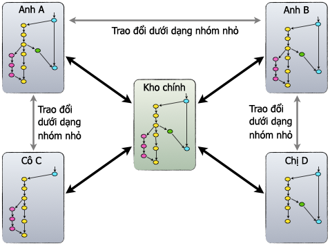

## Git là gì?

Git là một phần mềm [VCS](/programming/vcs) dùng để quản lý và kiểm tra các phiên bản mã nguồn khác nhau trong quá trình phát triển mã nguồn. Git là thế hệ mới nhất của các phần mềm này. Từ phiên bản NukeViet 3.5, nhóm phát triển NukeViet sẽ sử dụng git thay thế cho [Subversion](/programming/vcs/subversion) (SVN) đang được sử dụng để quản lý code của NukeViet trên Google code trước đây. Mặc dù Google code cũng đã hỗ trợ Git từ tháng 7 năm 2011, tuy nhiên chúng ta sẽ lựa chọn Github làm nơi lưu trữ code mới cho NukeViet vì tính chuyên nghiệp của Github đối với Git.

## Tại sao sử dụng Git?

Git có nhiều ưu điểm, đặc biệt nó đã thay đổi cách các lập trình viên chia tách và nhập các nhánh phần mềm. Trong khi với svn, việc này luôn là ác mộng vì các xung đột trong quá trình tách/nhập, còn với Git việc này quá dễ dàng.

Bài viết này sẽ giải thích đầy đủ tại sao chúng ta sử dụng Git: [http://nukeviet.vn/vi/news/nhom-phat-trien/NukeViet-da-hoan-tat-ke-hoach-chuyen-doi-kho-code-sang-Github-118/](http://nukeviet.vn/vi/news/nhom-phat-trien/NukeViet-da-hoan-tat-ke-hoach-chuyen-doi-kho-code-sang-Github-118/)

## Đặc tính phi tập trung nhưng mang tính tập trung của Git

Trong khi mỗi lập trình viên đều sở hữu một kho code đầy đủ thì Git cho thiết lập một kho trung tâm thực sự, tất cả các lập trình viên đều có thể kéo (pull) các thay đổi từ đó về kho của mình và đẩy (push) các thay đổi về kho trung tâm. Tuy nhiên, bên cạnh những mối quan hệ push-pull tập trung, mỗi nhà phát triển cũng có thể kéo (pull) thay đổi từ các đồng nghiệp khác để tạo thành các nhóm nhỏ hơn.

Hình dưới đây cho thấy một dự án với 1 kho code trung tâm và 4 người, họ hình thành 3 nhóm nhỏ hơn là nhóm của Anh A - Anh B, Anh A - Chị C, Anh B - Cô D. Mỗi nhóm nhỏ này có thể phụ trách phát triển một tính năng thuộc hệ thống rồi sau đó mới đẩy về kho trung tâm. Như vậy mô hình này rất hiệu quả cho các dự án lớn. 

## Làm việc với Git trên Github

### Nguyên tắc quản lý kho code NukeViet trên Github

Xem chi tiết trong bài [Nguyên tắc quản lý kho code NukeViet trên Github](/programming/github_rule)

### Tương tác với Git thông qua Github

Git là hệ thống được sinh ra là "để dành cho linux", do đó sử dụng git trên các hệ điều hành họ Linux (Ubuntu, Fedora...) mạnh hơn rất nhiều so với các hệ điều hành khác. Nếu bạn sử dụng các hệ điều hành họ linux, bạn sẽ dễ dàng tìm thấy các tài liệu hướng dẫn cài đặt và sử dụng git, việc tương tác với Github cũng không có gì khác biệt so với các kho code git khác.

Với các hệ điều hành khác dòng Linux, để tương tác với kho code của NukeViet trên Github, chúng ta phải thông qua một phần mềm trung gian (gọi là chương trình phía client (khách) của Git). Github cũng phát hành một số phần mềm client dành cho git để làm việc riêng với Github. Gồm có:

- GitHub for Mac [http://mac.github.com/](http://mac.github.com/)
- GitHub for Windows [http://windows.github.com/](http://windows.github.com/)
- GitHub for Eclipse [http://eclipse.github.com/](http://eclipse.github.com/)
- GitHub Mobile Apps [http://mobile.github.com/](http://mobile.github.com/)

Ngoài ra nhiều ứng dụng lập trình như Aptana Studio 3, Zend Studio 9, ... cũng hỗ trợ việc kết nối trực tiếp tới kho code sử dụng Git.

### Tương tác với Git trên Eclipse

Xem chi tiết tại: [http://wiki.eclipse.org/EGit/User_Guide](http://wiki.eclipse.org/EGit/User_Guide)

##### Đối với người quản lý

### Hướng dẫn merge và xử lý lỗi conflic Pull Request trên Git

Giả sử chúng ta chưa có gì bây giờ muốn merge các pull request từ các lập trình viên. Hãy tạo một thư mục nào đó và click chuột phải vào thư mục đó chọn Git Bash. Tiếp theo đánh lệnh:

``` text
$ git init
$ git clone https://github.com/nukeviet/nukeviet.git -b develop .
```

Hai lệnh trên để thiết lập một kho mới và tải kho nukeviet về thư mục vừa tạo. Khi clone xong mặc định sẽ chọn nhánh develop. (chú ý có dấu chấm ở cuối trong câu lệnh git clone, nếu không nó sẽ tạo vào trong 1 thư mục nữa )

Bây giờ ta tiếp tục nhập lệnh sau:

``` text
$ git remote add vuthao https://github.com/vuthao/nukeviet.git
$ git fetch vuthao
$ git merge vuthao/develop
```

3 lệnh đó sẽ thực hiện việc tạo một nhánh ảo từ thành viên vuthao trên github sau đó lấy toàn bộ pull request của thành viên đó, nhập nhánh develop của vuthao vào nhánh đang làm việc của kho code hiện tại (tức nhánh develop của nukeviet).

Nếu quá trình merge tự động diễn ra thành công ta chỉ cần thực hiện lệnh

``` text
$ git push origin develop
```

Để hoàn tất việc merge pull request

Nếu merge bị conflic thì ta phải xử lý các file conflic trước, sau đó đưa vào index, commit rồi mới push lên kho code. Thứ tự thực hiện như sau.

Để xem thử conflic chỗ nào ta đánh

``` text
$ git diff
```

Khi đó các file bị conflic sẽ hiển thị đoạn code lỗi. Ta chỉ cần mở các file đó lên, chỉnh sửa đoạn code đó. Sau khi chỉnh sửa xong ta add file đó vào index bằng cách dùng lệnh

``` text
$ git add [file]
```

trong đó \[file\] là đường dẫn đến file ví dụ

``` text
$ git add modules/news/admin/content.php
```

Để xem trạng thái các file, thư mục ... dùng lệnh

``` text
$ git status
```

Để hiển thị status gọn hơn ta dùng option -s

``` text
$ git status -s
```

Sau khi đã hoàn tất xử lý conflic ... ta commit các chỉnh sửa vừa rồi:

``` text
$ git commit -m "Message"
```

Trong đó message là nội dung commit. Cuối cùng là push lên kho code.

``` text
$ git push origin develop
```

### Một số lệnh git khác

Để tạm thời bỏ qua những thay đổi trong một tập tin nhất định, không muốn tập tin đó hiển thị trong các file thay đổi sử dụng lệnh:

``` text
git update-index --assume-unchanged path_file
```

Trong NukeViet Không đưa các file sau lên kho code khi có thay đổi .htaccess data/config_global.php data/ip_files/\*.php

Sau đó, khi muốn tập tin đó hiển thị trong các file thay đổi:

``` text
git update-index --no-assume-unchanged path_file
```

Thay đổi commit message cuối

``` text
git commit -a --amend -m "My new commit message"
```

Reset project về ID trước đó

``` text
git reset --hard idcommit
```

Sau đó dùng lệnh sau để cập nhật lên kho git

``` text
fix commit: git push -f
```

fix merge conflicts in Git?

``` text
git mergetool
```

Liệt kê tất cả các file thay đổi từ id 3bf2d29 đến id b2d0398

``` text
git diff-tree -r --name-only 3bf2d29 b2d0398
```

Liệt kê tất cả các file đã xóa từ id 3bf2d29 đến id b2d0398

``` text
git diff-tree -r --name-only --diff-filter=D 3bf2d29 b2d0398
```

Zip lại các file thay đổi từ id 3bf2d29 đến id b2d0398 (không có file đã xóa)

``` text
git archive -o update1.zip HEAD $(git diff-tree -r --name-only --diff-filter=ACMRT 3bf2d29 b2d0398)
```

Ghi chú: Các option của diff-filter --diff-filter=\[ACDMRTUXB\*\]

``` text
  A Added
  C Copied
  D Deleted
  M Modified
  R Renamed
  T have their type (mode) changed
  U Unmerged
  X Unknown
  B have had their pairing Broken
* All-or-none
```

Xóa 1 nhánh trên kho code

``` text
git push origin --delete BRANCH_NAME
```

Đưa các tag được đánh dầu lên kho code

``` text
git push --tags
```

## Nguồn tham khảo

Về Git:

- Git SRM - Ebook tiếng Anh về Git: [http://git-scm.com/book/en/Getting-Started-About-Version-Control](http://git-scm.com/book/en/Getting-Started-About-Version-Control)
- Tài liệu tham khảo về Git (Tài liệu chính thức của nhà cung cấp phần mềm): [http://git-scm.com/docs](http://git-scm.com/docs)
- Git Magic (Git - Công cụ quản lý mã nguồn vạn năng, ebook tiếng Việt về Git): [http://www-cs-students.stanford.edu/~blynn/gitmagic/intl/vi/](http://www-cs-students.stanford.edu/~blynn/gitmagic/intl/vi/)
- A successful Git branching model - Mô hình phân nhánh Git: [http://nvie.com/posts/a-successful-git-branching-model/](http://nvie.com/posts/a-successful-git-branching-model/)

Về Github:

- [Tham khảo về Git - Bản dịch tiếng Việt](http://gitref.dragula.viettug.org) - Tài liệu tham khảo trực tuyến cho Git được viết bởi đội phát triển GitHub. Bản gốc tiếng Anh có tại địa chỉ gitref.org.
- GitHub - Mạng xã hội dành cho lập trình viên (Bài viết trên Blog cộng đồng về Công nghệ thông tin): [http://cntt.tv/nodes/show/501](http://cntt.tv/nodes/show/501)
- Loạt bài viết về Git trên dotnetviet:
  - Phần 1: [Git – Hệ thống quản lý source phân tán](http://dotnetviet.org/showthread.php/590-Phan-I-Git-%C2%96-He-thong-quan-ly-source-phan-tan)
  - Phần 2: [Hướng dẫn sử dụng GitHub](http://dotnetviet.org/showthread.php/591-Phan-II-Git-Huong-dan-su-dung-GitHub)
  - Phần 3: [Tại sao nên sử dụng Git](http://dotnetviet.org/showthread.php/592-Phan-III-Git-Tai-sao-nen-su-dung-Git)
