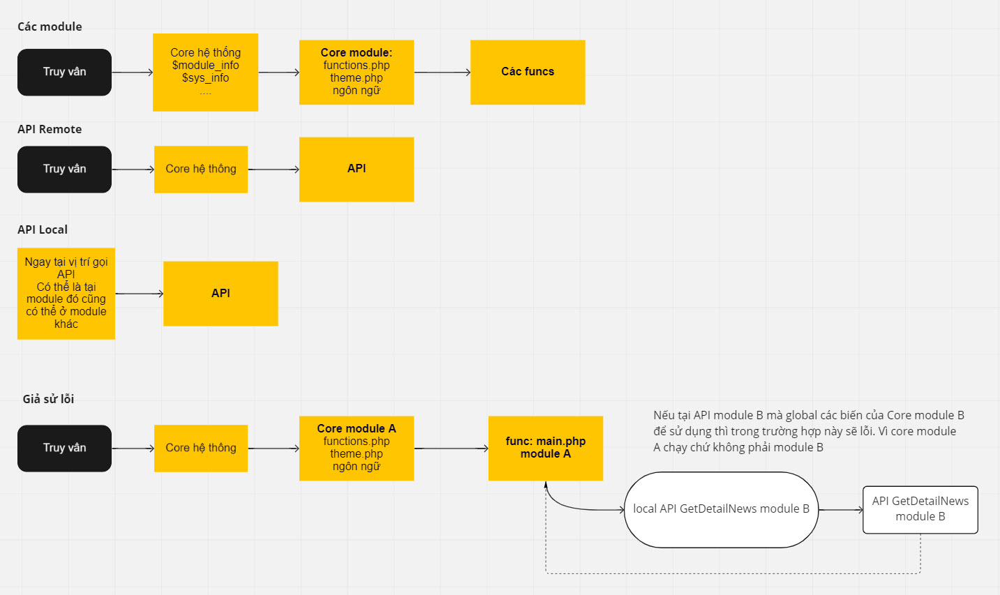

> Hệ thống API được đưa vào kể từ phiên bản 4.5.00

Xem mô tả luồng truy vấn thông thường và API như ảnh bên dưới



## Dành cho nhà phát triển sử dụng API

### Lưu ý khi sử dụng API

1.  Nếu không bắt buộc không nên sử dụng API (Mặc định NukeViet \< 4.5 không cung cấp API, bản NukeViet 4.5 trở đi sẽ không kích hoạt mặc định)
2.  Tại chức năng **Cấu hình =\> Cấu hình chung** cần Bật **Remote API**
3.  Quyền truy cập API tại phần **Quản trị =\> Quyền truy cập API** đã chọn đủ API Role có chứa API cần gọi.
4.  Cấp quyền ít nhất: Một API Roles chỉ nên có các quyền ít nhất, không nên cấp tất cả các quyền. Quyền có thể được thêm vào khi cần thiết và nên được thu hồi khi không còn được sử dụng.
5.  Quyền truy cập API, nên được giới hạn theo IP, Xóa Quyền truy cập API nếu không dùng nữa.
6.  Sử dụng HTTPS cho cả website, trong đó có API
7.  Nếu phải viết thêm API, hãy viết nó đơn giản: Mỗi khi bạn làm cho giải pháp phức tạp hơn một cách “không cần thiết”, bạn cũng có khả năng để lại một lỗ hổng.

### Nguyên tắc chung

Thực hiện lệnh POST vào URL `<scheme>://<domain>/api.php` (ví dụ [https://nukeviet.vn/api.php](https://nukeviet.vn/api.php)) với đầu vào được mô tả bên dưới, dữ liệu trả về dạng JSON, sử dụng hàm json_decode để chuyển thành array và thao tác.

Các tham số bắt buộc

``` json
[
    'apikey' => '...', // Khóa được cung cấp
    'timestamp' => '...', // Thời gian resquest sai lệch với giờ máy chủ không quá 5 giây
    'hashsecret' => '...', // Mã bí mật mỗi lần resquest = password_hash($apisecret . '_' . $timestamp, PASSWORD_DEFAULT);
    'action' => 'GetLesson', // Tên API được list bên dưới
    'module' => 'elearning', // Module xử lý, ở đây là elearning, để trống thì là API của hệ thống
    'language' => 'vi' // Bắt buộc nếu API của module trên site đa ngôn ngữ
]
```

Các tham số tùy chọn tùy theo từng API cụ thể quy định. Dữ liệu trả về cố định (toàn bộ các API đều sẽ có) như sau

``` json
[
    'status' => 'success', // Nếu thành công thì là success, thất bại (có lỗi) thì là error
    'code' => '0000', // Mã lỗi nếu có
    'message' => '' // Thông tin lỗi nếu có
]
```

### Ví dụ

#### Code sử dụng từ một website bất kỳ

Sử dụng thư viện CURL để gửi truy vấn

``` php
$api_remote_url = 'https://nukeviet.vn/api.php';
$agent = 'NukeViet Remote API Lib';

$ch = curl_init();

curl_setopt($ch, CURLOPT_URL, $api_remote_url);
curl_setopt($ch, CURLOPT_HEADER, 0);

$safe_mode = (ini_get('safe_mode') == '1' || strtolower(ini_get('safe_mode')) == 'on') ? 1 : 0;
$open_basedir = ini_get('open_basedir') ? true : false;
if (!$safe_mode and !$open_basedir) {
    curl_setopt($ch, CURLOPT_FOLLOWLOCATION, 1);
    curl_setopt($ch, CURLOPT_MAXREDIRS, 10);
}

$apisecret = '';
$timestamp = time();
$request = [
    // Tham số bắt buộc
    'apikey' => '...',
    'timestamp' => $timestamp,
    'hashsecret' => password_hash($apisecret . '_' . $timestamp, PASSWORD_DEFAULT),
    'language' => 'vi',
    'action' => 'CreatArticle',
    'module' => 'news'
];

curl_setopt($ch, CURLOPT_TIMEOUT, 20);
curl_setopt($ch, CURLOPT_RETURNTRANSFER, true);
curl_setopt($ch, CURLOPT_USERAGENT, $agent);

curl_setopt($ch, CURLOPT_POST, sizeof($request));
curl_setopt($ch, CURLOPT_POSTFIELDS, $request);

$res = curl_exec($ch);

curl_close($ch);

$responsive = json_decode($res, true);

print_r($responsive);
```

#### Code sử dụng từ một website NukeViet

Sử dụng thư viện NV HTTP để truy vấn

``` php
// Các tham số tùy chọn của mỗi API để vào biến $parameters
$apisecret = '';
$timestamp = time();
$parameters = [];
$request = [
    // Tham số bắt buộc
    'apikey' => '...',
    'timestamp' => $timestamp,
    'hashsecret' => password_hash($apisecret . '_' . $timestamp, PASSWORD_DEFAULT),
    'language' => 'vi',
    'action' => 'CreatArticle',
    'module' => 'news',
];
$request = array_merge($request, $parameters);

$NV_Http = new NukeViet\Http\Http($global_config, NV_TEMP_DIR);

$args = [
    'headers' => [
        'Referer' => NV_MY_DOMAIN
    ],
    'body' => $request,
    'timeout' => 20
];
$responsive = $NV_Http->post(MARKETING_API_URL, $args);

$res = [];
$error = '';

if (is_array($responsive) and empty(NukeViet\Http\Http::$error)) {
    $res = !empty($responsive['body']) ? json_decode($responsive['body'], true) : [];
} elseif (!empty(NukeViet\Http\Http::$error) {
    $error = 'Lỗi truy vấn: ' . NukeViet\Http\Http::$error;
} else {
    $error = 'Lỗi khác';
}

print_r($error);
print_r($res);
```

### API của module

Trong tài liệu này chúng tôi ví dụ module hiện tại là module **page** đang chuẩn bị lập trình chức năng API.

> Lưu ý: Tên module, tên file Api và tên Class phân biệt chữ hoa và chữ thường.

**Bước 1: Tạo thư mục Api để chứa các file Api**

Trong thư mục của module tạo thêm thư mục **Api**. Khi đó tồn tại đường dẫn `modules/page/Api`

**Bước 2: Tạo file trong thư mục Api**

Mỗi Api sẽ nằm trong một file php nằm trong thư mục Api. Tên file là tên class (phân biệt chữ viết hoa và viết thường). Ví dụ:

``` php
<?php

/**
 * @Project NUKEVIET 4.x
 * @Author VINADES.,JSC <contact@vinades.vn>
 * @Copyright (C) 2014 VINADES ., JSC. All rights reserved
 * @License GNU/GPL version 2 or any later version
 * @Createdate Jun 20, 2010 8:59:32 PM
 */

namespace NukeViet\Module\page\Api;

use NukeViet\Api\Api;
use NukeViet\Api\ApiResult;
use NukeViet\Api\IApi;

if (!defined('NV_ADMIN') or !defined('NV_MAINFILE')) {
    die('Stop!!!');
}

class CreatArticle implements IApi
{
    private $result;

    /**
     * @return number
     */
    public static function getAdminLev()
    {
        return Api::ADMIN_LEV_MOD;
    }

    /**
     * @return string
     */
    public static function getCat()
    {
        return 'System';
    }

    /**
     * {@inheritDoc}
     * @see \NukeViet\Api\IApi::setResultHander()
     */
    public function setResultHander(ApiResult $result)
    {
        $this->result = $result;
    }

    /**
     * {@inheritDoc}
     * @see \NukeViet\Api\IApi::execute()
     */
    public function execute()
    {
        // @TODO

        return $this->result->getResult();
    }
}

```

Giải thích code như sau:

#### Namespaces

``` php
namespace NukeViet\Module\page\Api;
```

Quy luật:

``` text
NukeViet\Module\<ModuleFile>\Api
```

`<ModuleFile>` chính là tên thư mục chứa module, trong ví dụ này là `page`.

Sau khi đặt namespace, ta khai báo sử dụng các class NukeViet Core hỗ trợ:

``` php
use NukeViet\Api\Api;
use NukeViet\Api\ApiResult;
use NukeViet\Api\IApi;
```

#### Class Name

``` php
class CreatArticle implements IApi
```

Class cần phải implements lớp IApi, theo đó phải có đủ 3 phương thức

``` php
/**
 * Lấy được quyền hạn sử dụng của admin
 * Admin tối cao, điều hành chung hay quản lý module được sử dụng
 */
public static function getAdminLev();

/**
 * Danh mục, cũng là khóa ngôn ngữ của API
 * Nếu không có danh mục thì trả về chuỗi rỗng
 */
public static function getCat();

/**
 * Thiết lập trình xử lý kết quả
 *
 * @param ApiResult $result
 */
public function setResultHander(ApiResult $result);

/**
 * Thực thi API
 */
public function execute();
```

> Lưu ý: Class name chính là tên file. Ví dụ class name là CreatArticle thì file sẽ là `module/Page/Api/CreatArticle.php`

#### Phương thức getAdminLev

Cho biết đối tượng được quyền sử dụng API:

``` php
public static function getAdminLev()
{
    return Api::ADMIN_LEV_MOD;
}
```

Cần trả về một trong 3 giá trị:

``` php
Api::ADMIN_LEV_GOD; // 1: Admin tối cao
Api::ADMIN_LEV_SP; // 2: Điều hành chung
Api::ADMIN_LEV_MOD; // 3: Quản lý module
```

#### Phương thức getCat

Cho biết danh mục của API nếu có, nếu API không được xếp danh mục hãy trả về chuỗi rỗng.

``` php
public static function getCat()
{
    return 'System';
}
```

#### Phương thức setResultHander

``` php
public function setResultHander(ApiResult $result)
{
    $this->result = $result;
}
```

Giữ nguyên code như mẫu, không thay đổi thêm.

#### Code thực thi Api

``` php
public function execute()
{
    // Viết code thực thi tại đây

    return $this->result->getResult();
}
```

Code thực thi được viết tự do, và bắt buộc phải trả về thông qua phương thức `getResult` của class `NukeViet\Api\ApiResult`

#### Sử dụng các dữ liệu hệ thống

- Lấy biến `$module_name` sử dụng lệnh `$module_name = Api::getModuleName();`
- Lấy biến `$module_info` sử dụng lệnh `$module_name = Api::getModuleInfo();`. Các biến `$module_data, $module_file, $module_upload` xác định từ `$module_info`.
- Lấy ID của Admin thực hiện API sử dụng lệnh `$admin_id = Api::getAdminName();`
- Lấy Username của Admin thực hiện API sử dụng lệnh `$admin_username = Api::getAdminId();`
- Lấy Cấp bậc của Admin thực hiện API sử dụng lệnh `$admin_level = Api::getAdminLev();`
- Các biến hệ thống như `$nv_Lang, $nv_Request, $db, $nv_Cache, ...` có thể gọi global như thông thường.

#### Cách trả dữ liệu về

Message thông báo:

``` php
$this->result->setMessage($nv_Lang->getModule('empty_bodytext'));
```

Mã lỗi (nếu có):

``` php
$this->result->setCode($code);
```

Đánh dấu thành công:

``` php
$this->result->setSuccess();
```

Đánh dấu lỗi:

``` php
$this->result->setError();
```

Các dữ liệu khác:

``` php
$this->result->set($key, $value);
```

\*\* Bước 3 thêm giá trị api vào file ngôn ngữ của module \*\*

- \$lang_module\['api_modulename'\]
- \$lang_module\['api_modulename_class'\]

### API của hệ thống

Tương tự như API của module ngoại trừ các điểm khác sau:

- File API nằm trong thư mục `includes/api`
- namespace là `namespace NukeViet\Api;`

### Cách gọi API nội bộ

Ta có thể dùng hàm `nv_local_api`, cụ thể như sau

``` php
$return = nv_local_api($cmd, $params, $adminidentity = '', $module = '');
```

Trong đó:

- \$return: là kết quả API trả về
- \$cmd: là tương ứng với action khi remote
- \$params: là mảng data nó sẽ được chuyển thành biến \$\_POST
- \$adminidentity: là userid hoặc username của admin
- \$module: tương ứng với module khi remote

Ví dụ: Với cách gọi qua CURL thông thường, ta cần phải làm các bước sau:

``` php
$agent = 'NukeViet Remote API Lib';
$safe_mode = (ini_get('safe_mode') == '1' || strtolower(ini_get('safe_mode')) == 'on') ? 1 : 0;
$open_basedir = ini_get('open_basedir') ? true : false;

$ch = curl_init();
curl_setopt($ch, CURLOPT_URL, '...'//URL của API);
curl_setopt($ch, CURLOPT_HEADER, 0);

if (!$safe_mode and !$open_basedir) {
     curl_setopt($ch, CURLOPT_FOLLOWLOCATION, 1);
     curl_setopt($ch, CURLOPT_MAXREDIRS, 10);
}

$params= [
    'apikey' => '...', // Khóa được cung cấp
    'timestamp' => '...', // Thời gian resquest sai lệch với giờ máy chủ không quá 5 giây
    'hashsecret' => '...', // Mã bí mật mỗi lần resquest = password_hash($apisecret . '_' . $timestamp, PASSWORD_DEFAULT);
    'action' => 'GetUsername', // Tên API hoặc action khi remote
    'module' => 'user', // Module xử lý, ở đây là user, để trống thì là API của hệ thống
    'language' => 'vi' // Bắt buộc nếu API của module trên site đa ngôn ngữ
    
    //Các dữ liệu cần thiết, ví dụ ở đây ta sẽ truyền userid
    'userid' => $userid
];

$str = http_build_query($request);
curl_setopt($ch, CURLOPT_TIMEOUT, 20);
curl_setopt($ch, CURLOPT_RETURNTRANSFER, true);
curl_setopt($ch, CURLOPT_USERAGENT, $agent);
curl_setopt($ch, CURLOPT_POST, sizeof($request));
curl_setopt($ch, CURLOPT_POSTFIELDS, $str);
$return = curl_exec($ch);  //Dữ liệu API sẽ trả về
curl_close($ch);
```

Với hàm `nv_local_api`, ta sử dụng:

``` php
$params= [
     'userid' => $userid
];
$return = nv_local_api('GetUsername', $params, 'admin', 'user');
/*
 Với:
  * $return: Dữ liệu API sẽ trả về
  * 'GetUsername': Tên API hoặc action khi remote
  * $params: Mảng dữ liệu truyền vào API
  * 'admin': username của tài khoản admin
  * 'user': Module xử lý
*/
```

Có thể xem thêm về hàm `nv_local_api` tại: `.../includes/function.php`

## Gỡ lỗi API

### Lệnh gọi API rewrite (không gọi vào /api.php) lỗi 404

Kiểm tra xem máy chủ có hỗ trợ rewrite hay không là điều kiện đầu tiên. Nếu có hỗ trợ thì check lần lượt các hướng bên dưới.

**Nếu máy chủ sử dụng Apache**

- Tìm trong httpd.conf (hoặc các file config tương đương) thẻ `<Directory "path/to/your/dir">` nếu có `Options .... MultiViews` thì xóa MultiViews sau đó khởi động lại apache.
- Tìm trong .htaccess ngay thư mục gốc website nếu không có thì thêm vào đoạn sau

``` text
<IfModule mod_negotiation.c>
    Options -MultiViews
</IfModule>
```

- Nếu thêm vào vẫn không hoạt động thì cần cài thêm [mod_negotiation](https://httpd.apache.org/docs/2.4/mod/mod_negotiation.html)
