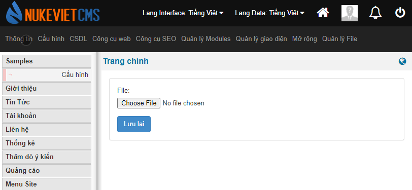

Class upload là lớp có chứa các chức năng tải file lên hệ thống. File tải lên có thể từ máy tính hoặc một file trên internet.

Một số lưu ý khi sử dụng upload các bạn xem tại video: [https://www.youtube.com/watch?v=B-mMzpL8BLw](https://www.youtube.com/watch?v=B-mMzpL8BLw)

## Chuẩn bị

1.  Cài đặt NukeViet 4.4.02 (link tải [NukeViet 4.4.02](https://github.com/nukeviet/nukeviet/releases/download/4.4.02/nukeviet4.4.02setup.zip)) hoặc tương đương.
2.  Cài đặt module mẫu samples ([nv4_module_samples.zip](/images/programming4/class/nv4_module_samples.zip)) để lập trình

## Hướng dẫn lập trình

### Tải file từ máy tính

#### Chuẩn bị một form để gửi file từ máy tính lên server:

Mở file `themes/admin_default/modules/samples/main.tpl` thêm vào đoạn HTML để tạo ra form gửi file lên máy tính, code html như sau

``` html
<!-- BEGIN: main -->
<form action="{NV_BASE_ADMINURL}index.php?{NV_LANG_VARIABLE}={NV_LANG_DATA}&amp;{NV_NAME_VARIABLE}={MODULE_NAME}&amp;{NV_OP_VARIABLE}={OP}" method="post" enctype="multipart/form-data">
    <div class="panel panel-default">
        <div class="panel-body">
            <div class="form-group">
                <label>File:</label>
                <input type="file" name="uploadfile">
            </div>
            <input class="btn btn-primary" name="submit" type="submit" value="{LANG.save}" />
        </div>
    </div>
</form>
<!-- END: main -->

```

Với file này ta sẽ có được một form upload file như ảnh



> Lưu ý: Thẻ `form` cần có thuộc tính `enctype="multipart/form-data"` mới có thể gửi file lên server.

#### Lập trình xử lý để lưu file gửi lên trên server

Trong file `modules/samples/admin/main.php` bên dưới đoạn

``` php
//------------------------------
// Viết code xử lý chung vào đây
//------------------------------
```

Chúng ta bắt đầu lập trình:

**Nhận diện được có file tải lên:**

Dùng lệnh

``` php
if ($nv_Request->isset_request('submit', 'post') and isset($_FILES, $_FILES['uploadfile'], $_FILES['uploadfile']['tmp_name']) and is_uploaded_file($_FILES['uploadfile']['tmp_name'])) {
    //
}
```

Trong đó:

- Điều kiện `$nv_Request->isset_request('submit', 'post')` để kiểm tra sự kiện submit form
- Điều kiện `isset($_FILES, $_FILES['uploadfile'], $_FILES['uploadfile']['tmp_name']) and is_uploaded_file($_FILES['uploadfile']['tmp_name'])` để kiểm tra có file tải lên hợp lệ.

**Tiến hành lưu file tải lên:**

Sau khi kiểm tra xong, tiến hành lưu file tải lên bằng các lệnh sau

``` php
// Khởi tạo Class upload
$upload = new NukeViet\Files\Upload($admin_info['allow_files_type'], $global_config['forbid_extensions'], $global_config['forbid_mimes'], NV_UPLOAD_MAX_FILESIZE, NV_MAX_WIDTH, NV_MAX_HEIGHT);

// Thiết lập ngôn ngữ, nếu không có dòng này thì ngôn ngữ trả về toàn tiếng Anh
$upload->setLanguage($lang_global);

// Tải file lên server
$upload_info = $upload->save_file($_FILES['uploadfile'], NV_UPLOADS_REAL_DIR, false, $global_config['nv_auto_resize']);
```

Các tham số khởi tạo bao gồm:

- `$admin_info['allow_files_type']` là các loại file được phép tải lên, nếu tải lên file không thuộc các loại này sẽ báo lỗi. Lập trình viên có thể thay biến này bằng mảng một chiều khác thuộc các giá trị này `text, images, archives, audio, video, xml, documents, adobe, flash, real, application`. Chi tiết các giá trị đó xem ở file `includes/ini/mime.ini`
- `$global_config['forbid_extensions'], $global_config['forbid_mimes']` là hai tham số không đổi, đây là mảng chứa các phần mở rộng bị cấm và mime bị cấm
- `NV_UPLOAD_MAX_FILESIZE` dung lượng tối đa tính bằng byte của file tải lên.
- `NV_MAX_WIDTH, NV_MAX_HEIGHT` là kích thước rộng, cao tối đa của file tải lên nếu là ảnh.

Các tham số lưu file tải lên bao gồm:

- `$_FILES['uploadfile']` đây là biến file tải lên của php (tham khảo thêm ở [POST method uploads](https://www.php.net/manual/en/features.file-upload.post-method.php))
- `NV_UPLOADS_REAL_DIR` là địa chỉ tuyệt đối của thư mục lưu file. Trong ví dụ này giá trị `NV_UPLOADS_REAL_DIR` biểu thị thư mục lưu file là `uploads`
- Tham số tiếp theo đang mang giá trị `false`, tại đây lập trình viên đặt true hoặc false tương ứng với việc thay thế nếu tồn tại hoặc lưu với tên khác nếu tồn tại.
- Tham số tiếp theo đang để giá trị `$global_config['nv_auto_resize']` tham số này có thể truyền giá trị 1, 0 biểu thị nếu file tải lên là ảnh mà vượt quá kích thước tối đa sẽ tự động thay đổi về kích thước tối đa hoặc là dừng upload.

Kết quả trả về trong ví dụ được lưu vào biến `$upload_info`, đây là mảng một chiều lưu trữ thông tin tải file lên.

Có 3 trường hợp:

1\. Có lỗi, mảng này sẽ như sau

``` text
Array
(
    [error] => Lỗi: loại file không được phép tải lên
)
```

2\. Thành công, file tải lên là ảnh

``` text
Array
(
    [error] => 
    [complete] => 1
    [name] => D:/webroot/www/nukeviet4/tmp2.nukeviet4.my/uploads/uq7c94b.jpg
    [basename] => uq7c94b.jpg
    [ext] => jpg
    [mime] => image/jpeg
    [size] => 40892
    [is_img] => 1
    [is_svg] => 
    [img_info] => Array
        (
            [0] => 720
            [1] => 720
            [2] => 2
            [3] => width="720" height="720"
            [bits] => 8
            [channels] => 3
            [mime] => image/jpeg
        )

)
```

3\. Thành công, file tải lên là loại file khác

``` text
Array
(
    [error] => 
    [complete] => 1
    [name] => D:/webroot/www/nukeviet4/tmp2.nukeviet4.my/uploads/nv4_module_samples.zip
    [basename] => nv4_module_samples.zip
    [ext] => zip
    [mime] => application/zip
    [size] => 19148
    [is_img] => 
    [is_svg] => 
)
```

Giải thích các giá trị:

- `error` giá trị này biểu thi nguyên nhân lỗi nếu có
- `complete` mang giá trị 1 biểu thị file đã được lưu thành công
- `name` là đường dẫn tuyệt đối của file đã lưu
- `basename` là tên file đã lưu
- `ext` là phần mở rộng của file
- `mime` Mime type của file
- `size` kích thước file tải lên tính bằng byte
- `is_img` giá trị 1 hoặc 0 tương ứng với file tải lên là ảnh hoặc không phải là ảnh
- `is_svg` giá trị 1 hoặc 0 tương ứng với file tải lên là SVG hoặc không phải là SVG
- `img_info` là mảng một chiều chứa thông tin ảnh nếu file tải lên là ảnh, đây là kết quả của hàm [getimagesize](https://www.php.net/manual/en/function.getimagesize.php)

Lập trình viên căn cứ vào biến `$upload_info` để xử lý cho ứng dụng của mình.

### Tải file trên internet

#### Chuẩn bị form tải lên

Trong file tpl ở hướng dẫn bên trên bổ sung thêm một nút gửi file từ internet như sau:

``` html
<div class="form-group">
    <label>Remote File:</label>
    <input type="text" class="form-control" name="remotefile">
</div>
<input class="btn btn-primary" name="submitremote" type="submit" value="{LANG.save}" />
```

#### Lập trình để tải file về

Trong file php như bên trên, dùng code nhận diện có thông tin gửi lên của người dùng ví dụ như sau:

``` php
if ($nv_Request->isset_request('submitremote', 'post')) {
    $remotefile = $nv_Request->get_string('remotefile', 'post', '');
    if (!empty($remotefile)) {
        //
    }
}
```

Với code đó, nếu có thông tin gửi lên thì địa chỉ file ở biến `$remotefile`

**Xử lý lưu file**

Dùng đoạn code như sau:

``` php
// Khởi tạo Class upload
$upload = new NukeViet\Files\Upload($admin_info['allow_files_type'], $global_config['forbid_extensions'], $global_config['forbid_mimes'], NV_UPLOAD_MAX_FILESIZE, NV_MAX_WIDTH, NV_MAX_HEIGHT);

// Thiết lập ngôn ngữ, nếu không có dòng này thì ngôn ngữ trả về toàn tiếng Anh
$upload->setLanguage($lang_global);

// Lưu file trên internet về server
$upload_info = $upload->save_urlfile($remotefile, NV_UPLOADS_REAL_DIR, false, $global_config['nv_auto_resize']);
```

Cách viết hoàn toàn tương tự như hướng dẫn lưu file từ máy tính bên trên, chỉ khác:

- Thay phương thức `save_file` bằng `save_urlfile`.
- Thay `$_FILES['uploadfile']` bằng `$remotefile`.

Kết quả trả về lưu vào biến `$upload_info` cũng có nội dung tương tự như cách lưu file từ máy tính bên trên.

### Sử dụng module quản lý File

Khai báo html

``` html
// thẻ input text đường dẫn file
<input class="w300 form-control pull-left" type="text" name="image" id="image" value="{DATA.image}" style="margin-right: 5px"/>

// thẻ input text tiêu đề file
<input class="w300 form-control" type="text" name="imagealt" id="imagealt" value="{DATA.imagealt}"/>

// button gọi tới module Quản lý file
<input type="button" value="Browse server" name="selectimg" class="btn btn-info"/>
```

Javascript gọi module quản lý file

``` javascript
$("input[name=selectimg]").click(function() {
        var area = "image"; //id của thẻ input lưu đường dẫn file
        var alt = "imagealt"; //id của thẻ input lưu tiêu đề file
        var path = '{NV_UPLOADS_DIR}/{MODULE_UPLOAD}'; //uploads/sample
        var type = "image"; // kiểu định dạng cho phép upload
                var currentpath = '{NV_UPLOADS_DIR}/{MODULE_UPLOAD}/2020'; //uploads/sample/2020
        
        nv_open_browse(script_name + "?" + nv_name_variable + "=upload&popup=1&area=" + area + "&alt=" + alt + "&path=" + path + "&type=" + type + "&currentpath=" + currentpath, "NVImg", 850, 420, "resizable=no,scrollbars=no,toolbar=no,location=no,status=no");
        
        return false;
    });
```

## Code mẫu

Tham khảo toàn bộ module trong hướng dẫn này tại đây [nv4_module_samples_upload.zip](/images/programming4/class/nv4_module_samples_upload.zip)
