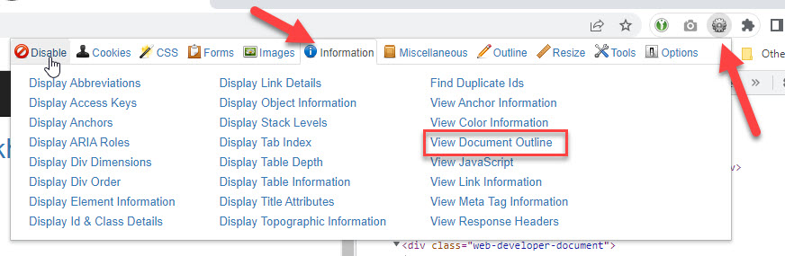
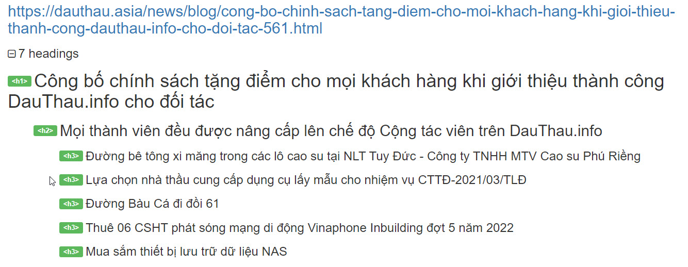
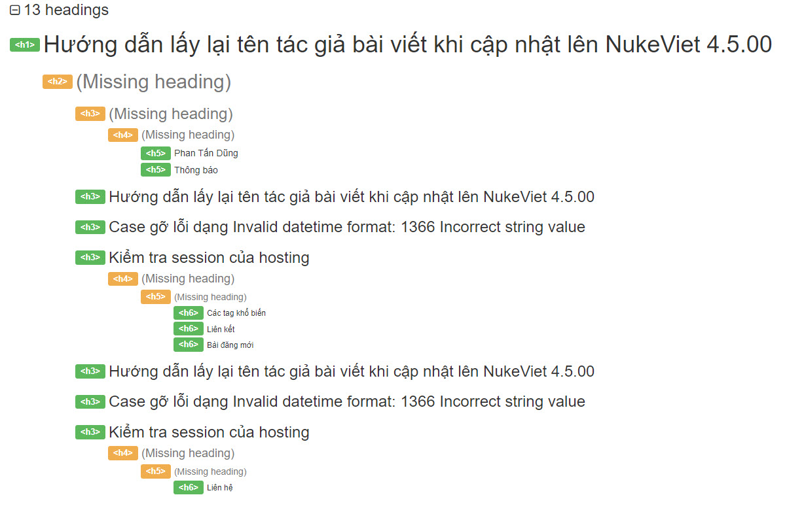
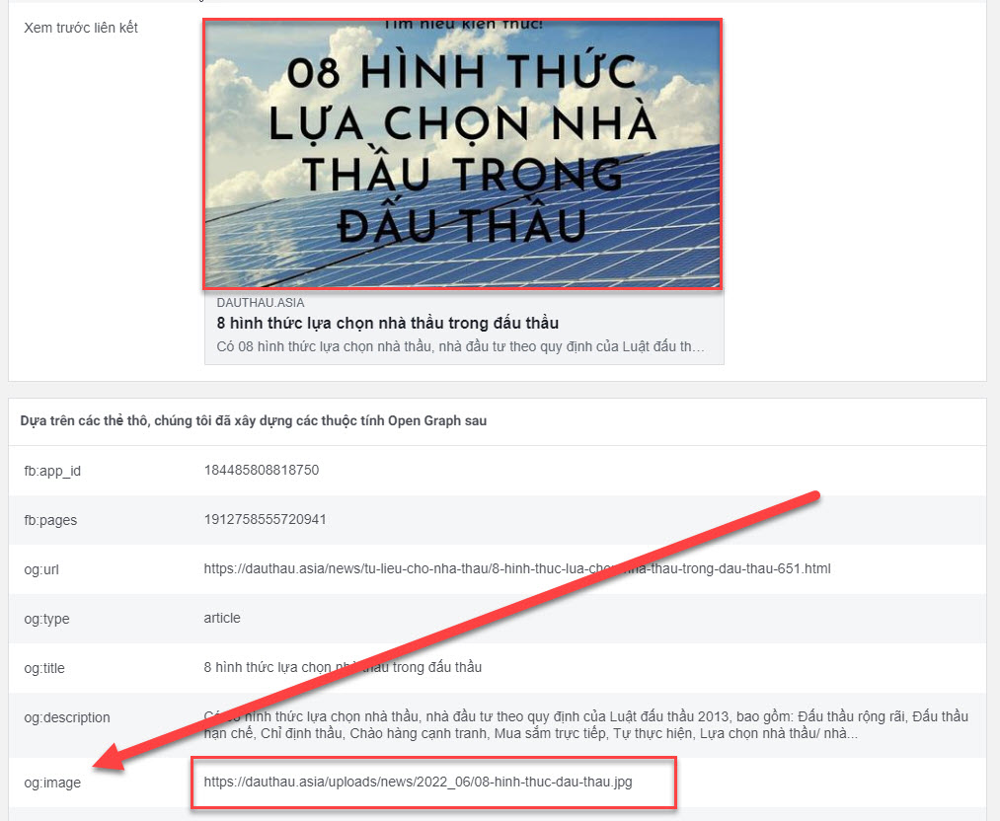
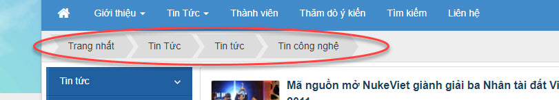
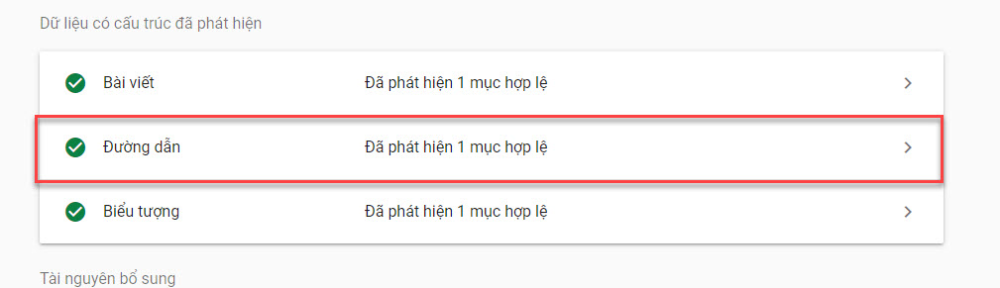

## Thẻ tiêu đề, mô tả, từ khóa

### Lập trình

Được quy định bởi 3 biến này:

- `$page_title` quy định tiêu đề site.
- `$key_words` quy định từ khóa.
- `$description` quy định mô tả của trang.

Tại function main.php, 3 biến này thường được viết cố định như sau

``` php
$page_title = $module_info['site_title'];
$key_words = $module_info['keywords'];
$description = $module_info['description'];
```

Tại các function khác cách xác định như sau:

**`$page_title`**

Bằng tên của đối tượng quản lý hoặc ngôn ngữ tùy chỉnh hoặc bằng biến `$module_info`. Cụ thể:

\- Giả sử function này là chi tiết bài viết thì \$page_title là tên của bài viết đó  
- Giả sử function này là chuyên mục thì \$page_title là tên của chuyên mục đó  
- Cũng có thể cố định `$page_title = $lang_module['func_site_title']` theo ngôn ngữ  
- Cũng có thể lấy `$page_title = $module_info['funcs'][$op_file]['func_site_title']`. Cách viết này có lợi mà cũng có hạn chế. Lợi: Có thể tùy biến giá trị trong quản trị. Hạn chế: Nếu không tùy biến thì giá trị này mặc định là tên file của function bỏ đi đuôi .php, nó không có ý nghĩa gì đối với người dùng. Quản trị sẽ bỏ ra nhiều thời gian để cấu hình.

**`$key_words`**

Từ khóa của đối tượng ví dụ từ khóa của bài viết, từ khóa của chuyên mục. Nếu không có thì viết `$key_words = 'no'`

**`$description`**

Mô tả của đối tượng ví dụ mô tả của bài viết, mô tả của chuyên mục. Nếu không có thì viết `$description = 'no'`

### Kiểm tra

**`$page_title`**

Xem trong code của function hiển thị, nếu không có biến `$page_title` là bị thiếu  
Xem mã nguồn của trang, giá trị trong cặp `<title></title>` biểu thị thẻ tiêu đề. Nếu lập trình thiếu thẻ này thì giá trị mặc định nó thường có dạng `Viewcat - Tin Tức`, `Main - Tin Tức`.  
Trong đó:

- Main là tên của function (mặc định là tên file php bỏ dấu)
- Phần phía sau dấu - là tên module

Trường hợp có lập trình `$page_title` nhưng vẫn xem là lỗi đó là nếu một function có thể control nhiều link mà chỉ có một `$page_title`. Ví dụ giả sử function news.php điều khiển cả 2 việc

- Xem danh sách bài viết [https://dauthau.asia/news/dau-gia/](https://dauthau.asia/news/dau-gia/)
- Xem chi tiết bài viết [https://dauthau.asia/news/dau-gia/tai-san-nao-duoc-phap-luat-quy-dinh-phai-ban-thong-qua-dau-gia-648.html](https://dauthau.asia/news/dau-gia/tai-san-nao-duoc-phap-luat-quy-dinh-phai-ban-thong-qua-dau-gia-648.html)

Mà ở 2 trang đó có cùng \$page_title như nhau tức là lỗi

**`$key_words`**

Tìm trong code của function hiển thị biến `$key_words`  
Xem mã nguồn trang thẻ dạng như thế này `<meta name="keywords" content="nukeviet, giáo dục, edu gate">`

Khác với thẻ tiêu đề, thẻ này có thể bỏ trống. Khi bỏ trống thì không có thẻ meta keywords trong mã HTML xuất ra.

**`$description`**

Tìm trong code của function hiển thị biến `$description`  
Xem mã nguồn trang thẻ dạng như thế này `<meta name="description" content="Trên cơ sở Hướng dẫn thực hiện nhiệm vụ CNTT năm học 2015 - 2016 của Bộ Giáo dục và Đào tạo, Công ty cổ phần phát triển nguồn mở Việt Nam và các doanh nghiệp phát triển">`

Khác với thẻ tiêu đề, thẻ này có thể bỏ trống. Khi bỏ trống thì thẻ meta description sẽ có giá trị dạng `page_title (nếu có) - function_name - module_name - current_link`

## Các thẻ heading

Phần này chủ yếu liên quan đến mặt giao diện. Trong lập trình cần chú ý, 1 page thì cần có thẻ h1, h2, h3. Còn các thẻ h4, h5, h6 áp dụng nếu trang đó là một bài viết cực dài.

Có thể dùng tiện ích [Web Developer](https://chrome.google.com/webstore/detail/web-developer/bfbameneiokkgbdmiekhjnmfkcnldhhm?hl=vi) trên Chrome để kiểm tra.

Sau khi cài đặt, tại trang web cần kiểm tra chọn vào các bước như ảnh



Kết quả hiện ra như sau là tốt



Kết quả như sau là không tốt



Giải thích thêm:

\- Một trang cần có một thẻ h1 duy nhất  
- Trong thẻ h1 có thể có nhiều thẻ h2, trong h2 có thể có nhiều thẻ h3....  
- Nếu có thẻ h3 mà trước đó lại thiếu thẻ h2 là không tốt, tương tự nếu có h4 mà không có h2 là không tốt...  
- h4, h5, h6 dùng cho trang có nội dung rất dài  

## Các thẻ Open Graph cho facebook

Các thẻ này được quy định tại đây [https://ogp.me/](https://ogp.me/). Trong lập trình module hầu như chỉ quan tâm đến một số thẻ sau: og:title, og:type, og:image, og:url, og:description

Trong đó 3 thẻ og:title, og:image, og:description rất quan trọng, nó giúp hiển thị tiêu đề, ảnh, mô tả khi chia sẻ link của trang lên facebook.

### Lập trình

Thêm vào biến `$meta_property` các giá trị cần thiết. Ví dụ

``` php
$meta_property['og:image'] = NV_MY_DOMAIN . NV_BASE_SITEURL . $show_no_image;
$meta_property['og:type'] = 'article';
$meta_property['og:url'] = $page_url;
$meta_property['og:description'] = $description;
$meta_property['og:title'] = $page_title;
```

### Kiểm tra

Các thẻ này là không bắt buộc. Tuy nhiên có một trường hợp sau được xem như là bắt buộc:  
Đối tượng có ảnh minh họa thì og:image bắt buộc phải chỉ ra. Ví dụ:

- Chuyên mục khi quản lý có mục ảnh minh họa thì khi xem chuyên mục phải có og:image
- Bài viết có ảnh minh họa thì xem chi tiết bài viết phải có og:image

Kiểm tra bằng cách xem mã nguồn trang, có thẻ như sau

``` html
<meta property="og:image" content="https://dauthau.asia/uploads/news/2022_06/08-hinh-thuc-dau-thau.jpg">
```

Hoặc dùng công cụ Sharing Debugger tại đây [https://developers.facebook.com/tools/debug/](https://developers.facebook.com/tools/debug/) để kiểm tra, kết quả phải có ảnh như bên dưới khớp với ảnh minh họa của đối tượng



## Breadcrumbs

Hiểu nôm na đây là thanh cấu trúc của website. Căn cứ vào đó người dùng biết vị trí mình đang ở trong sitemap.

### Lập trình

Thêm vào biến

``` php
$array_mod_title[] = [
    'catid' => $catid,
    'title' => $title,
    'link' => $link
];
```

Trong đó

- `$catid` là ID của đối tượng, không có thì đặt = 0
- `$title` là tiêu đề, tên hiển thị trong breadcrumb
- `$link` liên kết khi ấn vào breadcrumb

### Kiểm tra

Có hiển thị ra thanh như sau



Một số giao diện có khả năng ẩn thanh đó đi.

Dùng công cụ **Rich Results Test** của Google để kiểm tra dữ liệu có cấu trúc của breadcrumb tại [https://search.google.com/test/rich-results](https://search.google.com/test/rich-results) kết quả phải có cái như ảnh dưới



Lưu ý: Trong NukeViet mặc định ở các trang trong (tức trừ trang chủ) thì breadcrumb luôn có hai phần tử đó là Trang nhất và tên module đó. Khi kiểm tra nếu các function ngoại trừ main của module mà số phần tử của breadcrumb chỉ có 2 hoặc giống nhau cho các function khác nhau hoặc không có cả breadcrumb là lỗi

## Canonical URL, \$page_url, và no-index

- Tất cả các trang phải có \$page_url và \$canonicalUrl, [xem tại đây](https://github.com/nukeviet/update/wiki/H%C6%B0%E1%BB%9Bng-d%E1%BA%ABn-n%C3%A2ng-c%E1%BA%A5p-module-t%E1%BB%AB-NukeViet-4.4.02-l%C3%AAn-NukeViet-4.5.02)
- Đối với các trang tìm kiếm do người dùng nhập liệu form vào cần đánh no-index bằng `$nv_BotManager=>setPrivate()`, xem cách dùng class này [tại đây](/programming4/class/botmanager)
- Đối với các trang có phân trang cần dùng hàm betweenURLs. [Xem tại đây](https://github.com/nukeviet/update/wiki/H%C6%B0%E1%BB%9Bng-d%E1%BA%ABn-n%C3%A2ng-c%E1%BA%A5p-module-t%E1%BB%AB-NukeViet-4.4.02-l%C3%AAn-NukeViet-4.5.02#2%C4%91%C3%A1nh-s%E1%BB%91-trang)
