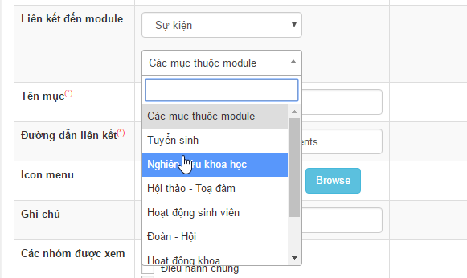

Ví dụ một module (sự kiện) có hỗ trợ xuất menu thì khi thêm menu từ module Menu, lúc chọn **Liên kết đến module** sẽ như sau:  Trong ảnh tên, các tùy chọn đổ xuống chính là các mục do module (sự kiện) xuất ra.

Để hỗ trợ xuất menu, cần tồn tại file sau `modules/module-name/menu.php`. File menu.php cần đưa dữ liệu vào mảng `$array_item`.

Ví dụ hoàn chỉnh về file `menu.php`:

``` php
<?php

/**
 * @Project EVENTS 4.X
 * @Author PHAN TAN DUNG (phantandung92@gmail.com)
 * @Copyright (C) 2016 PHAN TAN DUNG. All rights reserved
 * @License GNU/GPL version 2 or any later version
 * @Createdate Sun, 12 Jun 2016 05:02:54 GMT
 */

if (!defined('NV_IS_FILE_ADMIN'))
    die('Stop!!!');

$sql = 'SELECT * FROM ' . NV_PREFIXLANG . '_' . $mod_data . '_cat ORDER BY weight ASC';
$result = $db->query($sql);
while ($row = $result->fetch()) {
    $array_item[$row['catid']] = array(
        'parentid' => 0,
        'groups_view' => '6',
        'key' => $row['catid'],
        'title' => $row['title'],
        'alias' => $row['alias']
    );
}

```

Theo đó mảng \$array_item bao gồm:

- `parentid` là khóa của phần tử (menu) cha
- `groups_view` là danh sách ID các nhóm được quyền xem menu, phân cách bởi dấu ','
- `key` là khóa của menu
- `title` là tiêu đề của menu
- `alias` là liên kết tĩnh của menu

`alias` khi xuất ra link sẽ có dạng sau: `/index.php?language=vi&nv=events&op=Doan-Hoi`. Giá trị `Doan-Hoi` chính là alias

> Chú ý: Trong menu.php biến `$module_info` hay sử dụng thay bằng `$modvalues`
