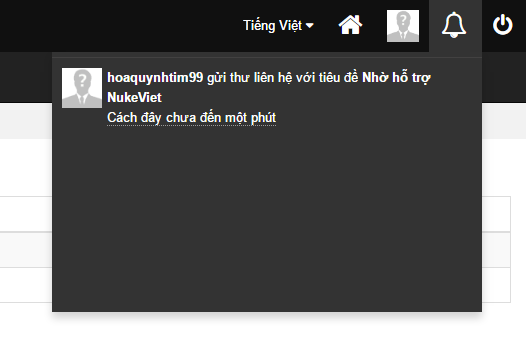

Một module có notification khi vào phần quản trị, bên góc phải phía trên sẽ hiện các thông báo, nhấp vào mỗi thông báo để xem chi tiết. 

Một module hỗ trợ notification cần tồn tại file `modules/module-name/notification.php` - File này là file xử lý lại tiêu đề và liên kết khi ấn vào thông báo.

Để hỗ trợ hệ thống notification, NukeViet cung cấp sẵn trong nhân hệ thống ba hàm xử lý:

- [nv_insert_notification](/programming4/function)
- [nv_status_notification](/programming4/function)
- [nv_delete_notification](/programming4/function)

## Tạo một notification mới

Để tạo một notification mới, từ vị trí thích hợp trong module, sử dụng hàm [nv_insert_notification](/programming4/function).

Ví dụ: tạo một notification từ module contact (thông báo có liên hệ mới)

``` php
nv_insert_notification($module_name, 'contact_new', array('title' => $ftitle), $row_id, 0, $sender_id, 1);
```

## Code xử lý ở notification.php

Các biến hỗ trợ có thể sử dụng:

- `$data` là mảng chứa dữ liệu của từng thông báo sẽ duyệt qua
- `$mod` là biến riêng của `$data['module']`

Các phần tử của `$data` bao gồm:

- `module` là giá trị `$module_name` cần thống báo
- `type` là chuỗi ký tự bất kỳ để tạo khóa cho thông báo
- `content` là mảng một chiều chứa nội dung thông báo
- `obid` giá trị số nguyên không âm để tạo khóa
- `send_to` giá trị userID của người nhận, bằng 0 nếu muốn thông báo cho tất cả
- `send_from` giá trị userID của người gửi thông báo, bằng 0 nếu là thông báo từ hệ thống

Nhiệm vụ của file này là xuất ra hai phần tử còn thiếu của `$data` là `title` và `link`. Dựa trên các phần tử đã có.

Ví dụ:

``` php
<?php

/**
 * @Project NUKEVIET 4.x
 * @Author VINADES (contact@vinades.vn)
 * @Copyright (C) 2014 VINADES. All rights reserved
 * @License GNU/GPL version 2 or any later version
 * @Createdate Apr 20, 2010 10:47:41 AM
 */

if (! defined('NV_IS_FILE_SITEINFO')) {
    die('Stop!!!');
}

$lang_siteinfo = nv_get_lang_module($mod);

$data['title'] = sprintf($lang_siteinfo['notification_contact_new'], $data['send_from'], $data['content']['title']);
$data['link'] = NV_BASE_ADMINURL . 'index.php?' . NV_LANG_VARIABLE . '=' . NV_LANG_DATA . '&amp;' . NV_NAME_VARIABLE . '=' . $data['module'] . '&amp;' . NV_OP_VARIABLE . '=view&amp;id=' . $data['obid'];

```

\> Chú ý: Có thể sử dụng

``` php
$lang_siteinfo = nv_get_lang_module($mod)
```

để lấy ngôn ngữ admin của module.

## Cập nhật trạng thái

Sử dụng hàm [nv_status_notification](/programming4/function)

Ví dụ:

``` php
nv_status_notification(NV_LANG_DATA, $module_name, 'contact_new', $id, 0);
```

## Xóa notification

Sử dụng hàm [nv_delete_notification](/programming4/function)

Ví dụ:

``` php
nv_delete_notification(NV_LANG_DATA, $module_name, 'contact_new', $id);
```
