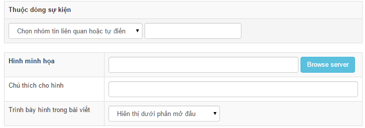

Thông thường để kiểm tra file hoặc thư mục tồn tại ta dùng hàm file_exists, để kiểm tra file tồn tại dùng hàm is_file, để kiểm tra thư mục tồn tại dùng hàm is_dir. Tuy nhiên, cách kiểm tra này không an toàn đối với đường dẫn file do người dùng nhập vào, theo đó người dùng có thể thông qua ô nhập liệu để dò ra các file bí mật như file config, các file ngầm định không cho người dùng biết... Ví dụ: Trong module news, khi thêm bài viết có ô chọn hình minh họa như ảnh  Nếu chỉ thực hiện việc đọc dữ liệu sau đó kiểm tra is_file:

``` php
$rowcontent['homeimgfile'] = $nv_Request->get_title( 'homeimg', 'post', '' );

if( is_file( NV_DOCUMENT_ROOT . $rowcontent['homeimgfile'] ) )
{
    $lu = strlen( NV_BASE_SITEURL . NV_UPLOADS_DIR . '/' . $module_upload . '/' );
    $rowcontent['homeimgfile'] = substr( $rowcontent['homeimgfile'], $lu );
}
```

Thì sau khi kiểm tra giá trị \$rowcontent\['homeimgfile'\] được ghi vào CSDL, kẻ phá hoại có thể dựa vào dữ liệu đó để kiểm tra sự tồn tại của các file hệ thống.

Để đảm bảo an toàn, người lập trình module cần sử dụng hàm nv_is_file thay vì is_file hay file_exists. Khi đó đoạn code trên được viết lại

``` php
$rowcontent['homeimgfile'] = $nv_Request->get_title( 'homeimg', 'post', '' );

if( nv_is_file( $rowcontent['homeimgfile'], $uploads_dir_user ) )
{
    $lu = strlen( NV_BASE_SITEURL . NV_UPLOADS_DIR . '/' . $module_upload . '/' );
    $rowcontent['homeimgfile'] = substr( $rowcontent['homeimgfile'], $lu );
}
```

Cách sử dụng hàm [nv_is_file](/programming4/function) tham khảo tại [Đây](/programming4/function)

## Bảo mật khi sử dụng biến \$client_info\['selfurl'\]

Bản chất của biến này là lấy từ `$_SERVER['REQUEST_URI']` do nó nó được xem là không an toàn nó trường được khai thác để tấn công Open Redirect vì thế có một số lưu ý về sử dụng nó

- **Không được** dùng để chuyển hướng kiểu `nv_redirect_location($client_info['selfurl'])` thay vào đó dùng biến \$page_url để chuyển hướng.
- Trong trường hợp bắt buộc cần sử dụng nó để chuyển hướng:
  - Nếu đưa lên url hoặc input trong form cần sử dụng hàm nv_redirect_encrypt và nv_redirect_decrypt để mã hóa và giải mã nó thay vì đưa trực tiếp biến vào. Để kẻ tấn công không điền bừa link giả mạo vào được
  - Nếu dùng chuyển hướng trực tiếp trong code cần kiểm tra nó an toàn. Ví dụ thuộc domain an toàn, cấu trúc hợp lệ, không chứa tham số nghi vấn
- Khi dùng hiển thị ra trình duyệt cần dùng hàm nv_htmlspecialchars để đưa các kí tự đặc biệt trong đó thành kí tự an toàn để đảm bảo nó không thực thi thành mã html, js khi hiển thị
