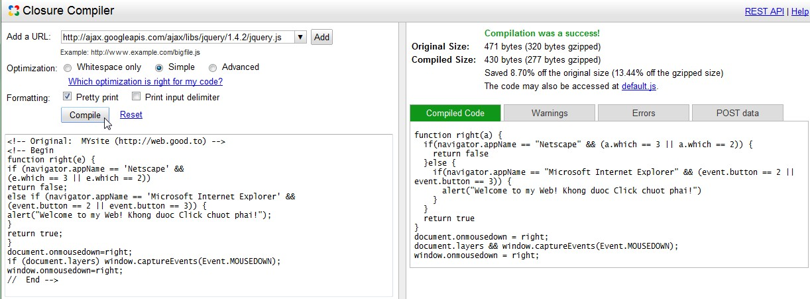
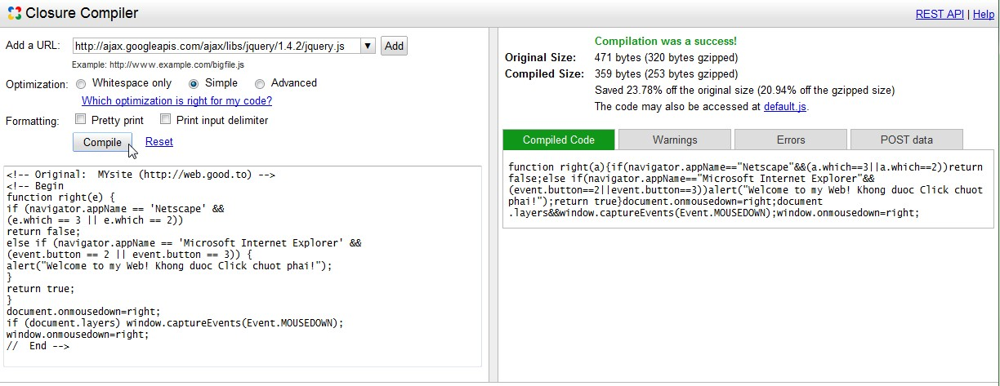

JavaScript là một trong những tác nhân gây chậm trình duyệt, nặng website (chỉ đứng sau Flash). Tuy nhiên JavaScript là ngôn ngữ lập trình của Ajax - một thành phần không thể thiếu cho các website hiện đại - do đó việc loại bỏ JavaScript khỏi web là điều không tưởng. Cách duy nhất là tối ưu các file JavaScript, để nó nhẹ hơn, chạy nhanh hơn.

NukeViet 4.x sử dụng công cụ trực tuyến (online tool) Google Closure Compiler để tối ưu các tập tin JavaScript. Bài viết này giới thiệu đến các bạn những tính năng nổi bật và cách sử dụng nó cho NukeViet.

## Các kiểu tối ưu JavaScript

Có thể chia các công cụ giúp người lập trình giảm kích thước tập tin JavaScript thành 3 kiểu, căn cứ vào phương pháp mà các công cụ này sử dụng:

### Kiểu RegExp

Xóa các chú thích, các khoảng trắng cũng như một số “rác” khác trong mã nguồn nhờ vào các biểu thức chính quy (Regular Expressions). Đại diện tiêu biểu cho phương pháp này là công cụ JSMin. Dưới đây là một vài website cung cấp công cụ kiểu này: [http://fmarcia.info/jsmin/test.html](http://fmarcia.info/jsmin/test.html) [http://www.crockford.com/javascript/jsmin.html](http://www.crockford.com/javascript/jsmin.html)

### Mã hóa kiểu Gzip nửa vời

Nguyên lý của nó là nén tập tin JavaScript bằng phương pháp nén đơn giản (nén với khóa định nghĩa). Khi hiển thị trên trình duyệt, nội dung bị mã hóa sẽ được giải mã bằng hàm biên dịch eval. Nó được gọi là nửa vời bởi sử dụng phương pháp nén gzip ở mức độ thấp. Kiểu mã hóa này không được khuyến khích sử dụng ở các website có chế độ nén gzip mặc định cho các tập tin JavaScript (nén 2 lần, khiến dung lượng của nội dung được đọc còn lớn hơn so với nội dung của tập tin nguyên gốc). Ngoài ra, trình duyệt khi đọc các tập tin này sẽ lâu hơn bình thường vì phải thực hiện thêm thao tác “giải mã”. Công cụ nén nổi tiếng một thời Dean Edwards thuộc trường phái này ([http://dean.edwards.name/packer/](http://dean.edwards.name/packer/)).

Bạn có thể truy cập website [http://jscompress.com](http://jscompress.com) để thấy được sự khác nhau của 2 kiểu tối ưu tập tin JavaScript nêu trên.

### Giảm kích thước tập tin dựa trên công nghệ tối ưu cấu trúc mã nguồn và rút gọn các ký tự.

Đây được coi là phương pháp tân tiến nhất và được ShrinkSafe, YUI Compressor, Google Closure Compiler sử dụng. Trước khi thực hiện chức năng tối ưu, các công cụ này đọc cây cú pháp của mã nguồn (syntax tree), dựa trên kết quả đạt được tiến hành thay tên của các biến cục bộ bằng tên khác ngắn gọn hơn. Cuối cùng, với cây thư mục có định dạng mới này, chúng tối ưu mã nguồn bằng cách xóa các chú thích, các khoảng trắng, viết gọn các số nguyên (1000 thành 1E3, 20000 thành 2E4).

Google Closure Compiler cũng như các công cụ tối ưu thế hệ mới khác không sử dụng các biểu thức chính quy và không tiến hành nén tập tin. Bên cạnh đó, nó vượt trội hơn so với ShrinkSafe và YUI Compressor ở phương pháp tối ưu. Trong khi YUI Compressor sử dụng phương pháp cục bộ, Google Closure Compiler tiến hành phân tích mã nguồn một cách toàn diện, lớn hơn nhiều so với ý nghĩa của từ “tối ưu”, cho ra một kết quả được coi là tốt nhất ở thời điểm hiện nay. Công cụ trực tuyến Google Closure Compiler được cung cấp tại đây: [http://closure-compiler.appspot.com/home](http://closure-compiler.appspot.com/home)

## Cách sử dụng Google Closure Compiler tối ưu JavaScript cho NukeViet 4

### Tối ưu cho các lập trình viên.

Tối ưu cho lập trình viên là cách tối ưu mà lập trình viên vẫn có thể đọc được code dễ dàng, ta sẽ sử dụng **Google Closure Compiler** tối ưu code mà vẫn giữ lại (thậm chí còn làm đẹp) cấu trúc dòng lệnh (chứ không phá hủy nó). Để làm việc này, tại công cụ [Google Closure Compiler](http://closure-compiler.appspot.com/home), bạn chọn các tùy chọn như sau:

- Optimiztion: Simple.
- Formatting: Pretty print.

Cuối cùng, sau khi xử lý xong các tùy chọn, bạn chỉ cần chép nội dung file JavaScript vào ô bên trái, nhấp nút **Compile**, code đã tối ưu sẽ được Google trả về ở phía bên phải. Google cũng sẽ tính toán luôn tỉ lệ % được tối ưu so với code gốc, thống kê các lỗi và các cảnh báo nếu đoạn mã JavaScript của bạn có vấn đề. 

### Tối ưu cho khách truy cập web.

Khách truy cập web không quan tâm đến các dòng mã JavaScript, do đó có thể hủy cả cấu trúc dòng lệnh để việc tối ưu được cao hơn. Để làm việc này, tại công cụ Google Closure Compiler, bạn chọn các tùy chọn như sau:

- Optimiztion: Simple.
- Formatting: hủy hết các tùy chọn tại đây.

Với những tính năng vượt trội và cách sử dụng dễ dàng, Google Closure Compiler sẽ được tích hợp sẵn vào các phiên bản NukeViet trong tương lai.
