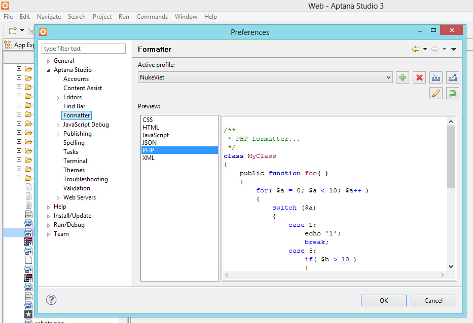
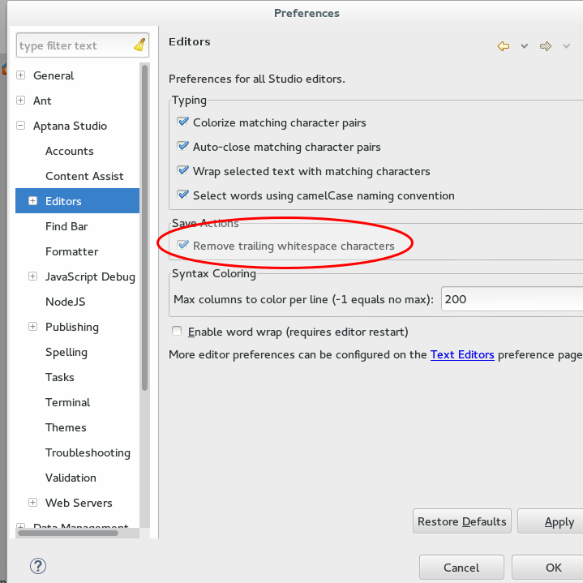
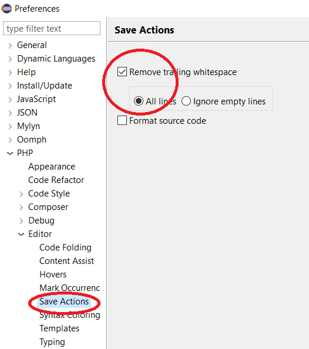
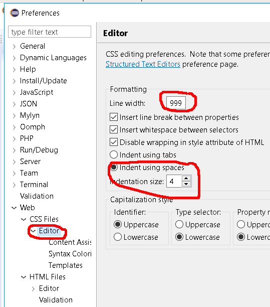
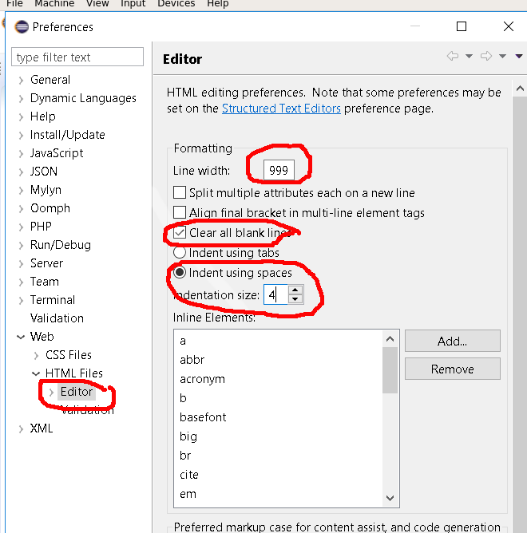
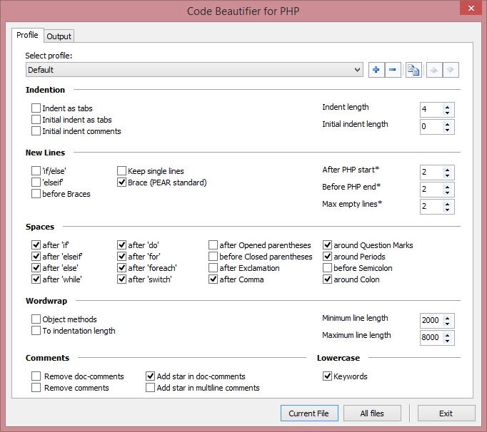
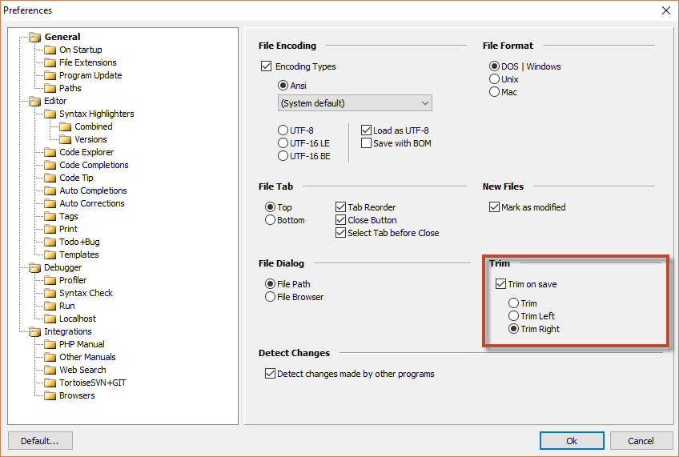

- Tên file đặt bằng tiếng Anh.
- Đặt tên file theo chức năng của file (ngoại trừ các file cố định) đó ví dụ file xử lý ảnh ta đặt image.php, file quản lý bình luận ta đặt comment.php.
- Tên file chỉ nên đặt bằng chữ cái thường, chỉ bao gồm số, chữ cái và dấu \_ (gạch dưới), tên file bắt đầu bằng chữ cái.

# Đối với các file PHP

- Các file PHP phải có định dạng UNIX (UNIX format).
- Khuyến nghị các file nên mã hóa dạng UTF-8 without BOM.

## Mở đầu mỗi file

Sau \<?php, mỗi file cần được bắt đầu bằng mô tả theo dạng

``` php
<?php

/**
 * @Project NUKEVIET 4.x
 * @Author VINADES.,JSC (contact@vinades.vn)
 * @Copyright (C) 2014 VINADES.,JSC. All rights reserved
 * @License GNU/GPL version 2 or any later version
 * @Createdate Tue, 21 Jan 2014 01:32:02 GMT
 */

// Some code here

```

Trong đó:

- Sau Project là tên dự án.
- Sau Author là thông tin về tên tác giả, email.
- Sau Copyright là thông tin bản quyền.
- Sau License là giấy phép của dự án
- Sau creatdate là thông tin về thời gian.

### Quy định riêng đối với file ngôn ngữ

``` php
<?php

/**
* @Project NUKEVIET 4.x
* @Author VINADES.,JSC (contact@vinades.vn)
* @Copyright (C) 2016 VINADES.,JSC. All rights reserved
* @Language English
* @License CC BY-SA (http://creativecommons.org/licenses/by-sa/4.0/)
* @Createdate Mar 04, 2010, 08:22:00 AM
*/

// Some code here

```

Ta thêm thông tin ngôn ngữ Language bên dưới thông tin về bản quyền.

## Chuẩn định dạng các file PHP

NukeViet áp dụng chuẩn định dạng code [PSR-2](http://www.php-fig.org/psr/psr-2/), mọi quy các áp dụng có thể xem tại đó.

Xem bản dịch Tiếng Việt của tài liệu trên: [https://github.com/nukeviet/fig-standards/blob/master/accepted/vi/PSR-2-coding-style-guide.md](https://github.com/nukeviet/fig-standards/blob/master/accepted/vi/PSR-2-coding-style-guide.md)

## Array

Do chuẩn PSR-2 không có quy định cụ thể về cách viết array, do đó NukeViet áp dụng riêng chuẩn như sau: Nếu mảng ngắn từ một đến hai phần tử ta viết

``` php
$array = array('id' => $id, 'title' => $title);
```

Nếu dài hơn ta phải viết

``` php
$array = array( 
    'id' => $id, 
    'title' => $title 
);
```

Đối với mảng nhiều chiều ta viết

``` php
$array = array( 
    'id' => array(
        'id' => $_id,
            'content' => array(
                'sub' => $sub,
                'cat' => $cat
            ),
        ), 
        'title' => $title 
);
```

# Đối với các file JS

Áp dụng chuẩn viết tương tự php

# Đối với các file TPL

Nếu không có trường hợp đặc biệt nên dùng duy nhất một tên main để dánh dấu khối

``` html
<!-- BEGIN: main ->
<!-- END: main ->
```

Dùng loop để đánh dấu những khối lặp lại

``` html
<!-- BEGIN: main ->
<ul>
    <!-- BEGIN: loop ->
    <li>The dinh dang kieu danh sach</li>
    <!-- END: loop ->
</ul>
<!-- END: main ->
```

> Các file TPL thực chất chứa mã HTML, JS tương tự các file .html, cần dùng 4 ký tự space để đánh dấu các thẻ cha con:

``` html
<!-- BEGIN: main -->
<div class="box-border">
    <div class="page-header">
        <h2>{CONTENT.title}</h2>
        <span class="small">{LANG.add_time}: {CONTENT.add_time}</span>
        <div class="clear">
        </div>
    </div>
    <div class="content-box">
        <div class="content-page">
            {CONTENT.bodytext}
        </div>
        <!-- BEGIN: other -->
            <div class="other-news" style="border-top: 1px solid #d8d8d8;">
                <ul style="margin:10px;">
                    <!-- BEGIN: loop -->
                    <li>
                        <a title="{OTHER.title}" href="{OTHER.link}">{OTHER.title}</a>
                    </li>
                    <!-- END: loop -->
                </ul>
            </div>
        <!-- END: other -->
    </div>
</div>
<!-- END: main -->
```

> Các thẻ có nội dung ngắn nên để một dòng

``` html
<span>{DATA.infomation}</span>
```

> Hạn chế tối đa viết trực tiếp CSS vào thẻ html.

# Đối với file CSS

Định dạng theo kiểu nhiều hàng.

``` css
.banner_plan {
    background: #FFF;
    border: 1px solid #DADADA;
    margin-bottom: 10px;
    padding: 5px
}
```

# Hướng dẫn định dạng php tự động

## Sử dụng Aptana Studio 3

Để định dạng code NukeViet trên Aptana Studio 3 bạn download file

[fomat_aptana.zip](/images/programming/fomat_aptana.zip) cho Aptana Studio 3.4

[fomat_aptana_3.6_nukeviet4.1.zip](/images/programming4/fomat_aptana_3.6_nukeviet4.1.zip) cho Aptana Studio 3.6.1

sau đó giải nén được file fomat_php.xml Import file định dạng

Vào menu Window -\> Preferences -\> Aptana-\> Code Style -\> Formatter, kích vào nút Imprort và chọn tới file fomat_php.xml vừa giải nén



Cấu hình thêm để xóa các dòng trắng: 

Sau khi lưu cấu hình, bạn mở từng file cần định dạng và nhấn tổ hợp phím Ctrl + Shift + F

## Eclipse Neon 3

Cấu hình Format cho PHP

[eclipse_neon_3_nukeviet4_php.zip](/images/programming4/eclipse_neon_3_nukeviet4_php.zip)

Cấu hình Format cho JS

[eclipse_neon_3_nukeviet4_js.zip](/images/programming4/eclipse_neon_3_nukeviet4_js.zip)

Cấu hình xóa khoảng trống khi lưu file PHP 

Cấu hình cho CSS 

Cấu hình cho html 

## Sử dụng phpDesigner 8

Để định dạng code NukeViet trên phpDesigner 8 bạn cầu hình fomat file php như sau: 

Sau khi lưu cấu hình, bạn mở từng file cần định dạng và nhấn tổ hợp phím Shift + Ctrl + F1

> **Chú ý**: PhpDesigner không định dạng tương tích hoàn toàn với chuẩn PSR-2 nên sau khi định dạng code theo trên, bạn cần thực hiện thêm hai thao tác nữa để có thể hoàn toàn áp dụng đúng chuẩn.

1.  Tại các file vừa định dạng, tìm kiếm cụm từ `Catch (` nếu có, đưa nó lên ngang hàng với ký tự `}`
2.  Tìm kiếm `array(` và `array (` nếu có kiểm tra lại và đưa ký tự đóng `)` xuống hàng mới.

Thiết lập cấu hình xóa khoảng trống khi lưu:

Vào mục Tools =\> Preferences sau đó thiết lập như hình: 
