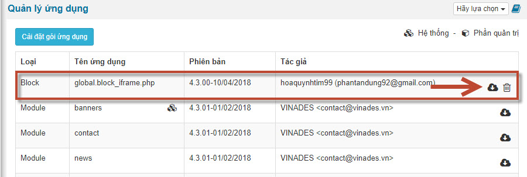

Đối với NukeViet 4, theme và module sẽ được hệ thống tự động nhận diện và có thể đóng gói ngay tại phần **Mở rộng** =\> **Quản lý ứng dụng**. Tuy nhiên, loại ứng dụng block, tiến trình tự động và ứng dụng khác (nếu có) do đặc thù có các file linh động, không cố định như theme và module nên hệ thống không thể tự động nhận diện được. Vì vậy, nhà phát triển cần chọn một trong các cách sau để đóng gói:

## Đưa lên NukeViet Store

Ứng dụng đưa lên NukeViet Store khi tải về sẽ được tự động đóng gói lại đúng chuẩn để có thể cài đặt tự động, đóng gói tự động sau này. Ví dụ khi cài đặt ứng dụng [Block Iframe](https://nukeviet.vn/vi/store/blocks/block-iframe/) trong phần quản lý ứng dụng sẽ xuất hiện block iframe. Quản trị có thể đóng gói lại block này hoặc xóa block này khỏi hệ thống.



Để đưa ứng dụng lên NukeViet Store, nhà phát triển chỉ cần nén các file của ứng dụng lại theo đúng cấu trúc và upload lên. Chi tiết hướng dẫn nhà phát triển có thể tham khảo tại trang [Đăng ứng dụng lên NukeViet Store](https://nukeviet.vn/vi/store/submit/)

## Đóng gói thủ công

1\. Nén lại các file ứng dụng theo đúng cấu trúc

Nhà phát triển cần nén tất cả các file ứng dụng của mình đúng cấu trúc vào file zip. Ví dụ đối với [Block Iframe](https://nukeviet.vn/vi/store/blocks/block-iframe/) thì nhà phát triển cần nén như sau

- modules/page/blocks/global.block_iframe.ini
- modules/page/blocks/global.block_iframe.php

2\. Khai báo thông tin ứng dụng vào file config.ini

Chuẩn bị file config.ini có dạng

``` ini
[extension]
id="0"
type="block"
name="global.block_iframe.php"
version="4.3.00"

[author]
name="hoaquynhtim99"
email="phantandung92@gmail.com"

[note]
text="Bình thường, bộ lọc an ninh của NukeViet sẽ lọc và chặn tất cả các thẻ HTML có khả năng chèn các mã độc hại vào trong nội dung bài viết bao gồm cả các iframe. Block này sẽ cung cấp cho bạn công cụ chèn iframe lên website."

```

Trong đó:

- `type="block"` thay block bằng loại ứng dụng module, block, theme, cronjob, other
- `name="global.block_iframe.php"` thay global.block_iframe.php bằng tên thật của ứng dụng, tham khảo quy định tên thật tại trang [Đăng ứng dụng lên NukeViet Store](https://nukeviet.vn/vi/store/submit/) (phần bên phải)
- `version="4.3.00"` thay 4.3.00 bằng phiên bản của ứng dụng.
- Thay hoaquynhtim99 bằng tên tác giả phantandung92@gmail.com bằng email của tác giả
- Thay text="" bằng giới thiệu ngắn gọn về ứng dụng

Sau đó nén file config.ini vào file zip, khi đó file zip hoàn chỉnh sẽ như sau:

- modules/page/blocks/global.block_iframe.ini
- modules/page/blocks/global.block_iframe.php
- config.ini

File này sẽ có thể cài đặt trực tiếp và đóng gói lại sau khi cài đặt.

> Lưu ý: Ứng dụng không phải là module và theme nếu cài đặt theo cách upload trực tiếp lên server mà không qua phần quản lý ứng dụng sẽ không thể đóng gói tự động!
