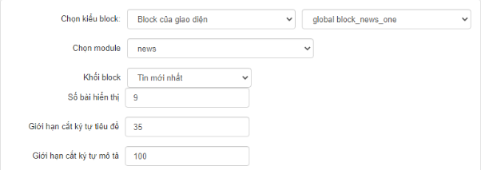
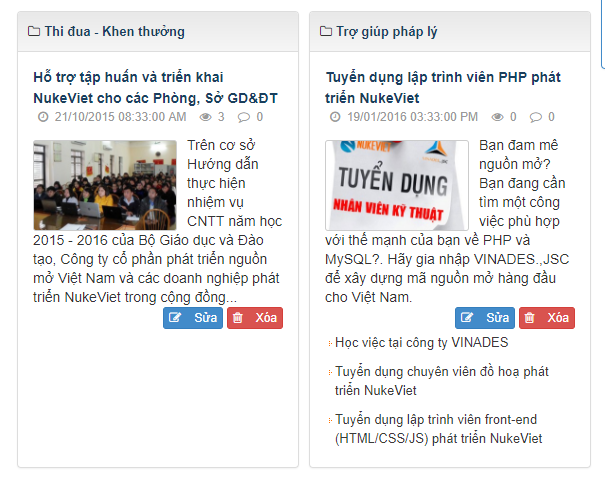
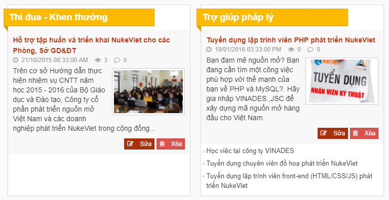
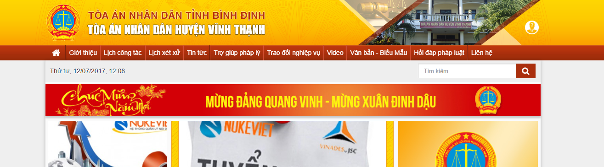

## 1) Copy Giao diện (Copy themes)

Copy Giao diện mặc định ../themes/default và đổi tên theme thành tên dự án.

> Ví dụ đặt tên là .../themes/shop-hoa

## 2) Xóa các phần thừa

Vào thư mục `/themes/ten-theme/blocks` xóa hết các file trừ `index.html`

Vào thư mục css xóa hết các file chừa lại `admin.css, bootstrap.min.css, bootstrap.non-responsive.css, custom.css, style.css, style.non-responsive.css, style.responsive.css`.

Vào thư mục images xóa hết chừa lại thư mục `icons, file index.html, no_image.gif`.

Vào thư mục js xóa hết các file chừa lại `bootstrap.min.js, custom.js, main.js`.

Vào thư mục language xóa `admin_fr.php, fr.php`. Nếu site của bạn không làm trên ngôn ngữ tiếng Anh thì xóa cả ''admin_en.php, en.php ''

Vào thư mục layout xóa các:

- Template block: `block.border.tpl, block.primary.tpl, block.simple.tpl` khi cần thì phát triển template cho giao diện
- Xóa các file layout `layout.xxx.tpl` nếu không dùng

## 3) Thay đổi hình minh họa của giao diện

Mở config.ini cấu hình lại các thông số tên giao diện, tác giả, mô tả, website

Hình minh họa của giao diện là `/themes/abc/default.jpg`. Nếu đổi tên `default.jpg` thành tên khác thì cần mở file `/themes/abc/config.ini` thay đổi giá trị tương ứng tại dòng

``` xml
<thumbnail>default.jpg</thumbnail>
```

> Ảnh này có kích thước chiều rộng là `800px`, chiều cao từ `600px`

Trong config.ini xóa hết các thẻ setlayout, setblocks và nội dung trong nó. Cấu hình lại layout mặc định trong thẻ \<layoutdefault\>

## 4) Chỉnh sửa giao diện

Các chỉnh sửa liên quan tới CSS cố gắng viết vào file `../themes/ten-theme/css/customs.css`. Trường hợp có liên quan đến responsive, non-responsive có thể sửa vào style.css, style.responsive.css, style.non-responsive.css tùy.

Các chỉnh sửa liên quan tới JS phải viết vào file `../themes/ten-theme/js/customs.js`

Các block của module mà có giao diện, cấu trúc hay không thể chỉnh sửa bằng css thì buộc phải viết thành block riêng của giao diện. Block của giao diện cần thỏa mãn cấu hình sau (hình minh họa phía dưới)

- Chọn module: Cầu lấy dữ liệu
- Cấu hình tùy chọn của block đó



Các chỉnh sửa thêm liên quan tới CSS bắt buộc phải sửa vào module thì phải viết xuống dòng file css của module đó và có thêm comment chú thích.

Các chỉnh sửa liên quan tới JS bắt buộc phải sửa vào JS của module thì cần phải chú thích đoạn nào đã sửa và thêm mới để người sau có thể biết tránh xóa đi.

Các giao diện rip từ mẫu có sẵn thì phải chỉnh sửa trên ...themes/ten-theme cho phù hợp chứ không được lấy full css html của giao diện đang rip đó vì sẽ thừa rất nhiều file

## 5) Giao diện của các Module

Nếu module nào không chỉnh sửa, cần xóa nó đi, bởi nếu không khi giao diện default chỉnh sửa sẽ phải đi sửa tất cả các giao diện này, và sinh ra rất nhiều rác trong code.

Để tránh việc thừa, Nên xóa hết giao diện của module, khi chỉnh sửa cho module nào thì mới copy từ giao diện mặc định sang.

Thành phần của giao diện module bao gồm:

- File `css/ten-module.css`
- Thư mục `images/ten-module/`
- File `js/ten-module.js`
- Thư mục `modules/ten-module/`

> Các file và thư mục trên tính từ thư mục `themes/abc/`

## 6) Layout của giao diện

Kiểm tra lại các layout,

``` text
/themes/abc/layout/layout.***.tpl
```

Cái nào làm thì giữ lại, Cái nào ko làm thì phải xóa đi để tránh người dùng cấu hình vào nó lỗi

Sau đó sửa lại file /themes/abc/config.ini

Sửa dòng

``` text
<layoutdefault>left-main-right</layoutdefault>
```

Thay **left-main-right** bằng layout mặc định cho giao diện, ví dụ thay thành main

``` text
<layoutdefault>main</layoutdefault>
```

## 7) Template của block

Kiểm tra các file `/themes/abc/layout/block.**.tpl` - chúng là các template của block, nếu cái nào làm thì giữ lại, cái nào không làm xóa đi.

> Chú ý: Template block.default.tpl là tối thiểu phải có, không được xóa nó.

## 8) Các block global của giao diện

Kiểm tra lại các blocks ở `/themes/abd/blocks`, cái nào cần sử dụng thì giữ lại, cái nào không cần sử dụng thì xóa đi.

> Xem [tổng quan về block](/programming4/block)

## 9) Chỉnh sửa lại giao diện để được giao diện mới

Cuối cùng là việc chỉnh sửa CSS và các file tpl để giao diện abc trở thành giao diện mới.

## 10) Một số chú ý khi làm giao diện

Hạn chế tối đa việc copy giao diện của các module từ giao diện mặc định sang giao diện mới để chỉnh sửa giao diện mà hãy tận dụng tối đa khả năng tùy biến của CSS để chỉnh sửa giao diện.

Áp dụng triệt để các thuộc tính của CSS 3 như `:last-child, :first-child, :before, :after` để tùy biến giao diện.

Ví dụ trường hợp sau:

Giao diện tin tức yêu cầu phải là hiển thị chuyên mục thành hai cột. Mặc định NukeViet có sẵn như sau:



Yêu cầu phải có giao diện như sau:



Khi đó chỉ cần viết đoạn CSS như sau là có thể chỉnh sửa được giao diện:

``` css
/* TIN TỨC LÀM HAI CỘT */
.news_column.two_column > .panel {
    margin-left: 10px;
    position: relative;
    background-color: #fff;
    border-radius: 0;
}
.news_column.two_column > .panel > .panel-heading {
    margin-left: -9px;
    position: relative;
    margin-right: 60px;
    border-radius: 0;
    background-color: transparent;
    background-image: none!important;
    border: 0;
    padding-left: 0;
}
.news_column.two_column > .panel > .panel-heading h4 {
    font-size: 18px;
    font-weight: bold;
    position: relative;
    background-image: url(../images/homepage-focus-bg.gif);
    background-repeat: repeat;
    border: 1px #f1a60d solid;
}
.news_column.two_column > .panel > .panel-heading h4:before {
    width: 9px;
    height: 11px;
    overflow: hidden;
    content: "";
    position: absolute;
    bottom: -12px;
    left: -1px;
    background-image: url(../images/news-cat-conner.jpg);
}
.news_column.two_column > .panel > .panel-heading h4 a {
    color: #fff;
    display: block;
    background-image: linear-gradient(to bottom,rgba(251, 149, 1, 0.39) 0%,rgba(251, 149, 1, 0.36) 100%) !important;
    padding: 3px 3px 3px 10px;
}
.news_column.two_column > .panel > .panel-body {
    padding: 0;
}
.news_column.two_column > .panel > .panel-body > h3,
.news_column.two_column > .panel > .panel-body > div,
.news_column.two_column > .panel > .panel-body > p {
    background-color: #f8f8f8;
    padding-left: 10px;
    padding-right: 10px;
}
.news_column.two_column > .panel > .panel-body > h3 {
    padding-top: 10px;
}
.news_column.two_column > .panel > .panel-body > h3 a {
    color: #bb3914;
}
.news_column.two_column > .panel > .panel-body > h3 a:hover {
    color: #3a4276;
}
.news_column.two_column > .panel > .panel-body > p {
    padding-bottom: 10px;
}
.news_column.two_column > .panel > .panel-body > ul li {
    margin-bottom: 6px!important;
}
.news_column.two_column > .panel > .panel-body > a img {
    margin-left: 10px;
    margin-right: 10px;
    border-radius: 0;
    padding: 3px;
    border: solid 1px #cecece;
    background-color: #fff;
    float: right!important;
}
.news_column.two_column > .panel > .panel-body > div ul li:first-child {
    margin-left: 0;
    padding-left: 0;
}
.news_column.two_column > .panel > .panel-body > div li {
    margin-bottom: 3px!important;
}
```

Nếu copy giao diện module từ giao diện mặc định sang giao diện mới để chỉnh sửa hãy kiểm tra lại nếu không thật sự cần thiết phải chỉnh sửa file js của module thì nên xóa nó đi, hệ thống sẽ tự động gọi từ giao diện mặc định, như vậy sẽ giảm thiểu một khối lượng công việc khi nâng cấp giao diện.

Không nên chỉnh sửa vào file style.css và main.js của giao diện mặc định copy sang mà hãy tạo file mới ví dụ 'custom.css' và 'custom.js' để viết những cái mới để sau này nâng cấp chỉ cần ghi đè các file tương ứng từ giao diện mặc định sang là giao diện mới hoàn toàn có thể sử dụng ngay.

Giao diện mặc định ở dạng `boxed` nếu muốn chỉnh sửa lại thành dạng `full-width` thì nên tránh việc CSS lại các thành phần `.container, .wraper` mà hãy tận dụng CSS `position absolute fixed` và `z-index`

Ví dụ một header có dạng sau:



Khi sửa từ giao diện mặc định ta chỉ cần thêm vào đầu file `header_extended.tpl`

``` html
<div class="site-banner-bg">&nbsp;</div>
<div class="site-banner-bg1">&nbsp;</div>
<div class="site-menu-bg">&nbsp;</div>
```

Và trong CSS

``` css
.site-banner-bg {
    background: #fdd602;
    background: -moz-linear-gradient(top, #fdd602 0%, #ffd701 3%, #fed503 5%, #fdcb01 41%, #fcb701 72%, #fba201 96%, #fba202 100%);
    background: -webkit-linear-gradient(top, #fdd602 0%,#ffd701 3%,#fed503 5%,#fdcb01 41%,#fcb701 72%,#fba201 96%,#fba202 100%);
    background: linear-gradient(to bottom, #fdd602 0%,#ffd701 3%,#fed503 5%,#fdcb01 41%,#fcb701 72%,#fba201 96%,#fba202 100%);
    filter: progid:DXImageTransform.Microsoft.gradient( startColorstr='#fdd602', endColorstr='#fba202',GradientType=0 );
    height: 100px;
    position: absolute;
    top: 0;
    left: 0;
    width: 100%;
}
.site-banner-bg1 {
    height: 100px;
    position: absolute;
    top: 0;
    left: 0;
    width: 100%;
    background-image: url(../images/trong-dong.png);
    background-repeat: no-repeat;
    background-position: center bottom;
}
.site-menu-bg {
    background: #d36f21;
    background: -moz-linear-gradient(top, #d36f21 0%, #c13513 3%, #bf360c 6%, #bc350f 10%, #b5340d 32%, #aa2f0d 52%, #aa2f0d 58%, #a42e0c 61%, #a62f0b 65%, #9f2d0b 84%, #9a2c0a 90%, #992703 94%, #982b0c 97%, #992a05 100%);
    background: -webkit-linear-gradient(top, #d36f21 0%,#c13513 3%,#bf360c 6%,#bc350f 10%,#b5340d 32%,#aa2f0d 52%,#aa2f0d 58%,#a42e0c 61%,#a62f0b 65%,#9f2d0b 84%,#9a2c0a 90%,#992703 94%,#982b0c 97%,#992a05 100%);
    background: linear-gradient(to bottom, #d36f21 0%,#c13513 3%,#bf360c 6%,#bc350f 10%,#b5340d 32%,#aa2f0d 52%,#aa2f0d 58%,#a42e0c 61%,#a62f0b 65%,#9f2d0b 84%,#9a2c0a 90%,#992703 94%,#982b0c 97%,#992a05 100%);
    filter: progid:DXImageTransform.Microsoft.gradient( startColorstr='#d36f21', endColorstr='#992a05',GradientType=0 );
    height: 33px;
    position: absolute;
    top: 100px;
    left: 0;
    width: 100%;
}
```
