Để có thể thiết kế được 1 giao diện các bạn cần phải biết được 1 số định nghĩa cùng với các thành phần "**cần**" và "**có**" trong giao diện.  

## 1. Định nghĩa về giao diện (theme)

Tham khảo [Khái niệm theme](/nukeviet4/concepts/theme)

## 2. Cấu trúc của giao diện

Giao diện được chia làm 3 phần **Header**, **Body** và **Footer**  
*Demo về dạng cấu trúc cơ bản của giao diện* 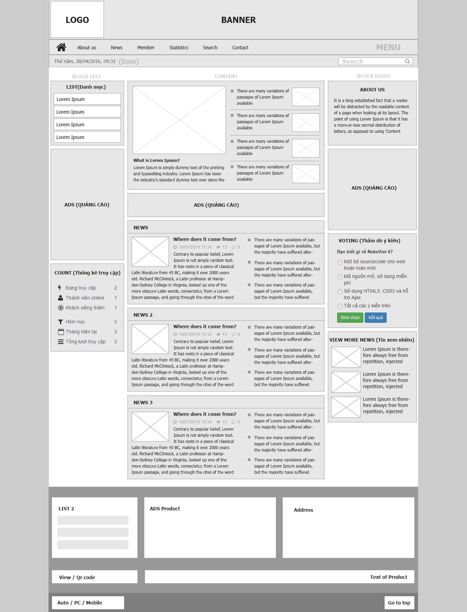

- Header bao gồm: Logo , Banner , Menu , Search và Date.
- Body bao gồm: những thành phần thuộc nhóm -\> Block left , Content, Block right.
- Footer bao gồm: những thành phần từ List 2, ADS Product, Address trở xuống phía dưới.

## 3. Font sử dụng trong giao diện

  
Nukeviet thường sử dụng các dạng font sau : **tahoma, arial, vendara, awesome, roboto**... (Tùy vào từng loại giao diện mà người thiết kế có thể thay đổi dạng font cho phù hợp).  
Ngoài ra thiết kế giao diện có thể kiếm thêm font để sử dụng tại : [https://fonts.google.com/](https://fonts.google.com/) (đây là bộ font mà google đã chuyển đổi (nhớ chuyển language sang tiếng việt font hiển thị chính xác) và tích hợp. Các bạn có thể down về sử dụng).

## 4. Hình ảnh sử dụng trong giao diện

Ảnh hiển thị đóng góp 1 phần rất quan trọng đến giao diện và rất nhiều người thiết kế hiện nay đang sử dụng ảnh bị dính bản quyền tác giả mà không biết (khi bạn sử dụng ảnh bản quyền mà bị phát hiện thì rất có thể bạn sẽ bị kiện và trả một số tiền cực lớn cho việc này). Dưới đây là list các site download ảnh free mà thôi đã check và kiểm tra về quyền sử dụng các bức ảnh :

- [http://www.gratisography.com/](http://www.gratisography.com/)
- [https://stocksnap.io/](https://stocksnap.io/)
- [https://unsplash.com/](https://unsplash.com/)
- [http://negativespace.co/](http://negativespace.co/)
- [http://www.lifeofpix.com/](http://www.lifeofpix.com/)
- [http://freestocks.org/](http://freestocks.org/)
- [http://jaymantri.com/](http://jaymantri.com/)
- [https://pixabay.com/](https://pixabay.com/) - Trang tìm kiếm ảnh yêu thích của tôi
- [http://publicdomainarchive.com/](http://publicdomainarchive.com/)
- [http://littlevisuals.co/](http://littlevisuals.co/)
- [http://kaboompics.com/](http://kaboompics.com/)
- [https://www.pexels.com/](https://www.pexels.com/)
- [https://www.flickr.com/](https://www.flickr.com/) - Trang này có 1 một số quy định nên cần phải xem hướng dẫn tại đây
- [https://foodiesfeed.com/](https://foodiesfeed.com/) - Ko có giấy phép cc nhưng có quyền sử dụng hình ảnh (miễn là ko được đem nó ra bán - [https://foodiesfeed.com/faq/](https://foodiesfeed.com/faq/))

Chú ý :

- Tuy ở trên tôi đã kiểm tra về bản quyền ảnh nhưng để chắc chắn trước khi download bạn kiểm tra lại 1 lần nữa cho chắc ăn nhé
- Các trang web trên có License là CC0 1.0
- Tạm thời đối với những trang web có License CC thì người sử dụng có thể tìm kiếm, sử dụng hình ảnh tự do (tham khảo về quyền sử dụng [https://creativecommons.org/](https://creativecommons.org/))
- Với 1 số trang không có giấy phép CC thì cần phải xem kĩ điều kiện mà người quản trị đưa ra

## 5. Các layout thường sử dụng trong giao diện

Trong NukeViet thì các layout được biến đổi để phù hợp với từng giao diện sử dụng. NukeViet có những layout sau đây thường được sử dụng

| Layout (dạng body hiển thị của nukeviet) | Col (số cột tương ứng với từng layout) | Ảnh minh họa (Click vào link để xem ảnh to) | Ví dụ minh họa trên NukeViet 4.0 |
|:---|:---|:---|----|
| Left - Main | 6 - 18 | 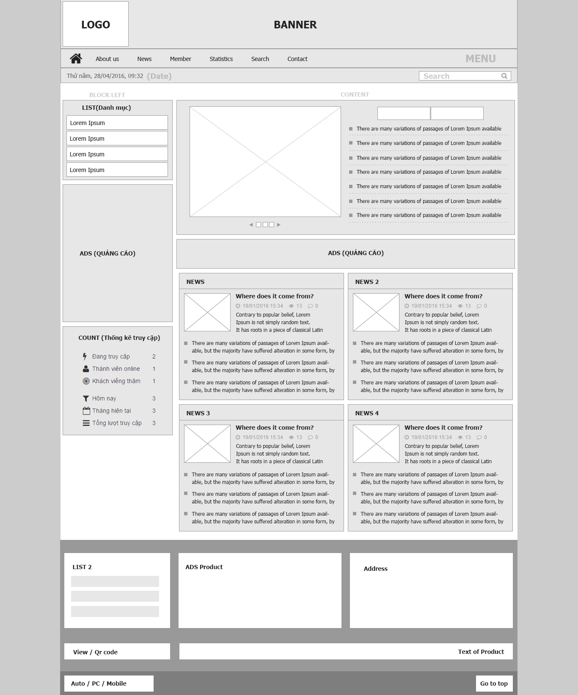 | 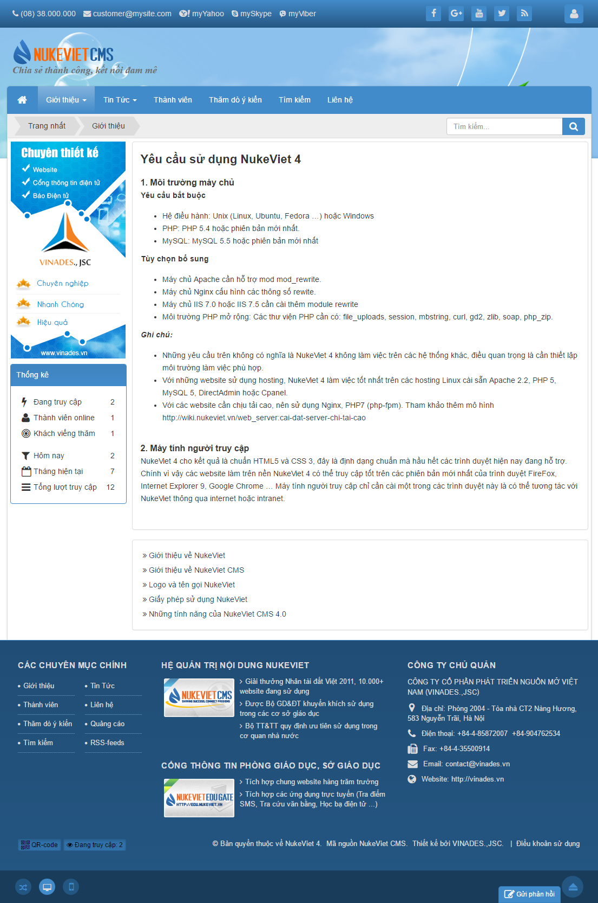 |
| Left - Main - Right | 5 - 13 - 6 |  | 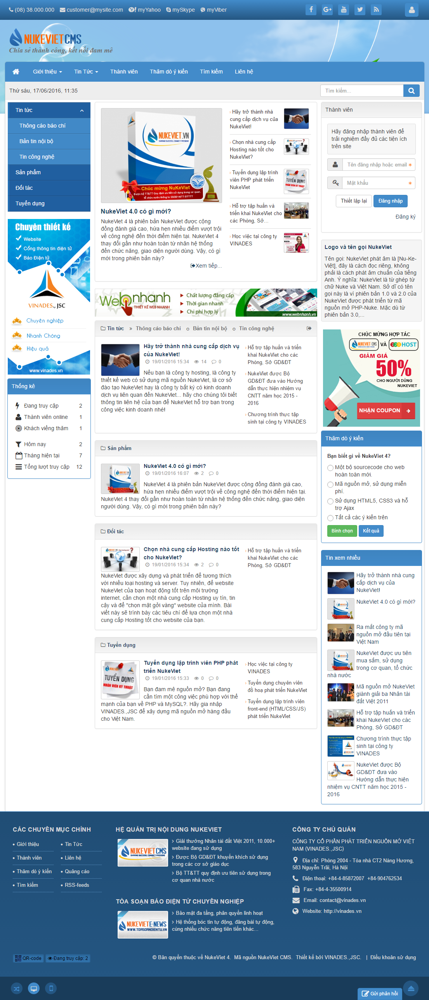 |
| Left - Right - Main | 5 - 6 - 13 | 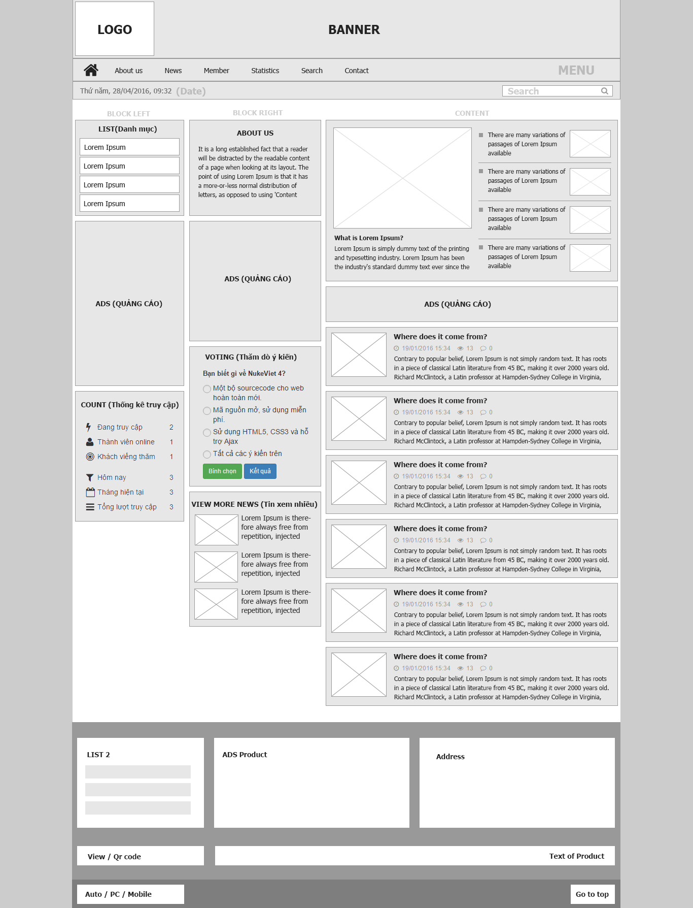 | 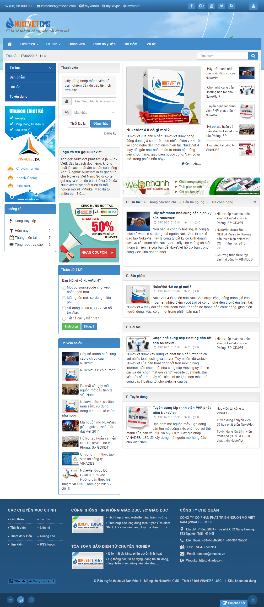 |
| Main | 24 | 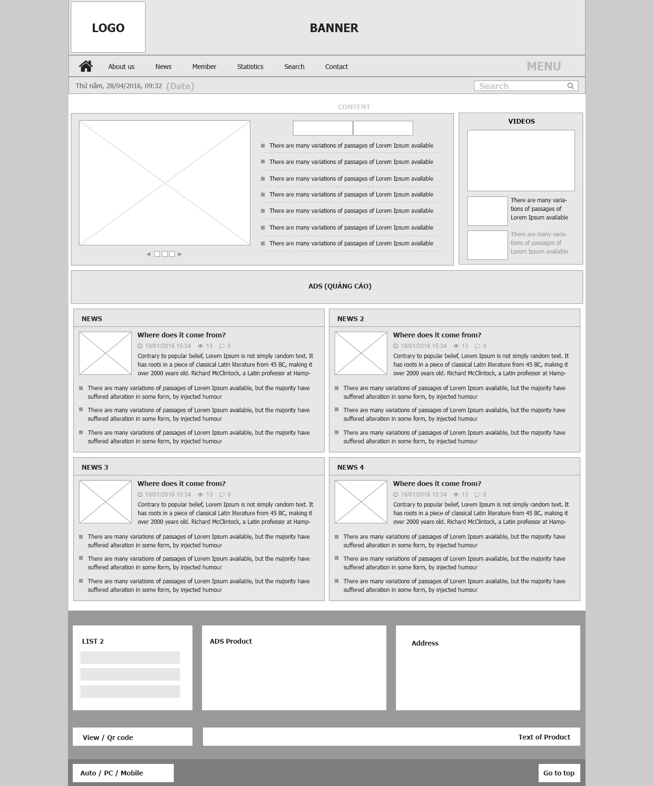 | 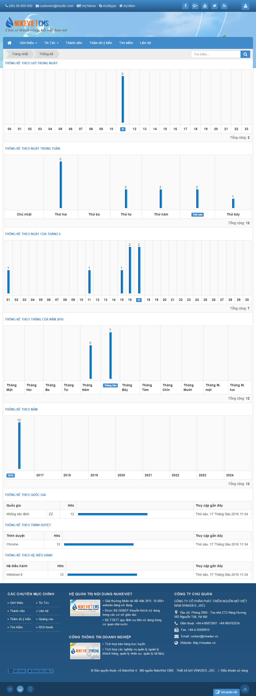 |
| Main - Left - Right | 13 - 6 - 5 | 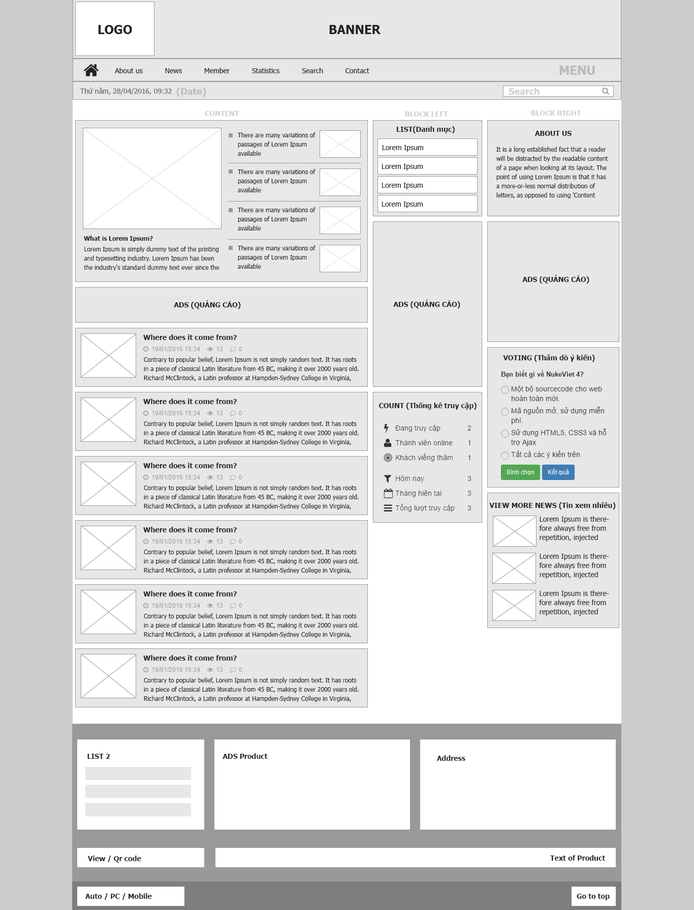 | 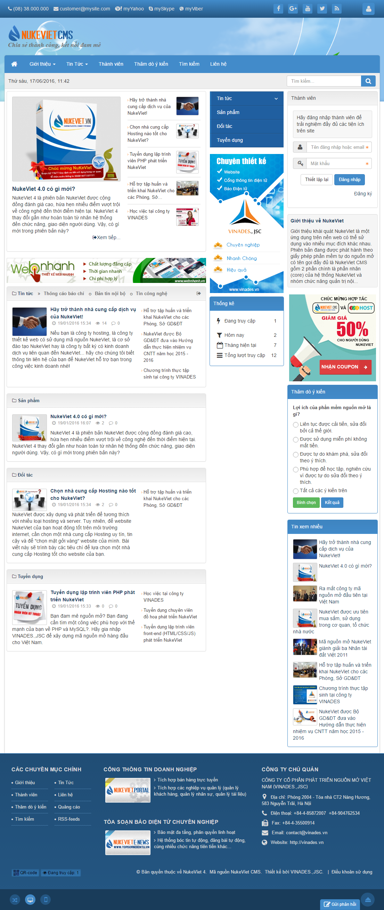 |
| Main - Right | 18 - 6 | 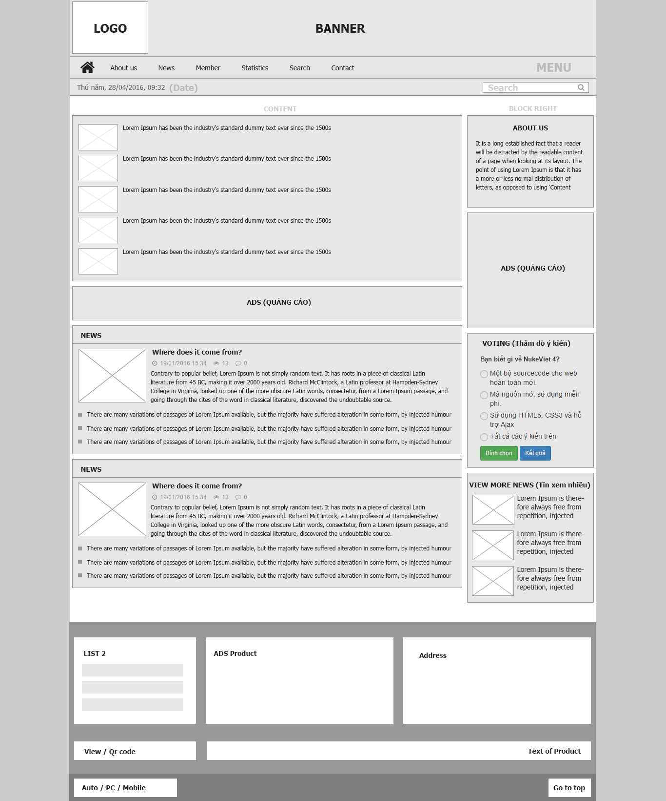 | 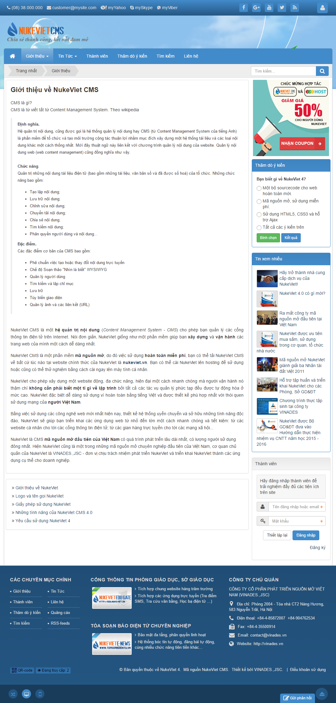 |

Chú ý

-  Main là cách gọi mới thay thế cho cách gọi cũ (body) để tránh sự nhầm lẫn.
-  Giao diện được vẽ ra trước khi đổi tên nên phần main được thay bằng content để phân biệt)

## 6. Quy chuẩn trong giao diện

Trong nukeviet có một số thành phần được quy chuẩn mà thiết kế cần phải tránh hoặc cân nhắc (khi thay hoặc thêm vào) khi sử dụng cho giao diện.

### Quy chuẩn về icon

Hầu hết các icon đều sử dụng font để hiển thị, lợi ích ở đây là nhẹ và không phải sử dụng nhiều hình ảnh do đó người thiết kế **nên hạn chế** thay đổi về mặt hình ảnh của những icon này.

#### Các icon nên ít chỉnh sửa

Các icon này gần như cố định ít thay đổi nên người thiết kế cần hạn chế chỉnh sửa những icon này

1.  Social icon: 
2.  Icon User: 
3.  Icon Home: 
4.  Icon Search: 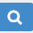
5.  Icon Tin tức: 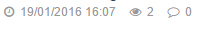
6.  Icon Thống kê truy cập: 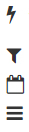
7.  Icon Reponsive: 
8.  Icon Back to top: 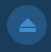
9.  Icon Mail in save: (trong chi tiết của bài viết): 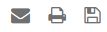
10. Icon tag (từ khóa: 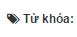
11. Icon Comment: 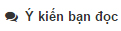
12. Icon Qr code - view : 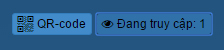

#### Các icon có thể chỉnh sửa

Các icon này không cố định nên người thiết kế có thể thay đổi được

1.  Icon Liên hệ (trên đầu trang): 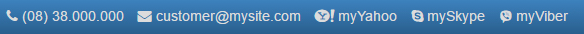
2.  Icon Title tin tức: 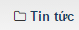
3.  Icon Xem tiếp: 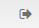
4.  Icon link của tin tức: 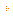
5.  Icon Address(địa chỉ): 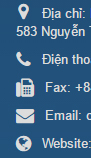

### Quy chuẩn về khoảng cách các khối

Theo quy chuẩn thường thì các khối sẽ có 1 khoảng cách nhất định với nhau (khoảng cách trên dưới trái phải). Tất nhiên nó không ràng buộc quá chặt chẽ, người thiết kế có thể thò ra thụt vào tùy ý để website hấp dẫn hơn nhưng cần chút hợp lí để không tạo sự hụt hẫng trong giao diện. Ngoài ra việc quy chuẩn này áp dụng cho cả các trang trong vì vậy người thiết kế cần lưu ý khi thiết kế các trang này)  
Ví dụ như sau : 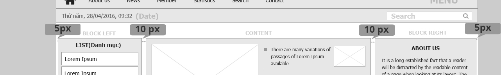

Ở đây chúng ta thấy phần khối block bên tay trái có khoảng cách với lề là 5px và khoảng cách với khối giữa là 5px (10px là tính cả khoảng cách của khối giữa - mỗi bên cách ra 5px), đây là khoảng cách mà nukeviet 4 thường sử dụng.
