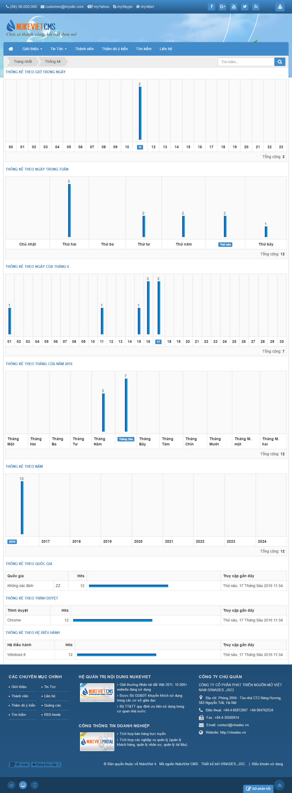

## Định nghĩa layout

Xem [Khái niệm layout trong NukeViet](/nukeviet4/concepts/layout)

NukeViet 4 sử dụng framework [Bootstrap](http://getbootstrap.com/) cho giao diện mặc định.

## Các layout đang sử dụng trong giao diện mặc định của NukeViet 4.0

Layout của NukeViet được xây dựng từ hệ thống [Grid system](http://getbootstrap.com/css/#grid) của bootstrap thông qua việc chỉnh sửa số cột của bootstrap trừ 12 lên 24.

Như vậy có thể giải thích ngắn gọn về số cột như sau: Đem chia chiều rộng của trang web (chiều rộng này đối với giao diện mặc định do class `.container` quyết đinh và tùy thuộc vào kiểu giao diện) thành 24 phần bằng nhau thì các cột trong giao diện mặc định sẽ chiếm độ rộng được mô tả ở bảng sau:

| Tên layout | Số cột mà từng thành phần sẽ chiếm dụng | Ví dụ minh họa |
|----|----|----|
| Main | 24 |  |
| Main - Left - Right | 13 - 6 - 5 |  |
| Main - Right | 18 - 6 |  |
| Left - Main | 6 - 18 |  |
| Left - Main - Right | 5 - 13 - 6 |  |
| Left - Right - Main | 5 - 6 - 13 |  |

> Lưu ý: Các cột trên sẽ chiếm độ rộng khác nhau tùy theo kích thước màn hình và kiểu giao diện. Xem thêm [Grid options](http://getbootstrap.com/css/#grid-options)

## Cách thiết lập layout trong trang quản trị của NukeViet

- [Thiết lập layout cho giao diện](/nukeviet/admin/themes/setuplayout)
- [Các layout thường sử dụng trong giao diện](/programming4/theme/items)
