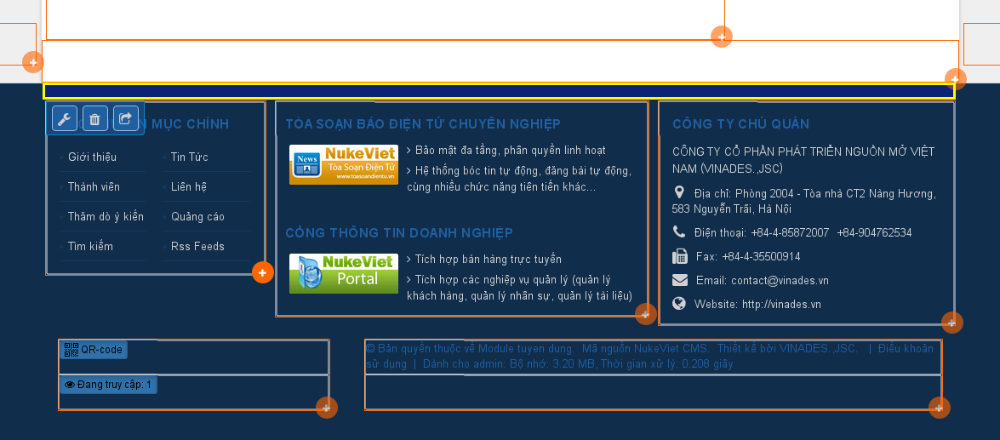
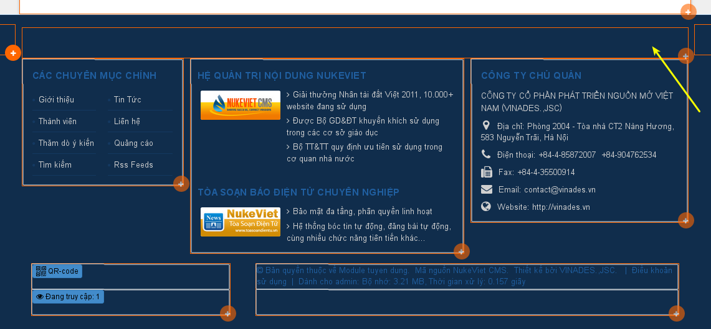

Giả sử, trên giao diện default của NukeViet, mình muốn thêm một khối block ở bị trí (khung đánh dấu màu vàng) với tên là BOTTOM_CONTENT (Nộ dung dưới trang). Thì các bước thực hiện như bên dưới.



## 1. Khai báo khối block mới

Thực hiện mở tập tin themes/ten-theme/config.ini, bên trong thẻ (trong này sẽ có nhiều thẻ con) \<positions\>\</positions\> khai báo tên khối block mới, với cấu trúc.

``` html

<position>
    <name>TEN-HIEN-THI</name>
    <tag>[TEN-KHOI]</tag>
</position>
```

Trong đó:

``` text
  TEN-HIEN-THI là tên hiển thị của khối, có thể đặt tùy ý.
  TEN-KHOI được xem như là khóa để nhận biết khối, tên này cần khác với tên các khối khác, in hoa, sử dụng chữ hoặc số, cách nhau bằng dấu dạch dưới “_”.
```

Kết quả cho trường hợp này sẽ là:

``` html

<positions>
    <position>
        .....
    </position>
    <position>
        .....
    </position>
    <position>
        <name>
            Nội dung cuối trang
        </name>
        <tag>
            [BOTTOM_CONTENT]
        </tag>
    </position>
</positions>
```

## 2. Hiển thị khối block lên giao diện

Đối với vị trí đã nêu trên, mình sẽ mở themes/ten-theme/layout/footer_extend.tpl, tìm:

``` html
<div class="wraper">
    <div class="container">
```

Thêm bên dưới

``` html
[BOTTOM_CONTENT]
```

## 3. cấu hình và hiển thị

Với NukeViet \>= 4.2 cần vào phần quản trị: Công cụ web -\> Dọn dẹp hệ thống -\> Làm sạch cache

Ra ngoài site bật kéo thả block, bạn sẽ thấy ở vị trí đánh dấu màu vàng bên trên, sẽ xuất hiện khung thể hiện khối block ở vị trí đó.



Chú ý: ten-theme đại diện cho cả giao diện PC và mobile, vậy nên trên giao diện mobile cũng thực hiện tương tự.

Tham khảo: [https://mynukeviet.net/tuy-bien-nukeviet/huong-dan-them-khoi-block-giao-dien-nukeviet-119.html](https://mynukeviet.net/tuy-bien-nukeviet/huong-dan-them-khoi-block-giao-dien-nukeviet-119.html)
