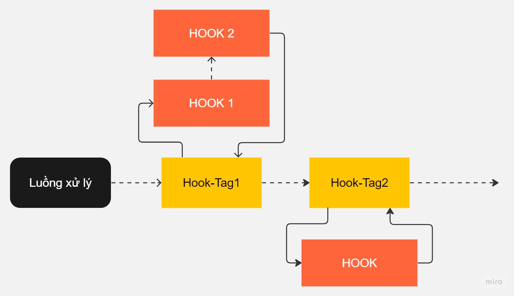
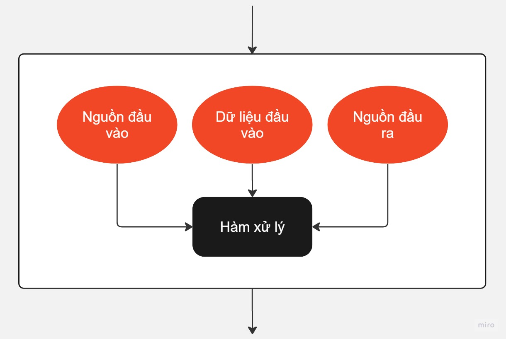

## Mô tả về hook



Ảnh bên trên mô tả về hook của NukeViet 4. Trong một luồng xử lý (hoặc hiểu là một truy vấn) hệ thống sẽ gặp các vị trí mà code có khai báo một thẻ nào đó (có thể hiểu là event-name). Tại các vị trí đó hệ thống sẽ tìm trong thiết lập các hook (có thể hiểu là các hàm, các đoạn code) để xử lý sau đó mới quay lại luồng chính.

Có thể bắt gặp các vị trí đó bằng cách tìm kiếm trong code những chỗ có sử dụng hàm `nv_apply_hook`. Các vị trí này do người lập trình quy định, có thể đặt bất kỳ đầu trong code từ nhân hệ thống, giao diện lẫn các module.

Chi tiết một hook sẽ như sau



Hook bản chất là một hàm xử lý và có thể trả kết quả về hoặc không tùy theo nhu cầu của lập trình viên. Trong đó ngoài việc có thể sử dụng các biến global, các hằng, class của hệ thống để xử lý thì có một số dữ liệu cố định tùy thuộc vào khai báo trước đó có thể sử dụng:

- Nguồn đầu vào: Đây là thông tin của module tại luồng xử lý mà gặp các hook-tag (xem ảnh 1). Trống thì nguồn đầu vào xuất phát từ hệ thống
- Dữ liệu đầu vào: Đây là dữ liệu được hàm nv_apply_hook truyền vào, tùy thuộc người lập trình. Bên dưới sẽ mô tả kỹ hơn
- Nguồn đầu ra: Đây là thông tin của module cần được thao tác dữ liệu vào nó tại hàm xử lý. Có thể trống nếu không chỉ ra.

Hàm xử lý sẽ sử dụng các tài nguyên hệ thống và các nguồn cố định bên trên để làm việc gì đó tùy người lập trình quyết định.

## Lập trình hook

### Đăng ký hook-tag mới

Lập trình viên tìm vị trí trong code mà mình muốn, sau đó sử dụng hàm `nv_apply_hook` bằng một trong các cách sau

``` php
nv_apply_hook('', 'get_qr_code', [$nv_Request]);
$db_slave = nv_apply_hook('', 'db_slave_connect', [$db, $db_config], $db);
list($contents, $headers) = nv_apply_hook('', 'change_site_buffer', [$global_config, [$contents, $headers]], [$contents, $headers]);
```

Cú pháp hàm nv_apply_hook như sau:

``` php
nv_apply_hook($module, $tag, $args = [], $default = null, $return_type = 0);
```

- `$module` là tên module nguồn đầu vào (xem ảnh 2) nếu có, nếu không thì để chuỗi rỗng `""`
- `$tag` tên hook, tùy ý lập trình viên đặt. Xem quy định bên dưới
- `$args` mảng dữ liệu đầu vào nếu truyền dữ liệu đầu vào (xem ảnh 2). Bắt buộc là mảng, và nên có key tự động, không đặt key vào. Ví dụ `[$global_config, [$contents, $headers]]`
- `$default` dữ liệu mặc định trả về của hàm nv_apply_hook nếu hook này không có file xử lý nào hoặc hàm xử lý trả về null.
- `$return_type` là kiểu xử lý dữ liệu trả về nếu có nhiều hook cùng chạy. 0 sẽ lấy dữ liệu cuối cùng. 1 thì dữ liệu cuối cùng trả về sẽ là array_merge của các kết quả, 2 thì dữ liệu là array_merge_recursive của các kết quả. Chú ý 1 và 2 chỉ khả dụng nếu dữ liệu trả về là mảng. Nếu dùng 1,2 mà hàm xử lý trả không phải array thì giá trị `$default` sẽ được sử dụng

### Lập trình hook

Tạo file PHP đặt vào thư mục includes/plugin. Tên file gồm số, chữ cái thường, in hoa từ a-z và dấu gạch dưới. Trong file này nội dung như sau

``` php
<?php

/**
 * NukeViet Content Management System
 * @version 4.x
 * @author VINADES.,JSC <contact@vinades.vn>
 * @copyright (C) 2009-2021 VINADES.,JSC. All rights reserved
 * @license GNU/GPL version 2 or any later version
 * @see https://github.com/nukeviet The NukeViet CMS GitHub project
 */

$nv_hook_module = 'users'; // Module xảy ra event chứa data
$nv_receive_module = 'users'; // Module nhận và xử lý data

$callback = function($vars, $from_data, $receive_data) {
    $module_name = $receive_data['module_name'];
    $module_info = $receive_data['module_info'];
    $module_data = $module_info['module_data'];

    $credential = $vars[0];

    // FIXME code here
    
    return 'value'; // ['value'] ...
};
nv_add_hook($module_name, 'handling_google_identity_login', $priority, $callback, $hook_module, $pid);

```

Khai báo biến `$nv_hook_module` có giá trị bằng module_file của module nguồn đầu vào nếu muốn. Không thì xóa dòng đó đi.

Khai báo biến `$nv_receive_module` có giá trị bằng module_file của module nguồn đầu ra nếu muốn. Không thì xóa dòng đó đi.

Thay tham số `handling_google_identity_login` bằng hook-tag mà bạn muốn xử lý, ví dụ bạn viết plugin để xử lý cho bước đăng ký hook-tag bên trên thì thay bằng giá trị `$tag` đã đăng ký.

Trong hàm xử lý có 3 biến tương ứng với các dữ liệu cố định mô tả ở ảnh 2

- `$vars`
- `$from_data`
- `$receive_data`

**`$vars`**

Đây là giá trị của nguồn đầu vào mô tả trong ảnh 2. Hay là giá trị của `$args` được truyền vào tại hàm nv_apply_hook. Ngoài ra hệ thống tự thêm vào `$vars['pid']` đây là ID của plugin này trong CSDL.

Chú ý `$vars` là tham chiếu, tức trong hàm xử lý làm thay đổi giá trị của nó thì sau khi thực hiện xong hàm, dữ liệu đã được truyền vào cũng được thay đổi theo.

**`$from_data`**

Nếu nguồn đầu vào rỗng thì `$from_data = [];` nếu là module thì có giá trị

``` php
$from_data['module_name'] = 'module-name'; // Tương đương $module_name của module
$from_data['module_info'] = $sys_mods['module-name']; // Tương đương $module_info của module
```

**`$receive_data`**

Nếu nguồn đầu ra rỗng thì `$receive_data = [];` nếu là module thì có giá trị

``` php
$receive_data['module_name'] = 'module-name'; // Tương đương $module_name của module
$receive_data['module_info'] = $sys_mods['module-name']; // Tương đương $module_info của module
```

## Danh sách các hook có sẵn

[Xem danh sách các hook trong NukeViet 4](/nukeviet4/codex/hooks-reference)

## Lưu ý khi đặt tên vị trí mới của hook:

1.  Tên vị trí của hook được gắn với một vị trí nhất định và là duy nhất
2.  Tên vị trí của hook phải theo đúng chuẩn a-zA-Z0-9\_
3.  Không nên tạo tên mới đối với các vị trí đã được đặt tên, thay vào đó sử dụng luôn tên đã được đặt này. Chú ý đảm bảo không được thay đổi cách sử dụng nếu nó đã có sẵn để các hook đã viết không bị hỏng. Nếu phải thay đổi cách sử dụng thì phải tạo ra tên mới

## Cách chuyển từ plugin sang hook

#### Để chuyển từ plugins sang hook, ta làm theo các bước sau:

- Mục danh sách không đánh sốTìm đến file plugins cần chuyển sang hook.
- Mục danh sách không đánh sốThường trong các file plugins này sẽ có 2 dạng: 1 là code trực tiếp, 2 là các functions. Xác định xem đâu là code chạy trực tiếp, đâu là functions.
- Với code chạy trực tiếp, ta cho vào funcstion có dạng

``` php
nv_add_hook($module_name, $sector, $priority, function () {
  //di chuyển code vào đây
}
```

với \$sector chính là ID của plugins, ví dụ plugins có id là 3, thì \$sector = 'sector3' (Lưu ý, gán trực tiếp \$sector vào function)

- Còn các code dạng functions thì giữ nguyên, không cho vào nv_add_hook.
- Xoá các file .ini của plugins
- Vào các chỗ cần gọi hook và gọi
  ``` php
  nv_apply_hook('', 'sector4');
  ```

  (Lưu ý: gọi chỗ nào thì có quy định theo cách đặt tên, vị trí gọi tương ứng với ID của plugins)
- Thêm CSDL theo mẫu, với các dữ liệu insert vào tương ứng các plugins đã chuyển đổi

``` sql
DROP TABLE IF EXISTS `nv4_plugins`;
CREATE TABLE `nv4_plugins` (
  `pid` mediumint(8) unsigned NOT NULL AUTO_INCREMENT,
  `plugin_lang` varchar(3)  COLLATE utf8_unicode_ci NOT NULL DEFAULT 'all',
  `plugin_file` varchar(50)  COLLATE utf8_unicode_ci NOT NULL,
  `plugin_area` varchar(50)  COLLATE utf8_unicode_ci NOT NULL DEFAULT '',
  `plugin_module_name` varchar(50)  COLLATE utf8_unicode_ci NOT NULL DEFAULT '',
  `plugin_module_file` varchar(50)  COLLATE utf8_unicode_ci NOT NULL DEFAULT '',
  `hook_module` varchar(50)  COLLATE utf8_unicode_ci NOT NULL DEFAULT '',
  `weight` tinyint(4) NOT NULL,
  PRIMARY KEY (`pid`),
  UNIQUE KEY `plugin` (`plugin_lang`,`plugin_file`,`plugin_area`,`plugin_module_name`,`hook_module`)
) ENGINE=InnoDB  AUTO_INCREMENT=1001  DEFAULT CHARSET=utf8;

INSERT INTO `nv4_plugins` VALUES
 (1, 'all', 'qrcode.php', 'get_qr_code', '', '', '', 1),
 (2, 'all', 'cdn_js_css_image.php', 'change_site_buffer', '', '', '', 1),
 (1001, 'all', 'redirect_to_non_www.php', 'check_server', '', '', '', 1),
 (1002, 'all', 'enable_db_debug.php', 'sector2', '', '', '', 1),
```
