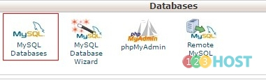
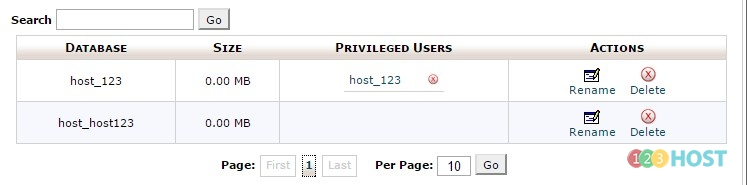
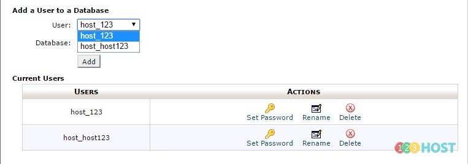
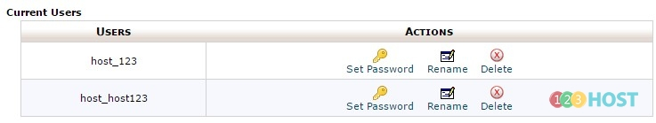

Chào các Bạn,

Hướng dẫn quản lý cơ sở dữ liệu và user tương ứng

Bước 1: Đăng nhập Cpanel --\> Tìm đến mục Databases --\> Chọn công cụ MySQL Databases

Bước 2: Trong phần này các bạn sẽ thấy được danh sách các databses - user được tạo - xóa databases - user

Bước 3: Tại đây Bạn có thể gán databases nào được dùng bởi user nào, có thể gán nhiều user cho 1 databases và ngược lại.

Bước 4: Và phân quyền cho từng user dùng cho databases - thay đổi mật khẩu của user

