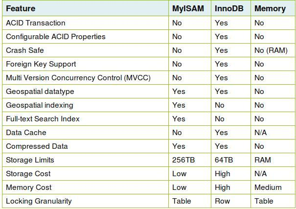

## Chọn Storage Engine cho bảng

Nếu website của bạn sử dụng MySQL database, thì bạn có thể tùy chọn giữa các Storage Engine InnoDB, MyISAM và MEMORY sao cho phù hợp với nhu cầu của mình. Khi bạn lựa chọn đúng Storage Engine, Mysql sẽ có hiệu suất hoạt động tốt nhất , tối ưu MySQL sẽ có kết quả tốt hơn, khi đó website có thể đón được nhiều lượng truy cập nhất trước khi bạn quyết định nâng cấp VPS – Server.

### 1. MyISAM và MySQL

MyISAM là kiểu Storage Engine được dùng phổ biến nhất. Storage Engine này cho phép lạp chỉ mục toàn cột (Full text index) do đó nó cho tốc độ đọc truy suất nhanh nhất. Tuy nhiên nó lại rất kém trong việc “insert/update” – “thêm/sửa” dữ liệu ( cơ chế Table Level Locking). Do vậy nếu website của bạn chủ yếu là đọc như blog wordpress thì nên lựa chọn loại Storage Engine này.

### 2. InnoDB trong MySQL

Storage Engine này mới hơn MyISAM , đây là Storage Engine tốt nhất cho các diễn đàn có lượng cập nhật liên tục. Tốc độ insert/update/delete tốt nhất do hoạt động theo cơ chế Row Level Locking nên khi cập nhật (Thêm,xóa,sửa) 1 bảng thì chỉ có bản ghi đang bị thao tác bị khóa mà thôi, các hoạt động khác trên table này vẫn diễn ra bình thường. Tuy nhiên nhược điểm của nó là khi hoạt động nó tốn nhiều RAM hơn so với MyISAM.

### 3. MEMORY trong MySQL

MEMORY engine (HEAP) là engine cho tốc độ truy xuất và cập nhật tốt nhất do nó lưu trữ dữ liệu trực tiếp lên RAM. Vì thế nó được dùng làm các table chứa dữ liệu tam hay các phiên làm việc của user. Khi khởi động lại MySQL hay Server, tất cả dữ liệu sẽ bị xóa hết.

### 4. Bảng so sánh MyIsam & Innodb & Memory

Ngoài ra bạn có thể tham khảo các giá trị khác ở bảng dưới: 

### 5. Vậy Storage Engine nào thích hợp cho website bạn

-  Nếu bạn làm blog (wordpress…) hay làm các trang tin tức nên dùng MyIAM để cho hiệu suât tốt nhất
-  Nếu bạn làm forum, mạng xã hội thì nên sử dụng InnoDB để tốc độ insert và update dữ liệu cao nhất.
-  MEMORY Storage Engine dùng cho các table có dữ liệu không quan trọng, dữ liệu tạm và thông tin làm việc của người dùng.

``` text
* 
```

## Sử dụng UTF-8 đúng chuẩn

utf8_general_ci, utf8_unicode_ci hay là utf8_bin?

Theo các tài liệu nghiên cứu, thì utf8_general_ci chạy nhanh hơn utf8_unicode_ci, nhưng utf8_unicode_ci phổ (hỗ trợ) nhiều ngôn ngữ hơn. Nếu bạn bắt đầu làm quen với một công ty mới, thiết kế website cho khách hàng ở một quốc gia sử dụng tiếng mà bạn không biết nên dùng collation nào, lời khuyên là hãy dùng utf8_unicode_ci. Chậm mà chắc!

Đối với dự án nào yêu cầu độ tìm kiếm chính xác, hãy sử dụng utf8_bin, vì nó so sánh phân biệt HOA-thường (case-sensitive) còn 2 anh bạn ở trên là case-insensitive. Hơn nữa, nó so sánh mức binary, nên độ chính xác cao hơn là văn bản thường.

Nếu cần hỗ trợ các ký tự đặc biệt mà utf8 không hỗ trợ hãy chuyển sang utf8mb4 tương tương tự như utf8.

## Câu lệnh INSERT và set DEFAULT

Khi insert vào CSDL qua câu lệnh INSERT INTO cố gắng chỉ ra danh sách các field được insert vào ví dụ

``` sql
INSERT INTO table1 (field1, field2, field3, field4) VALUES (1, 2, 3, 4)
```

Không INSERT kiểu

``` sql
INSERT INTO table1 VALUES (1, 2, 3, 4)
```

Nguyên nhân: Sau này phát triển nếu có thêm trường vào bảng đó thì các câu lệnh insert into sẽ die hết.

Khi thiết kế CSDL cố gắng thêm tham số DEFAULT vào field để khi INSERT ta không cần chỉ ra field đó.

Đối với kiểu dữ liệu text: text, mediumtext, longtext KHÔNG chỉ ra giá trị DEFAULT vì rất nhiều máy chủ nếu DEFAULT kiểu text sẽ lỗi.

Như vậy đối với trường dữ liệu kiểu text cần BẮT BUỘC CHỈ RA khi INSERT vào CSDL

## Sử dụng \* trong câu truy vấn SELECT, COUNT

Điều tối kỵ là sử dụng \* để trả về tất cả các cột trong bảng, hoặc sử dụng tất cả các field chỉ để COUNT. Chúng ta chỉ nên trích xuất dữ liệu mà chúng ta cần.

Cái vụ này thì nói mãi, mà vẫn cứ đầy rẫy lập trình viên dùng đó, đừng có khinh thường nó. Nhưng lỗi lập trình php này thì thường xảy ra đối với các bạn lập trình php hơn vì đa phần là thường mới vào nghề, kinh nghiệm chưa có nhiều nên không để ý những vấn đề này.

## Một số chú ý tạo index trong mysql

**Khi nên sử dụng**

1.  Khi so sánh giá trị của field với số chỉ định VD: WHERE name = "hogehoge"
2.  Khi JOIN toàn bộ giá trị của filed VD:WHERE a.name = b.name
3.  Khi cần giới hạn phạm vi giá trị của field bằng các toán tử so sánh\[=、\>、\>=、\<、\<=\]
4.  Khi cố định giá trị đầu tiên của chuỗi theo LIKE
5.  MIN(), MAX()
6.  Có thể ORDER BY, GROUP BY dựa theo prefix của chuỗi
7.  Trường hợp nếu tất cả các field của của WHERE có một phần index (không tham chiếu toàn bộ DB)
8.  Khi áp dụng mệnh đề BETWEEN or IN

**Khi không nên sử dụng**

1.  Khi bắt đầu LIKE bằng wild card
2.  Khi Mysql được xác định rằng việc đọc toàn bộ DB sẽ nhanh hơn
3.  Thông thường index sẽ không sử dụng ORDER BY
4.  Khi field ORDER BY và WHERE khác nhau nhưng chỉ đánh index trên một filed
5.  Trong trường hợp data dưới 1000 record, mặc dù đánh index nhưng có thể không được sử dụng

Tham khảo thêm: [https://viblo.asia/p/mot-so-chu-y-tao-index-trong-mysql-djeZ1BYglWz](https://viblo.asia/p/mot-so-chu-y-tao-index-trong-mysql-djeZ1BYglWz)

## Thường ưu tiên hàm PHP hơn hàm SQL

Khi người dùng mới làm quen với MySQL, thì thường xu hướng để giải quyết vấn đề là sử dụng ngôn ngữ mà họ biết. Điều đó có thể dẫn tới những đoạn code không cần thiết và chậm hơn. Ví dụ, thay vì sử dụng phương thức avg() của MySQL thì người dùng lại sử dụng vòng lặp trong PHP để tính giá trị trung bình của tất cả các giá trị trong một tập kết quả trả về. Nhìn chung, nên sử dụng những thế mạnh của CSDL khi phân tích dữ liệu sẽ tạo hiệu quả cao hơn.

Đây là một số hàm, từ khóa hữu ích của Mysql, bạn nên nghiên cứu trước khi dùng bằng PHP:

1.  UNION: bạn thường viết cả đống code PHP để lấy dữ liệu thay vì dùng UNION.
2.  COUNT: nhớ count 1 tên cột (field) thôi, đừng COUNT(\*)
3.  MAX, MIN: đừng có lấy cả đống dữ liệu về chỉ để tính min, max
4.  AVG: đã nói ở trên
5.  RAND: ORDER BY RAND() chẳng hạn, rất hữu dụng đó chứ!
6.  CONCAT: kết dữ liệu ngay trên kết quả từ Mysql

Trên đây là một vài kỹ thuật mà nếu mới viết PHP sử dụng Mysql cũng nên học trước, nếu bạn sử dụng hàm php quá nhiều sẽ dẫn đến lỗi lập trình php nhiều hơn và cũng khó phân tách giữa cơ sở dữ liệu và lập trình.
