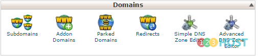
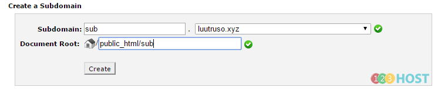

cPanel cho phép chúng ta có thể tạo các tên miền phụ cũng như các các domain chạy song song hoặc độc lập với domain chính của hosting. Bài viết dưới đây sẽ hướng dẫn các bạn tạo các domain như trên.

\_ Đăng nhập cPanel

\_ Mục Domains

\+ Subdomains: tên miền phụ cho domain muốn tạo, có dạng xxx.yourdomain.com (.net, .info, …)

Ta điền vào tên Subdomain vào, chọn domain muốn tạo, cuối cùng là Document Root (Nơi chứa source code của subdomain) -\> Create

Sau đó, ta chỉ việc upload source code vào đường dẫn /home/public_html/sub, trỏ sub-domain về IP hosting là có thể chạy được.

