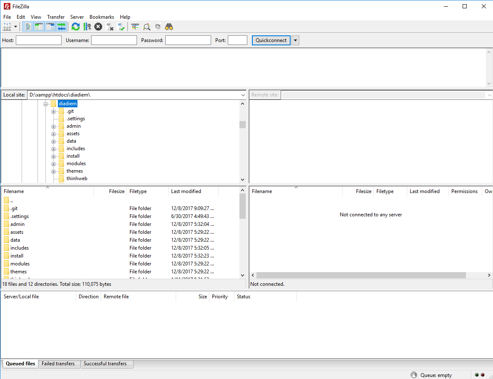

Là một công cụ dùng trong việc đưa các file lên hosting, máy chủ thông qua FTP

Để sử dụng File Zilla trước tiên bạn cần tải về bản cài đặt FileZilla hoặc bản portal tại địa chỉ: [https://filezilla-project.org/download.php](https://filezilla-project.org/download.php)

Sau đó cài vào máy tính của bạn rồi tiến hành khởi động để sử dụng

Trong đó

- Bên trái là thông tin thư mục và file ở dưới localhost tức là máy tính
- Bên phải là thông tin thư mục và file trên hosting, máy chủ
- Bên trên là các chức năng và nơi điền thông số của fpt để bạn kết nối tới hosting, máy chủ
